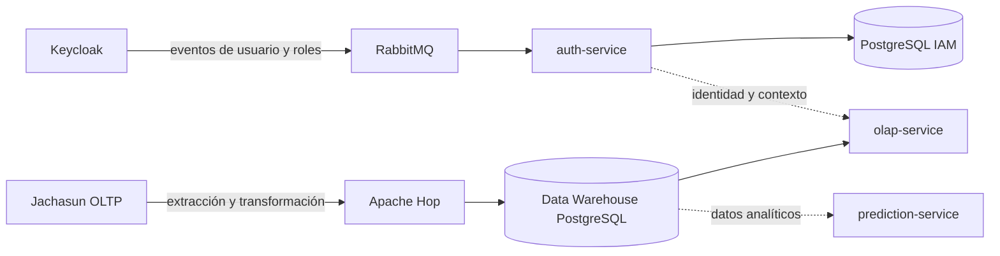

# DSS-DW-ML de la UATF


Plataforma de soporte a decisiones de la Universidad Autónoma Tomás Frías (UATF). El proyecto integra identidad, datos académicos y analítica para ofrecer información institucional con alcance según el contexto del usuario.

> **Estado del repositorio:** contiene servicios implementados y componentes de la arquitectura objetivo que siguen en desarrollo o no están disponibles en este checkout. El `docker-compose.yml` raíz todavía referencia algunos contextos de build que no existen; por eso no se debe asumir que `docker compose up` levanta toda la plataforma.

## Arquitectura



El flujo académico carga el DW desde fuentes operacionales mediante Apache Hop. Keycloak autentica a las personas y publica eventos; `auth-service` mantiene perfiles, roles reconocidos y contexto académico local. Los diagramas C4 describen además la arquitectura objetivo y señalan qué componentes aún no cuentan con una implementación verificable en este repositorio.

## Componentes

| Ruta | Responsabilidad | Estado documentado |
|---|---|---|
| [`auth-service/`](auth-service/README.md) | API IAM, validación de tokens y gestión de usuarios, roles y contexto académico. | Servicio Spring Boot implementado. |
| [`keycloak-webhook/`](keycloak-webhook/) | Provider de Keycloak para publicar eventos de usuario y roles en RabbitMQ. | Integración implementada; consulta su `pom.xml` y pruebas. |
| [`etl-layer/apache-hop/`](etl-layer/apache-hop/README.md) | Extracción y carga de Jachasun al DW, incluida la sincronización del catálogo académico. | Proyecto Hop y flujos de integración documentados. La habilitación productiva requiere configuración operativa y secretos externos. |
| [`etl-layer/loadmanager/`](etl-layer/loadmanager/README.md) | Extractor Go para snapshots OLTP hacia staging. | Servicio pausado para el MVP actual; no confundir con el flujo activo directo Jachasun → Hop → DW. |
| [`infra/dw-schema/`](infra/dw-schema/) | Migraciones, roles y esquemas del almacén analítico. | Base de datos y regresiones de integración. |
| [`olap-service/`](olap-service/) | API y consultas analíticas multidimensionales. | Ver documentación y código del servicio. |
| [`prediction-service/`](prediction-service/) | API de análisis predictivo. | La arquitectura C4 describe su alcance y límites actuales. |
| `etl-service/`, `saiku-ui/` y otros servicios | Componentes conservados en el repositorio o parte de la arquitectura objetivo. | Su estado y relación con el flujo vigente se describen en la documentación específica. |

## Requisitos

- Docker y Docker Compose para la infraestructura local y las pruebas de integración.
- Java 21 para `auth-service` y `keycloak-webhook`.
- Python 3.12 para validar el proyecto Apache Hop.
- Go según la versión fijada por `etl-layer/loadmanager/go.mod`, solo si se trabaja en Load Manager.
- Apache Hop 2.19.0 y sus drivers JDBC locales para ejecutar los flujos manualmente.

## Configuración local

1. Crea el archivo local de configuración a partir de la plantilla:

   ```powershell
   Copy-Item .env.example .env
   ```

2. Completa las contraseñas y secretos vacíos en `.env` con valores locales. No guardes secretos reales en Git ni los copies a archivos de ejemplo.
3. Revisa las variables requeridas para el componente que vas a ejecutar. Las plantillas de ambientes de Hop están en `etl-layer/apache-hop/projects/dss-uatf-etl/environments/`.

El Compose raíz agrupa servicios de varias etapas del sistema y aún tiene contextos de build pendientes. Para trabajar con un componente, sigue su README y Compose específico; no uses el arranque global como señal de que todos los servicios están listos.

## Desarrollo y validación

### Auth Service

```powershell
cd auth-service
./mvnw --batch-mode --no-transfer-progress clean verify
```

En PowerShell de Windows, usa `./mvnw.cmd` si no tienes Bash disponible.

### Apache Hop

Desde la raíz del repositorio:

```powershell
python etl-layer/apache-hop/scripts/validate_project.py
```

Para ejecutar el flujo vertical de integración con fixtures, revisa `etl-layer/apache-hop/scripts/run_hop_vertical.ps1` y la guía de [`docs/dw/`](docs/dw/README.md). La regresión del catálogo académico y la suite DW también se ejecutan en GitHub Actions.

### Load Manager

Sigue las instrucciones y configuración de [`etl-layer/loadmanager/README.md`](etl-layer/loadmanager/README.md). Su extractor actual no sustituye el flujo Hop que implementa el MVP vigente.

## Integración continua

- [Auth Service CI](.github/workflows/auth-service-ci.yml): valida Compose, compila, ejecuta checks de arquitectura y pruebas, y construye la imagen del servicio.
- [DW y Apache Hop CI](.github/workflows/dw-hop-ci.yml): valida el proyecto Hop y Compose, corre las regresiones del DW y comprueba la sincronización del catálogo académico.

Los workflows se activan en cambios de sus rutas y en solicitudes de integración hacia `main`. Consulta GitHub Actions para ver el resultado de una ejecución concreta.

## Documentación

- [Catálogo de variables de entorno](docs/envs/README.md): índice global y guías detalladas por servicio y ambiente.
- [Documentación del Data Warehouse](docs/dw/README.md): arquitectura MVP, contratos, modelo, control de ejecuciones y pruebas.
- [Diagrama C4 de contexto](docs/c4/diagrama-contexto-dss.md).
- [Diagrama C4 de contenedores y evidencias de implementación](docs/c4/diagrama-contenedores-dss.md).
- [Vista funcional de negocio](docs/arquitectura/vista-funcional-negocio-dss.md).
- [Documentación OLAP](docs/olap/README.md).
- Guías específicas en el README y la carpeta `docs/` de cada componente.

## Seguridad

- Usa cuentas de mínimo privilegio y secretos separados por ambiente.
- Mantén `.env`, ambientes activos de Hop, datos reales y credenciales fuera del control de versiones.
- No expongas Hop Web, Keycloak, RabbitMQ ni bases de datos a redes públicas sin autenticación, TLS y controles de acceso apropiados.
- Para producción, valida conectividad, permisos, respaldos, migraciones y procedimientos de operación con el equipo responsable.
