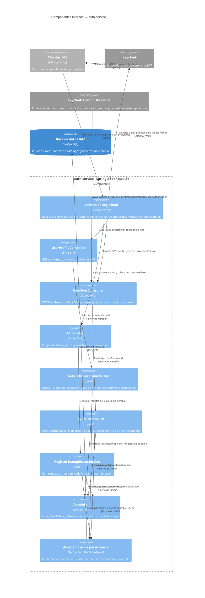

# Funcionamiento interno de `auth-service`

## Alcance y método

Este informe describe la implementación que existe en `auth-service`, no una arquitectura propuesta. Se revisaron los controladores REST, los filtros y la configuración de seguridad, los casos de uso, el dominio, los adaptadores JPA, las migraciones Flyway, la configuración por perfil, el `pom.xml`, el `Dockerfile`, las pruebas y la documentación del servicio. No se ejecutaron pruebas ni se modificó código de aplicación.

El directorio `graphify-out` contiene un grafo anterior, generado el 6 de octubre de 2026, con foco en README y documentos de diseño. La consulta de ese grafo no se pudo ejecutar porque el lanzador Graphify falló al resolver la ruta de su script. Por ello, las conclusiones siguientes se verificaron directamente contra el código.

## Resumen

`auth-service` es una aplicación Java 21 con Spring Boot y arquitectura hexagonal. En ejecución cumple dos funciones principales:

1. Actúa como **OAuth2 Resource Server**: recibe JWT emitidos por Keycloak, valida firma, emisor y audiencia, y convierte roles del token en autoridades de Spring Security.
2. Mantiene un perfil local asociado al `sub` de Keycloak: recibe sincronizaciones de usuario por webhook y expone `GET /auth/me` para devolver los datos locales junto con los contextos académicos asociados.

La autenticación interactiva ocurre en Keycloak y no en este servicio. No hay un endpoint de login ni el servicio consulta Keycloak Admin API para cargar perfiles: el mecanismo previsto para sincronizar el perfil es el endpoint webhook `POST /auth/sync`.

## Stack y arranque

- **Java 21**, **Spring Boot 4.1.0**, Spring MVC, Spring Security, OAuth2 Resource Server, Spring Data JPA y PostgreSQL. Versiones declaradas en `pom.xml`.
- **Flyway** ejecuta las migraciones de `src/main/resources/db/migration`; Hibernate usa `ddl-auto: validate`, de modo que valida el esquema, pero no lo crea ni lo actualiza.
- **MapStruct 1.6.2** convierte modelos de dominio y entidades JPA. Lombok genera código accesorio.
- `AuthServiceApplication` inicia Spring Boot. `server.servlet.context-path` establece `/api/${API_VERSION:v1}` y el puerto predeterminado es `8080`.
- `SPRING_PROFILE_ACTIVE` selecciona el perfil; si no se define, `application.yaml` activa `dev`. `application-dev.yaml` configura conexión PostgreSQL, issuer y JWK Set URI de Keycloak, orígenes CORS locales y trazas SQL. `application-prod.yaml` toma conexión y orígenes CORS de variables de entorno y exige HTTPS para los orígenes permitidos.
- El `Dockerfile` crea una imagen en dos etapas con Temurin 21; la etapa runtime usa JRE Alpine y el usuario no root `appuser`, y declara el puerto `8080`.

El `JwtDecoder` configurado en `SecurityConfig` consume `KEYCLOAK_JWK_SET_URI`, con tiempos de conexión y lectura de cinco segundos. Valida el `issuer` configurado y exige que `aud` contenga `KEYCLOAK_AUDIENCE` (o el identificador de recurso configurado). La configuración de producción debe proporcionar también `KEYCLOAK_JWK_SET_URI`, aunque no aparece como clave en `application-prod.yaml`.

## Arquitectura interna

El código organiza el sistema en cuatro zonas:

- **Dominio (`domain`)**: `User`, `Email`, `Role`, `UserAcademicContext`, `RoleType`, validaciones y excepciones. No depende de Spring ni de JPA.
- **Aplicación (`application`)**: puertos de entrada y salida, comandos, DTO de perfil y servicios que implementan los casos de uso. Los servicios son Java sin anotaciones de Spring.
- **Adaptadores (`adapter`)**: controladores REST de entrada y adaptadores de persistencia de salida. Los repositorios Spring Data, entidades y mappers quedan detrás de adaptadores por concepto (`user`, `role`, `useracademiccontext`, `exampleuser`).
- **Configuración (`configuration`)**: conecta manualmente los casos de uso con los puertos de persistencia mediante beans; configura seguridad, JWT, CORS, webhook, Flyway y auditoría.

La guía `ARCHITECTURE_GUIDE.md` describe esta separación como Ports and Adapters. `ArchitectureTest` contiene reglas ArchUnit para impedir dependencias desde dominio y aplicación hacia Spring, configuración o adaptadores, y para restringir dependencias de controladores a puertos de entrada.

## API y controles de acceso

Las rutas siguientes combinan el contexto `/api/v1` por defecto con los mappings de los controladores:

| Ruta | Acceso en la cadena de seguridad | Comportamiento |
|---|---|---|
| `GET /api/v1/auth/me` | JWT válido requerido | Devuelve perfil local y contextos académicos del sujeto autenticado. |
| `POST /api/v1/auth/sync` | `permitAll` de Spring Security, pero protegido por `WebhookSecretFilter` | Recibe perfil de usuario y sincroniza la fila local. Debe incluir `X-Webhook-Secret`. |
| `GET /api/v1/demo/public` | Público | Endpoint demostrativo. |
| `GET /api/v1/demo/admin` | JWT y rol `SUPERADMIN` | Endpoint demostrativo con `@PreAuthorize`. |
| `GET /api/v1/demo/rector` | JWT y rol `RECTOR` | Endpoint demostrativo con `@PreAuthorize`. |
| `GET /api/v1/demo/decano` | JWT y rol `DECANO` | Endpoint demostrativo con `@PreAuthorize`. |
| `GET /api/v1/demo/director` | JWT y rol `DIRECTOR` | Endpoint demostrativo con `@PreAuthorize`. |
| `POST /api/v1/example-user` | JWT requerido por la regla general | Registra un usuario de ejemplo; devuelve `201` o `409`. |

La cadena es **stateless**, deshabilita CSRF y usa bearer tokens. CORS admite orígenes explícitos, métodos `GET` y `OPTIONS`, encabezados `Authorization` y `Content-Type`, y no permite credenciales de navegador. En producción comprueba que los orígenes usen HTTPS. Por tanto, el `POST /auth/sync` está planteado para tráfico servidor a servidor, no para llamadas browser cross-origin.

`JwtConverter` combina las autoridades estándar derivadas de scopes con los roles del claim `resource_access[KEYCLOAK_RESOURCE_ID].roles`; estos últimos se convierten a `ROLE_<nombre>`. El nombre principal se obtiene del claim configurado, con fallback a `preferred_username` y después a `sub`. El controlador de perfil, sin embargo, busca al usuario por el `sub` UUID, no por ese nombre principal.

## Flujos de ejecución

### 1. Consulta del perfil autenticado

1. El cliente DSS envía `GET /api/v1/auth/me` con `Authorization: Bearer <JWT>`.
2. Spring Security usa el JWK Set de Keycloak para validar la firma y valida `issuer`, `audience` y vigencia del token.
3. `JwtConverter` convierte el token a `JwtAuthenticationToken` y extrae authorities y principal.
4. `UserProfileController` toma `jwt.getSubject()`, lo interpreta como UUID de Keycloak y llama a `GetAuthUserProfileUseCase`.
5. `GetAuthUserProfileService` consulta `UserRepository.findByKeycloakId`; si no encuentra la fila, lanza `UserNotFoundException`.
6. Consulta todos los contextos con `AcademicContextRepository.findAllByUserId` y arma `AuthUserProfile` con id local, username, correo, nombres, estado y contextos.
7. `UserRepositoryAdapter` y `UserAcademicContextAdapter` delegan en Spring Data JPA; sus mappers traducen entidades y modelos de dominio.

Si el usuario no está sincronizado, `GlobalExceptionHandler` responde `404` como `ProblemDetail`, con título `USER_NOT_SYNCED`. No existe una consulta a Keycloak para recuperar el perfil durante esta petición.

### 2. Sincronización del perfil desde webhook

1. El emisor manda `POST /api/v1/auth/sync` con JSON y la cabecera `X-Webhook-Secret`.
2. La regla HTTP permite pasar la petición sin JWT, pero `WebhookSecretFilter` limita la exención: solo valida el `POST` cuyo servlet path sea `/auth/sync`.
3. El filtro rechaza la petición con `401` si falta el secreto o no coincide. Recorta espacios y compara los bytes usando `MessageDigest.isEqual`.
4. `UserSyncController` valida `UserSyncRequest` y convierte su objeto `user` en `SyncUserCommand`. `username`, `email`, `firstName` y `lastName` deben ser no vacíos en el DTO; en cambio, el modelo `User.create` acepta nombres nulos si se invoca desde otro flujo.
5. `SyncUserService.sync` corre dentro de una transacción. Busca por `keycloakId`: actualiza username, correo, nombres y estado si ya existe; si no, crea la fila. La unicidad de `keycloak_id`, `username` y `email` se impone también en PostgreSQL.
6. El adaptador guarda el cambio y el servicio emite un evento estructurado `USER_SYNCED` al logger de auditoría.

El DTO recibe `eventId`, `realmId`, `eventType` y `timestamp`, pero el controlador solo pasa los campos de `user` al caso de uso. El servicio no registra ni valida el evento; la repetición de una sincronización converge por la búsqueda del `keycloakId`. El estado `isActive` se copia, pero este flujo no elimina físicamente al usuario.

### 3. Rutas demostrativas y usuario de ejemplo

`DemoEndpoint` demuestra autorización por rol con `@PreAuthorize`; no implementa todavía operaciones de negocio de dashboards. `ExampleUserController` y `RegisterExampleUserService` son un flujo auxiliar: verifica si ya existe un correo y persiste el registro en `example_users`. Ambos pertenecen al código ejecutable, aunque no forman parte del flujo principal de perfil/sincronización.

## Modelo de datos y persistencia

Las migraciones actuales definen estas tablas:

- `users`: identidad local UUID, `keycloak_id` único, username y email únicos, nombres, `is_active` y timestamps. Un trigger actualiza `updated_at`.
- `roles` y `user_roles`: catálogo y relación muchos a muchos.
- `user_academic_contexts`: contextos vinculados a usuarios; `career_id` termina como `CHAR(3)` y una restricción exige facultad cuando hay carrera.
- `academic_faculties` y `academic_programs`: snapshot local del catálogo académico. V3 crea claves foráneas hacia esos catálogos como `NOT VALID`.
- `example_users`: tabla auxiliar del endpoint de ejemplo.
- `revinfo` y `revchanges`: estructuras de revisiones presentes en V1.

V2 convierte `career_id` entero a `CHAR(3)` con ceros a la izquierda y aborta si encuentra valores fuera del rango 000–999. V3 documenta que el sistema académico sigue siendo fuente de verdad y que el catálogo será poblado por una carga futura; este servicio no contiene un proceso de carga de esas tablas.

El perfil devuelve una lista de contextos académicos, pero el esquema y código no devuelven nombres de facultad/carrera ni una relación de roles en `AuthUserProfile`. `UserAcademicContext` comprueba id de facultad positivo, carrera de tres caracteres y que carrera requiera facultad. `AcademicContextValidator` define reglas de rol: Rector/Superadmin sin ámbito; Decano con facultad sin carrera; Director con facultad y carrera.

## Autorización y contexto académico: límite real

El servicio valida roles del JWT y los aplica en las rutas demostrativas. El código revisado no implementa autorización por contexto académico en endpoints de datos, no configura RLS en PostgreSQL y no transmite un contexto de sesión a un Data Warehouse. `GET /auth/me` entrega los contextos locales al consumidor para que la arquitectura que los consuma pueda decidir cómo usarlos.

También hay una distinción entre reglas modeladas y operaciones expuestas: `AcademicContextValidator` tiene pruebas, pero no se invoca desde los casos de uso actuales. El repositorio de contextos ofrece lectura, guardado y borrado, pero no hay un caso de uso ni controlador para administrar esos contextos en este servicio.

## Errores, auditoría y operación

- `WebhookSecretFilter` responde `401` para secretos ausentes o inválidos.
- `GlobalExceptionHandler` traduce explícitamente `UserNotFoundException` a `404`; otros errores siguen el manejo predeterminado de Spring (por ejemplo, autorización `401/403` y validación HTTP).
- `AUDIT_LOGGER` escribe JSON a consola. `SyncUserService` registra `USER_SYNCED`. `AuditLoggingListener` intenta registrar éxitos y fallos de autenticación para `/auth/me`, junto con roles e IP.
- Hay una discrepancia en ese listener: compara `request.getRequestURI()` con `/auth/me`, mientras que `application.yaml` pone `/api/v1` como context path. En una petición servlet normal el URI incluye ese prefijo, por lo que el filtro de auditoría probablemente no reconoce la ruta real.
- Para IP, el listener usa `remoteAddr` directamente salvo si parece una dirección privada/de loopback; en ese caso acepta `X-Real-IP`, `Forwarded` o `X-Forwarded-For`. La validez depende de que el servicio solo reciba esas cabeceras de proxies confiables.
- Actuator expone `health`, `info` y `metrics`; el detalle de salud está condicionado por autorización.

## Diferencias entre documentación y código observado

1. **Secreto del webhook:** `docs/keycloak/keycloak_specification.md` muestra `Authorization: Bearer <webhook-shared-secret>`. `WebhookSecretFilter` exige `X-Webhook-Secret`. La integración debe alinear emisor y receptor antes de considerar el webhook operativo.
2. **Listener de Keycloak:** la documentación describe un SPI que envía eventos `USER_CREATED`/`USER_UPDATED`, pero su implementación no aparece en este directorio. Aquí solo están el endpoint receptor, el filtro y el contrato DTO.
3. **Eventos recibidos:** el DTO exige `eventType`, pero el servicio no diferencia `CREATE`, `UPDATE` u otros eventos; solo aplica los datos de `user` como upsert.
4. **Roles locales:** existen tablas y entidades de roles, y un `RoleRepositoryAdapter` de consulta. Sin embargo, `AssignRoleRepository` no tiene implementación, no hay caso de uso/controlador para asignar roles y el modelo de dominio `User` no contiene roles. La autorización efectiva observada procede del JWT de Keycloak.
5. **Validación académica por rol:** las reglas están implementadas y probadas en dominio, pero ningún servicio actual las invoca; tampoco se observa API para crear o cambiar contextos.
6. **Estado local del usuario:** `/auth/me` devuelve `isActive`, pero no rechaza una fila inactiva por ese valor. El JWT aún debe superar su propia validación temporal y criptográfica.
7. **Auditoría de acceso:** la comparación del URI descrita arriba no coincide con el context path configurado.
8. **Documentación de stack:** README nombra Spring Boot 3.x y presenta Flyway/Liquibase; `pom.xml` fija Spring Boot 4.1.0 y solo incluye Flyway. También describe comandos Gradle aunque el proyecto usa Maven Wrapper.
9. **Encapsulamiento JPA:** `ARCHITECTURE_GUIDE.md` recomienda entidades y repositorios Spring Data package-private; `UserEntity`, `RoleEntity` y los repositorios Spring Data observados son públicos.
10. **Auditoría de entidades:** V1 crea `revinfo` y `revchanges` bajo un comentario de Hibernate Envers, pero no se encontró dependencia Envers en `pom.xml` ni anotaciones `@Audited` en el código. Las tablas por sí solas no demuestran que se estén registrando revisiones.

Estas diferencias son hallazgos para contrastar antes de redactar el diagrama como arquitectura final; el informe no las cambia ni presupone cuál documento debe prevalecer.

## Diagrama Mermaid: componentes internos

Este C4 de componentes centra el contenedor `auth-service`. Los endpoints de demostración y el ejemplo se agrupan como API auxiliar para mantener visible el flujo principal sin ocultar su existencia. La integración de webhook del lado de Keycloak está respaldada por la especificación del repositorio; su SPI no está incluido en este código.

## Evidencia revisada

| Área | Archivos representativos |
|---|---|
| Arranque y dependencias | `AuthServiceApplication.java`, `pom.xml`, `Dockerfile` |
| Configuración | `application.yaml`, `application-dev.yaml`, `application-prod.yaml`, `ApplicationConfig.java`, `FlywayConfig.java` |
| Seguridad JWT y webhook | `SecurityConfig.java`, `JwtConverter.java`, `WebhookSecretFilter.java` |
| REST | `UserProfileController.java`, `UserSyncController.java`, `UserSyncRequest.java`, `DemoEndpoint.java`, `ExampleUserController.java`, `GlobalExceptionHandler.java` |
| Casos de uso y puertos | `GetAuthUserProfileService.java`, `SyncUserService.java`, `RegisterExampleUserService.java`, `application/port/in`, `application/port/out` |
| Dominio | `User.java`, `Email.java`, `UserAcademicContext.java`, `RoleType.java`, `AcademicContextValidator.java` |
| Persistencia y esquema | `adapter/out/persistence`, `V1__init_schema.sql`, `V2__init_schema.sql`, `V3__create_academic_catalog.sql` |
| Auditoría y pruebas | `AuditLoggingListener.java`, `AuthenticationEventPublisherConfig.java`, `logback-spring.xml`, `src/test/java` |
| Contratos documentados | `README.md`, `ARCHITECTURE_GUIDE.md`, `docs/keycloak/keycloak_specification.md`, `docs/database/improved_erd.md` |

## Alcance no comprobado

- No se inspeccionaron valores de `.env` ni secretos.
- No se verificó el comportamiento contra una instancia viva de Keycloak o PostgreSQL.
- No se ejecutaron las pruebas automatizadas.
- El código del listener SPI de Keycloak y el despliegue Compose referido por la documentación no están en el directorio `auth-service` revisado.
