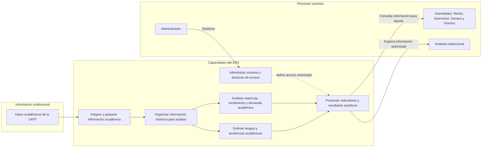

# Vista funcional de negocio — DSS académico de la UATF

Esta vista describe las capacidades que ofrece el DSS y el recorrido de la información académica hasta su uso en decisiones institucionales. Está expresada en términos funcionales: no representa aplicaciones, microservicios, protocolos ni infraestructura. Por ello complementa el diagrama C4 de contexto, pero no es un diagrama C4 de contenedores.

## Alcance funcional representado

- La información académica se integra y prepara para análisis consolidado.
- Las personas usuarias consultan indicadores sobre matrícula, rendimiento y demanda; el DSS también presenta estimaciones predictivas cuando los datos disponibles lo permiten.
- Las autoridades usan la información en la planificación y gestión académica, dentro del alcance que corresponde a su función.
- El administrador gestiona usuarios y accesos. El diagrama no le atribuye decisiones académicas.

## Evidencias y supuestos

- **Evidencia:** `DSS-PASTED.docx` describe la integración de información institucional, indicadores de matrícula/rendimiento/demanda, análisis predictivo y dashboards para apoyar decisiones académicas.
- **Evidencia:** `DssSoftwareArchitecture-Software.drawio (1).png` identifica fuentes académicas, carga y preprocesamiento, almacenamiento analítico, OLAP, predicción, gestión de identidad y visualizaciones.
- **Evidencia:** `auth-service/docs/keycloak/keycloak_specification.md` y `infra/keycloak/realm/uatf-dss-realm-realm.json` documentan administración técnica y restricciones de acceso por rol académico.
- **Supuesto:** Se toma al Analista institucional como perfil funcional indicado por el usuario; el rol equivalente aún no aparece definido en la configuración de acceso revisada.
- **Supuesto:** “Riesgos y tendencias” resume el uso predictivo mostrado en los adjuntos. Los indicadores y estimaciones finales dependerán de los datos y modelos efectivamente aprobados para el proyecto.
