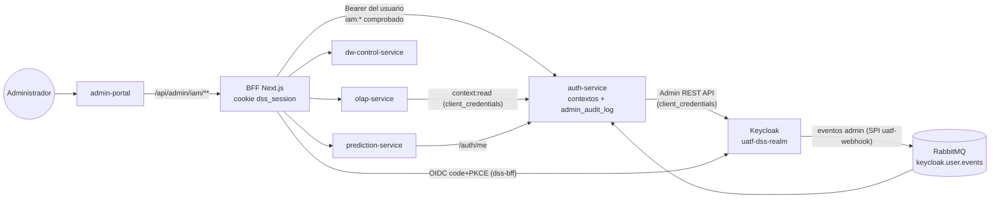

# Roles y permisos en el DSS: cómo funcionan

> Estado final de la épica IAM (#290), tras IAM-019 (2026-11-21). Rutas relativas a la raíz del repositorio.
> El diagnóstico previo, con los problemas que motivaron la épica, queda en el historial de git de este archivo
> y en las decisiones D1–D4 de [rbac-iam-admin-proposal.md](rbac-iam-admin-proposal.md).

## Resumen

- **Keycloak** (realm `uatf-dss-realm`) sigue siendo la fuente de verdad de usuarios, roles, permisos y clientes, pero **ya no hace falta abrir su consola**: todo se administra desde el admin-portal.
- **Permiso** = rol del cliente catálogo `dss-permissions`, nombrado `recurso:acción`. **Rol** = rol del realm que agrupa permisos y abre un portal. **Usuario** = recibe roles y, para excepciones, permisos sueltos.
- **auth-service** administra Keycloak con la Admin REST API (cuenta de servicio `uatf-auth-service`), guarda el contexto académico y la auditoría (`admin_audit_log`).
- **Todos los servicios** (BFF, auth-service, olap-service, dw-control-service, prediction-service) autorizan con los permisos de `resource_access.dss-permissions.roles`. Los roles de cliente antiguos y los flags de convivencia se retiraron en IAM-019.

---

## 1. Keycloak

- Versión **26.7.4**, realm **`uatf-dss-realm`**. Export: `infra/keycloak/realm/uatf-dss-realm-realm.json`.
- `--import-realm` no sobrescribe un realm existente. Los cambios de modelo se llevan a un entorno ya importado con los scripts idempotentes de `infra/keycloak/migrations/` (`iam-002-permission-catalog.sh`, `iam-019-retire-legacy-roles.sh`, `iam-020-portal-permissions.sh`); ver `docs/envs/keycloak.md`.
- `keycloak-webhook/src/test/java/uatf/keycloak/RealmPermissionCatalogTest.java` verifica el modelo del export y que los scripts coincidan con él.

### 1.1 Catálogo de permisos (`dss-permissions`, bearer-only)

| Recurso | Permisos | Quién lo comprueba |
|---|---|---|
| Analítica | `analytics:read`, `analytics:global`, `analytics:faculty`, `analytics:career` | BFF (alcance OLAP/GraphQL), prediction-service |
| Datos | `pipelines:read`, `pipelines:execute`, `connectors:read`, `connectors:write` | BFF |
| Predicción | `prediction:train`, `prediction:publish`, `prediction:forecast:read` (PRED-106: leer pronósticos de postulaciones y matrícula) | prediction-service, BFF |
| OLAP | `olap:admin`, `olap:user` | olap-service, BFF (`/rest/saiku/admin/**`) |
| Data Warehouse | `dw:closure:read`, `dw:closure:manage`, `dw:etl-monitor:read`, `dw:etl:execute`, `dw:etl-schedule:manage` | dw-control-service, BFF |
| IAM | `iam:users:read`, `iam:users:write`, `iam:roles:read`, `iam:roles:write`, `iam:clients:read`, `iam:clients:write`, `iam:audit:read` | auth-service, BFF, admin-portal |
| Servicio | `context:read` | auth-service (endpoint interno) |
| Aplicaciones (IAM-020) | `portal:admin`, `portal:rector`, `portal:decano`, `portal:director` | Llegan al token; la landing, los dashboards y el admin-portal los exigen desde IAM-024 |

Un permiso nuevo se crea desde el admin-portal (**Permisos**) y llega al token sin desplegar nada; solo tiene efecto cuando un servicio lo exige.

### 1.2 Roles del realm

| Rol | Portal | Permisos (compuestos) |
|---|---|---|
| `DIRECTOR` | director | `portal:director`, `analytics:read`, `analytics:career`, `prediction:forecast:read` |
| `DECANO` | decano | `portal:decano` + analítica de DIRECTOR + `analytics:faculty`, `pipelines:read` |
| `RECTOR` | rector | `portal:rector` + analítica de DECANO + `analytics:global`, `connectors:read` |
| `SUPERADMIN` | admin | `portal:admin`, `iam:*`, `connectors:*`, `pipelines:*`, `prediction:train`, `prediction:forecast:read`, `dw:etl-monitor:read`, `dw:etl:execute`, `dw:etl-schedule:manage` |

- SUPERADMIN no tiene permisos académicos ni `olap:admin` (D4): administrar la plataforma no da acceso a los datos. Desde LM-005 sí opera el Load Manager: lanza, detiene y programa cargas ETL. Esos permisos no dan acceso a los datos del DW.
- `olap:*`, `dw:*` y `prediction:publish` se asignan por usuario o en roles creados desde el portal.
- **Aplicación del rol (IAM-020/021):** cada rol abre una sola aplicación, la de su permiso `portal:*`; ese permiso no se hereda entre RECTOR, DECANO y DIRECTOR. auth-service lo garantiza: la aplicación es obligatoria al crear un rol, cambiarla reemplaza su `portal:*`, la matriz no la cambia (los `portal:*` se conservan aunque falten en la lista y agregar otro da 400), los roles del sistema conservan la suya y los `portal:*` no se crean ni se borran a mano. El atributo libre `portal` ya no se usa (se elimina al editar el rol). Mientras IAM-024 no esté desplegado, la entrada a cada app todavía se decide por los cuatro roles y `KEYCLOAK_PORTAL_ROLES` (§3).
- Roles, permisos y la matriz rol × permiso se editan en el admin-portal (**Roles**, **Permisos**, **Matriz de acceso**). Los roles del sistema (los cuatro de arriba) y los permisos `iam:*`, `context:read` y `portal:*` no se pueden borrar, y SUPERADMIN siempre conserva `iam:*`.

### 1.3 Clientes

| clientId | Tipo | Notas |
|---|---|---|
| `dss-bff` | confidencial, code + PKCE | Login de los portales. Audience mappers explícitos para `uatf-auth-service`, `olap-service` y `dw-control-service` |
| `uatf-auth-service` | confidencial, solo `client_credentials` | Su cuenta de servicio tiene los nueve roles mínimos de `realm-management` (sin `realm-admin`); secreto en `KEYCLOAK_AUTH_SERVICE_CLIENT_SECRET` |
| `olap-service` | confidencial, solo `client_credentials` | Cuenta de servicio con `context:read` y audience mapper de `uatf-auth-service` |
| `dw-control-service` | bearer-only | Solo valida tokens |
| `dss-permissions` | bearer-only | Contenedor del catálogo; sin secreto, flujos ni cuenta de servicio |

Los clientes del sistema son de solo lectura en el admin-portal (**Aplicaciones**), salvo nombre, descripción y URIs de `dss-bff`. Las aplicaciones nuevas se registran allí; su secreto se muestra una sola vez. `uatf-dss-spa` se eliminó (D4).

**Roles de cliente retirados (IAM-019):** `uatf-auth-service:{SUPERADMIN,RECTOR,DECANO,DIRECTOR,CONTEXT_READER}`, `olap-service:{OLAP_ADMIN,OLAP_USER}` y `dw-control-service:{DW_CLOSURE_READ,DW_CLOSURE_MANAGE,DW_ETL_MONITOR_READ}`. Como antes llevaban el `aud` de su cliente («audience resolve»), las audiencias pasaron a mappers explícitos.

### 1.4 Cómo llegan al JWT

- `realm_access.roles`: roles del realm (deciden el portal).
- `resource_access.dss-permissions.roles`: permisos (deciden qué se puede hacer).
- El contexto académico (facultad/carrera) **no** va en el token: auth-service lo devuelve en `/auth/me` (D2).
- No se usan grupos, Authorization Services ni FGAP (D3).

### 1.5 keycloak-webhook (SPI `uatf-webhook`)

Publica en `keycloak.user.events` (con DLX/DLQ y confirmación del broker) altas, cambios, bajas, cambios de grupos y de roles, con los **roles efectivos** del usuario (`schemaVersion` 2). auth-service hace borrado lógico y ofrece una resincronización completa (`POST /admin/iam/users/resync`). Ver el Flujo B de `auth-service/docs/auth-service-funcionamiento.md`.

---

## 2. auth-service

- **Validación del JWT** (`configuration/JwtConverter.java`): `resource_access.dss-permissions.roles` → autoridades sin prefijo (`iam:users:write`); `realm_access.roles` → `ROLE_<rol>`. Los roles de otros clientes se ignoran.
- **Endpoints de administración** (`/api/v1/admin/iam/**`, contrato `docs/auth/contracts/auth-service-v1.yaml`), cada uno con su `iam:*` en `@PreAuthorize`:

| Recurso | Operaciones | Permiso |
|---|---|---|
| Usuarios | crear e invitar, activar/desactivar, correos de acción, roles y permisos directos y efectivos, resync | `iam:users:read` / `iam:users:write` |
| Roles y permisos | CRUD de roles (cada uno con su aplicación, `portal`, obligatoria) y permisos, matriz, reemplazo de permisos de un rol | `iam:roles:read` / `iam:roles:write` |
| Aplicaciones | listar, registrar, editar, rotar secreto | `iam:clients:read` / `iam:clients:write` |
| Auditoría | consulta paginada y filtrable | `iam:audit:read` |

- **Reglas de negocio**: no se puede borrar lo que está en uso sin `force`, ni lo del sistema; SUPERADMIN conserva `iam:*`; no se puede dejar la plataforma sin un SUPERADMIN habilitado ni desactivarse a uno mismo.
- **Contexto académico**: `user_academic_contexts`, sin límite de uno por usuario (D2: un decano interino puede tener dos facultades). `GET /internal/users/{id}/academic-contexts` exige `context:read` **y** que `azp` esté en `AUTH_CONTEXT_READER_CLIENTS`.
- **Auditoría**: tabla `admin_audit_log` (V7) con actor, acción, objetivo, antes/después saneados (`[REDACTED]` para secretos) y resultado (`PENDING`/`SUCCESS`/`FAILURE`).

---

## 3. Otros backends

| Servicio | Qué lee | Cómo autoriza |
|---|---|---|
| olap-service (Saiku) | `dss-permissions` (`olap:admin` → `ROLE_ADMIN`, `olap:user` → `ROLE_USER`); roles del realm como `ROLE_<rol>` para Mondrian | `/rest/saiku/admin/**`, estadísticas y datasources exigen `ROLE_ADMIN`; un rol del realm llamado `ADMIN` no lo concede |
| dw-control-service | `dss-permissions` (`dw:*`) | Cada ruta exige su `dw:*`; cualquier otro rol se ignora |
| prediction-service | `dss-permissions` y el contexto de `/auth/me` | `analytics:read` + alcance para consultar, `prediction:publish` para el scoring poblacional, `prediction:train` para entrenar y gestionar datasets |
| etl-service (Go) | — | No expone API autenticada |

El filtro por facultad/carrera de OLAP se aplica en el BFF; el backstop en Saiku está descrito en `docs/olap/academic-scope-backstop-design.md`.

---

## 4. Frontend y BFF (`dss-monorepo`)

- **Sesión**: OIDC Authorization Code + PKCE con `dss-bff` (`libs/connectors/auth-connector`), tokens cifrados en la cookie HttpOnly `dss_session`.
- **Lectura del token** (`jwt-verifier.ts`): roles de portal solo desde `realm_access.roles` (más `KEYCLOAK_PORTAL_ROLES`, que mapea roles nuevos a un portal, IAM-014); permisos solo desde `dss-permissions`.
- **Autorización en el BFF** (`apps/bff/src/app/api/_lib/auth-guard.ts`): `requirePermissions` con los permisos del token. Las rutas de administración, DW, OLAP admin, IAM y predicción exigen su permiso; la analítica exige `analytics:read` y aplica el alcance académico.
- **IAM en el BFF**: `/api/admin/iam/[...path]` reenvía a auth-service según la tabla `iam-operations.ts`, que fija método, ruta, validación del cuerpo y permiso de cada operación (IAM-015).
- **Admin-portal**: cada sección se abre con su permiso (`ADMIN_PERMISSIONS` en `AdminPortalLayout.tsx`): Usuarios (`iam:users:read`), Roles/Permisos/Matriz (`iam:roles:read`), Aplicaciones (`iam:clients:read`), Auditoría (`iam:audit:read`), Cierres (`dw:closure:*`), Ejecuciones ETL (`dw:etl-monitor:read`), OLAP (`olap:admin`) y ML (`prediction:train`). La guía de uso está en `apps/docs-portal/src/content/guia-portal-administracion.mdx`.
- **Dashboards**: rector, decano y director se abren por rol del realm (o por un rol mapeado con `KEYCLOAK_PORTAL_ROLES`); los datos los protege el BFF.

---

## 5. Qué queda fijo en el código

1. `DSSRole` (los cuatro roles de portal) y su jerarquía (`libs/shared/rbac-server/src/permissions.ts`), y el enum `RoleType` de auth-service, que decide las reglas de contexto académico. Un rol nuevo **no** necesita código si se mapea a un portal con `KEYCLOAK_PORTAL_ROLES`; un portal nuevo sí.
2. Qué permiso exige cada endpoint: está en el código de cada servicio (y en `iam-operations.ts` para IAM), como corresponde. Lo que cambia sin desplegar es **quién** tiene cada permiso.
3. Las apps controlan el acceso a las pantallas en el navegador; los datos los protege siempre el BFF y cada servicio.
