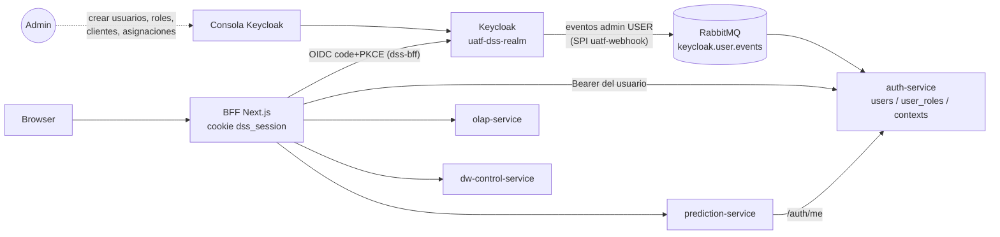

# Roles y permisos en el DSS: cómo funcionan hoy

> Fecha: 2026-11-19. Rutas relativas a la raíz del repositorio.
> `R:<n>` = línea `n` de `infra/keycloak/realm/uatf-dss-realm-realm.json`.

## Resumen

- **Keycloak** es la fuente de verdad de usuarios y roles. Toda alta de usuario, rol, permiso o cliente, y toda asignación de rol, se hace hoy **en la consola de Keycloak**.
- **auth-service** guarda una copia de usuarios y roles que llega por RabbitMQ, más el contexto académico (facultad/carrera). **No llama a la Admin REST API de Keycloak.**
- **El admin-portal** solo lista usuarios y asigna el contexto académico.
- **Los permisos funcionales** (`users:write`, `analytics:faculty`…) existen solo en TypeScript, fijos en el código.

---

## 1. Keycloak

- Versión **26.7.4**, realm **`uatf-dss-realm`** (R:3).
- Imagen: `infra/keycloak/Dockerfile`. Copia el SPI, los temas y el realm en `/opt/keycloak/data/import/`.
- Servicio: `docker-compose.yml:123-169` (`start-dev --import-realm`, BD `dss_identity`, esquema `keycloak`).
- `--import-realm` **no sobrescribe** un realm que ya existe, así que los cambios se aplican a mano (`docs/envs/keycloak.md:11`).
- Exportación: `auth-service/export-realm.ps1` (partial-export). Enmascara los secretos y no incluye usuarios de personas.

### 1.1 Roles del realm (compuestos)

| Rol | Incluye | Línea |
|---|---|---|
| `SUPERADMIN` | `uatf-auth-service:SUPERADMIN`, `olap-service:OLAP_ADMIN` | R:118 |
| `RECTOR` | `uatf-auth-service:RECTOR`, `DECANO`, `DIRECTOR` | R:70 |
| `DECANO` | `uatf-auth-service:DECANO`, `DIRECTOR` | R:53 |
| `DIRECTOR` | `uatf-auth-service:DIRECTOR` | R:137 |
| `default-roles-uatf-dss-realm` | `offline_access`, `uma_authorization`, `account:*` | R:97, R:614 |

### 1.2 Roles de cliente

| Cliente | Roles | Línea |
|---|---|---|
| `uatf-auth-service` | SUPERADMIN, RECTOR, DECANO, DIRECTOR, CONTEXT_READER | R:414-450 |
| `olap-service` | OLAP_ADMIN, OLAP_USER | R:465, R:474 |
| `dw-control-service` | DW_CLOSURE_READ, DW_CLOSURE_MANAGE, DW_ETL_MONITOR_READ | R:585-603 |

`OLAP_USER` y los `DW_*` no forman parte de ningún rol compuesto. Es una decisión deliberada (`docs/envs/dw-control-service.md:35-38`): se asignan a mano a cada usuario, y hoy solo se puede hacer desde la consola.

### 1.3 Clientes

| clientId | Tipo | Flujos | Cuenta de servicio | Notas |
|---|---|---|---|---|
| `dss-bff` (R:922) | confidencial | code + PKCE, refresh | no | `fullScopeAllowed:true`. Audiencias `olap-service` y `dw-control-service`. Secreto `${KEYCLOAK_BFF_CLIENT_SECRET}` |
| `uatf-dss-spa` (R:1292) | público | code + PKCE | no | `fullScopeAllowed:false` y **sin mapeos de alcance**, por lo que sus tokens probablemente no llevan roles de negocio. Parece un cliente que ya no se usa |
| `uatf-auth-service` (R:1233) | confidencial | solo client_credentials | sí | **La cuenta de servicio no tiene roles de `realm-management`**. Secreto exportado como `**********` (R:1243) |
| `olap-service` (R:1062) | confidencial | solo client_credentials | sí | La cuenta de servicio tiene `uatf-auth-service:CONTEXT_READER` (R:699) |
| `dw-control-service` (R:1024) | bearer-only | — | no | — |
| `account`, `account-console`, `admin-cli`, `broker`, `realm-management`, `security-admin-console` | integrados de Keycloak | | | sin cambios |

### 1.4 Grupos, usuarios y funciones avanzadas

- **Grupos:** `groups: []` (R:613). No se usan.
- **Usuarios cargados:** solo `service-account-uatf-auth-service` y `service-account-olap-service` (R:668-705).
- **Authorization Services:** ningún cliente los tiene activados.
- **Permisos de administración granulares (FGAP):** `adminPermissionsEnabled:false` (R:3168).
- **Organizations:** desactivadas.

### 1.5 Cómo llegan los roles al JWT

- Mappers estándar del scope `roles` (R:1712): `realm_access.roles` y `resource_access.<client>.roles`.
- **No hay claims propios.** Facultad, carrera y grupos no van en el token.
- El claim `groups` del scope opcional `microprofile-jwt` contiene los *roles del realm*, no grupos.

### 1.6 keycloak-webhook (SPI `uatf-webhook`)

- Código: `keycloak-webhook/src/main/java/uatf/keycloak/WebhookEventListenerProvider.java`.
- Atiende solo eventos de administración con `ResourceType.USER`:

| Evento en Keycloak | Mensaje publicado |
|---|---|
| CREATE | `USER_CREATED` |
| UPDATE | `USER_UPDATED` |
| alta o baja de role-mappings | `USER_ROLES_UPDATED` |

- Publica en RabbitMQ, en la cola `keycloak.user.events` (con DLX y DLQ), con confirmación del broker y 3 reintentos.
- La foto de roles sale de `getRoleMappingsStream()`, que devuelve **solo asignaciones directas** (los roles compuestos no se expanden).
- **No se publican:** borrado de usuarios, cambios de pertenencia a grupos, cambios en los compuestos de un rol, ni eventos de login (`onEvent` está vacío).

> **Actualizado en IAM-010.** Keycloak 26 informa las asignaciones de roles como `REALM_ROLE_MAPPING`/`CLIENT_ROLE_MAPPING`, no como `USER`, así que el listener original nunca publicaba `USER_ROLES_UPDATED`. Ahora el webhook publica también `USER_DELETED`, cambios de grupos y `ROLE_CHANGED`, y envía los roles efectivos (`schemaVersion` 2). auth-service hace borrado lógico y tiene una resincronización completa (`POST /admin/iam/users/resync`). Ver el Flujo B de `auth-service/docs/auth-service-funcionamiento.md`.

---

## 2. auth-service (Spring Boot)

Paquete base: `auth-service/src/main/java/uatf/dss/authservice/`.

### 2.1 Endpoints (`/api/v1`)

| Método | Ruta | Autorización |
|---|---|---|
| GET | `/auth/me` | cualquier JWT válido |
| GET | `/admin/users`, `/admin/users/{id}` | `ROLE_SUPERADMIN` |
| PUT | `/admin/users/{id}/academic-contexts` | `ROLE_SUPERADMIN` |
| GET | `/admin/academic-catalog` | `ROLE_SUPERADMIN` |
| GET | `/internal/users/{keycloakId}/academic-contexts` | `ROLE_CONTEXT_READER` **y** `azp` incluido en `AUTH_CONTEXT_READER_CLIENTS` |
| — | `/demo/*`, `POST /example-user` | restos de la plantilla |

No hay ningún endpoint que escriba usuarios, roles o permisos.

### 2.2 Relación con Keycloak

- **No hay cliente de la Admin REST API:** no está la dependencia `keycloak-admin-client`, no hay `client_credentials` y no hay variable con el secreto del cliente.
- Lo único que se pide a Keycloak por HTTP es el JWKS (`SecurityConfig.java:92-100`).
- `auth-service/docs/keycloak/keycloak_specification.md:131-135` dice que la cuenta de servicio *debería* tener `view-users`/`manage-users`, pero el realm no se los da.

### 2.3 Validación del JWT

- `SecurityConfig.java:87-113`: comprueba firma (JWKS), emisor, vigencia y audiencia `uatf-auth-service`.
- `configuration/JwtConverter.java:45-62`: **solo lee `resource_access[uatf-auth-service].roles`** y los convierte en `ROLE_*`. **Ignora `realm_access`.**
- No existen cadenas de permiso: todo se decide con `@PreAuthorize` sobre roles.

### 2.4 Base de datos (Flyway `src/main/resources/db/migration`)

| Tabla | Uso |
|---|---|
| `users` | copia de los usuarios de Keycloak (`keycloak_id` único, `is_active`) |
| `roles` | semilla fija: SUPERADMIN=1, RECTOR=2, DECANO=3, DIRECTOR=4 (V4) |
| `user_roles` | foto de los roles de cada usuario |
| `user_academic_contexts` | facultad (INT) y carrera (CHAR(3)), con CHECK de coherencia |
| `academic_faculties`, `academic_programs` | catálogo que carga el ETL de Apache Hop |
| `processed_keycloak_events` | bandeja de entrada para no procesar eventos dos veces |
| `revinfo`, `revchanges` | creadas pero **sin uso** (no hay Envers) |

**No hay tabla de permisos ni de auditoría.**

### 2.5 Sincronización

- `adapter/in/messaging/KeycloakUserEventConsumer.java:31-59` → `SyncUserService.java`.
- Hace upsert por `keycloakId` y reemplaza `user_roles`.
- **Guarda solo los roles del realm** (`clientRole=false`) que coinciden con el enum `RoleType` (`SyncUserService.java:30-36,77-90`).
- Contradice al JWT, que autoriza con roles de cliente.

### 2.6 Reglas de contexto académico

- `AcademicContextValidator.java:13-29`:

| Rol | Contexto requerido |
|---|---|
| SUPERADMIN, RECTOR | ninguno |
| DECANO | una facultad, sin carrera |
| DIRECTOR | facultad y carrera |

- `SetUserAcademicContextsService.java:102-111`: como máximo un contexto por usuario. Se valida contra el catálogo activo.

### 2.7 Auditoría

- Solo líneas JSON en stdout (`AUDIT_LOGGER`, `logback-spring.xml`).
- Eventos: `LOGIN_SUCCESS`/`LOGIN_FAILURE` (solo en `/auth/me`), `USER_SYNCED` y `USER_ACADEMIC_CONTEXTS_REPLACED`.

### 2.8 Código sin usar

Los puertos `AssignRoleRepository` y `RoleRepository` están declarados, pero ningún caso de uso los conecta.

---

## 3. Otros backends

| Servicio | Roles que lee | Cómo autoriza | Archivo |
|---|---|---|---|
| olap-service (Saiku) | `realm_access` + `resource_access[olap-service]` → `ROLE_*` (OLAP_ADMIN se traduce a ROLE_ADMIN) | `/rest/saiku/admin/**`, `/statistics/**` y datasources exigen ADMIN; el resto, solo autenticación | `olap-service/saiku-core/saiku-web/.../SaikuKeycloakJwtAuthenticationConverter.java:33-107`, `applicationContext-saiku.xml:81-224` |
| dw-control-service | `resource_access[dw-control-service]`, filtrado a los tres `DW_*` | GET closures → READ; POST → MANAGE; ETL executions → MONITOR_READ | `dw-control-service/.../DwControlJwtAuthenticationConverter.java:20-68`, `SecurityConfig.java:41-92` |
| prediction-service | `realm_access` + `resource_access[KEYCLOAK_ROLE_CLIENT_ID]` | `PREDICTION_ALLOWED_ROLES` y el contexto obtenido de `/auth/me` | `prediction-service/inference_adapters.py:36-107`, `inference.py:98-121` |
| etl-service (Go) | — | no autentica | — |

El filtro por facultad/carrera de OLAP se aplica **en el BFF**, no en Saiku. El "backstop" que lo replicaría en Saiku (`docs/olap/academic-scope-backstop-design.md`) sigue propuesto, sin implementar.

---

## 4. Frontend y BFF (`dss-monorepo`)

### 4.1 Modelo fijo en el código

| Elemento | Archivo | Contenido |
|---|---|---|
| Roles | `libs/shared/auth-models/src/lib/roles/dss-role.ts:1-12` | `DSSRole = SUPERADMIN \| RECTOR \| DECANO \| DIRECTOR`; `isDSSRole` descarta cualquier otro rol |
| Jerarquía | `libs/shared/rbac-server/src/permissions.ts:7-12` | RECTOR incluye a DECANO y DIRECTOR; DECANO incluye a DIRECTOR |
| Permisos | `libs/shared/rbac-server/src/permission-map.ts:5-26` | `analytics:{read,global,faculty,career}`, `connectors:{read,write}`, `pipelines:{read,execute}`, `users:{read,write}` |

- `libs/rbac` reexporta `rbac-server` y añade los componentes de UI `Can`, `RoleGuard`, `useCan` y `usePermission`.
- **Solo se comprueban los `analytics:*`** (`apps/bff/src/app/api/_lib/academic-scope.ts:40-74`, `graphql/analytics.ts:329`).
- `requirePermissions` (`auth-guard.ts:154-172`) **no lo usa ninguna ruta**. Las rutas de administración usan `requireRoles(['SUPERADMIN'])`.

### 4.2 Sesión

- El BFF implementa a mano OIDC Authorization Code + PKCE con el cliente `dss-bff` (`libs/connectors/auth-connector/src/oidc/keycloak-oidc-client.ts`). Solo usa la librería `jose`.
- Los tokens se guardan cifrados (JWE) en la cookie HttpOnly `dss_session` (`apps/bff/src/app/api/_lib/session-cookie.ts`). El refresh es silencioso.
- `apps/bff/src/proxy.ts`: aplica CORS y exige la cookie en `/api/*`.

### 4.3 Lectura de roles y contexto

- `jwt-verifier.ts:113-121`: une `realm_access.roles` con `resource_access[KEYCLOAK_ROLE_CLIENT_ID].roles` y filtra con `isDSSRole`.
- `auth-guard.ts:38-100`:
  - Verifica el JWT.
  - Pide `/api/v1/auth/me` a auth-service en cada petición, para obtener perfil y contexto.
  - Añade el `clientRoles` crudo, que se usa para los `DW_*`.

### 4.4 Control de acceso en cada app

- Las apps no hacen ninguna comprobación en el servidor: sus `proxy.ts` llaman directamente a `NextResponse.next()`.
- Todo el control es en el navegador, con `ProtectedRoute` y `RoleGuard`:
  - rector: `['RECTOR']`
  - decano: `['DECANO']`
  - director: `['DIRECTOR']`
  - olap-workspace: los cuatro roles
  - admin-portal: `['SUPERADMIN']`, salvo las páginas DW, que usan `access="authenticated"` y dependen de `/api/admin/dw/capabilities`
- Como la jerarquía se aplica, un RECTOR también entra en los dashboards de decano y director.

### 4.5 Endpoints de administración del BFF

| Ruta BFF | Acceso | Destino |
|---|---|---|
| `GET /api/admin/users`, `/users/:id` | SUPERADMIN | auth-service |
| `PUT /api/admin/users/:id/academic-contexts` | SUPERADMIN | auth-service |
| `GET /api/admin/academic-catalog` | SUPERADMIN | auth-service |
| `GET /api/admin/dw/capabilities` | autenticado | se calcula con `clientRoles` |
| `/api/admin/dw/**` | `requireClientRoles('dw-control-service', …)` | dw-control-service |
| `/api/olap/**` | ruta admin de Saiku: SUPERADMIN; resto: rol académico + scope | olap-service |
| `/api/prediction/**` (training/datasets/models) | SUPERADMIN | prediction-service |

**El BFF nunca llama a la Admin API de Keycloak.**

### 4.6 Admin-portal hoy

- Menú: solo "Servicio de autenticación → Usuarios" (`AdminPortalLayout.tsx:66-73`).
- `AdminUsersPage.tsx`: directorio paginado con filtros y un panel "Contexto" (solo para DECANO y DIRECTOR, con un único contexto).
- **Falta:** crear o invitar usuarios, activarlos o desactivarlos, asignar o quitar roles, restablecer contraseñas, asignar `DW_*`/`OLAP_USER`, gestionar roles, permisos y clientes, y una vista de auditoría.
- La guía `apps/docs-portal/src/content/guia-portal-administracion.mdx:25` indica que todo eso se hace en Keycloak.

---

## 5. Problemas y riesgos encontrados

1. **El modelo está fijo en tres sitios:**
   - TypeScript: `DSSRole`, `ROLE_HIERARCHY`, `ROLE_PERMISSIONS`.
   - Java: el enum `RoleType`.
   - SQL: la semilla V4.

   Crear un rol o un permiso obliga a desplegar código.
2. **Cada servicio lee los roles de una forma:**
   - auth-service autoriza con roles de cliente, pero su sincronización solo guarda roles del realm.
   - BFF, olap-service y prediction-service usan los dos.
   - dw-control-service usa solo los suyos.
3. **Los permisos funcionales no existen en Keycloak:** viven solo en el frontend, y la mayoría no se comprueban.
4. **auth-service no puede administrar Keycloak:**
   - Su cuenta de servicio no tiene roles de `realm-management`.
   - Su secreto está exportado como `**********`, y el test de secretos solo vigila `dss-bff` y `olap-service`.
5. **El webhook se queda corto:** solo manda asignaciones directas, y no informa de borrados de usuario, grupos ni cambios en los compuestos.
6. **No hay auditoría guardada en base de datos** ni grupos para asignar permisos colectivamente.
7. **SUPERADMIN recibe `olap-service:OLAP_ADMIN`**, aunque la especificación dice que no debería tener acceso de negocio.
8. **`uatf-dss-spa` no lleva roles en sus tokens**, por `fullScopeAllowed:false` sin mapeos de alcance. Hay que confirmar si se elimina.
9. **El nombre del realm no coincide entre documentos:** `uatf-dss-realm` (real), `uatf-dss` (`.env.example`) y `uatf-realm` (`keycloak_specification.md`).
10. **Las apps no comprueban el acceso en el servidor**, solo en el navegador. El BFF sí protege los datos.
