# Diagrama C4 Nivel 2 — Contenedores del DSS-DW-ML UATF

Este diagrama presenta la **arquitectura objetivo** del DSS a nivel de software: aplicaciones, servicios, almacenes de datos y sus comunicaciones. La perspectiva funcional de negocio está en un documento separado. La arquitectura objetivo se basa en la imagen de referencia y en las declaraciones del `docker-compose.yml`; la tabla de evidencias distingue lo que existe en el repositorio de lo que aún no tiene implementación verificable.

```mermaid
C4Container
  title Diagrama de contenedores — DSS-DW-ML UATF
  Person(administrador, "Administrador", "Administra usuarios y roles del sistema")
  Person(autoridades, "Autoridades UATF", "Rector, Vicerrector, Decano y Director; consultan información según su ámbito")
  Person(analista, "Analista institucional", "Explora indicadores y resultados autorizados")

  System_Boundary(dss, "DSS-DW-ML UATF — arquitectura objetivo") {
    Container(spa, "Aplicación web", "Next.js 16, React 19", "Presenta dashboards e inicia la autenticación de los usuarios")
    Container(gateway, "API Gateway", "Traefik v3 (objetivo)", "Enruta el tráfico web y las solicitudes GraphQL")
    Container(bff, "Backend for Frontend", "Node.js, Apollo GraphQL (objetivo)", "Compone las consultas de la aplicación y coordina los servicios DSS")

    Container(auth, "Servicio de autenticación y contexto", "Java 21, Spring Boot", "Gestiona el perfil y el contexto académico; valida tokens")
    Container(keycloak, "Proveedor de identidad", "Keycloak 26.7.1", "Autentica usuarios y emite tokens OIDC con roles")
    ContainerDb(authdb, "Base de datos IAM", "PostgreSQL 15", "Almacena perfiles y contexto académico local")

    Container(etl, "Servicio ETL", "Java 21, Spring Boot", "Orquesta la extracción y carga de datos académicos")
    ContainerDb(etldb, "Base de datos de metadatos ETL", "PostgreSQL 16", "Almacena metadatos y estado de pipelines en el entorno ETL local")
    ContainerDb(dw, "Data Warehouse", "PostgreSQL (versión por confirmar)", "Conserva los datos académicos preparados para análisis")

    Container(olap, "Servicio de análisis OLAP", "Java 21, Saiku/Mondrian", "Consulta el almacén analítico y entrega resultados multidimensionales")
    Container(prediction, "Servicio de predicción", "Python, FastAPI", "Implementa inferencia puntual y trabajos asíncronos; el uso institucional requiere modelos y permisos aprobados")
    Container(graphapi, "Servicio de análisis de grafos", "Go (objetivo)", "Expone consultas sobre relaciones académicas")
    ContainerDb(graphdb, "Base de datos de grafos", "Neo4j (versión por confirmar)", "Almacena relaciones académicas")
  }

  Container_Ext(fuentes, "Sistemas y bases académicas UATF", "Sistemas institucionales", "Fuentes operacionales de información académica")

  Rel(administrador, keycloak, "Administra usuarios y roles", "Consola web")
  Rel(autoridades, spa, "Consulta dashboards", "HTTPS")
  Rel(analista, spa, "Explora indicadores autorizados", "HTTPS")
  Rel(spa, keycloak, "Inicia sesión y obtiene tokens", "OIDC Authorization Code + PKCE")
  Rel(spa, gateway, "Solicita datos para dashboards", "HTTPS/GraphQL")
  Rel(gateway, bff, "Enruta las consultas GraphQL", "HTTP interno")

  Rel(bff, auth, "Consulta perfil y contexto académico", "REST/JSON")
  Rel(auth, keycloak, "Valida tokens y consulta claves públicas", "OIDC/JWKS sobre HTTPS")
  Rel(auth, authdb, "Lee y actualiza perfiles y contexto", "JDBC")
  Rel(bff, olap, "Solicita indicadores multidimensionales", "REST/JSON")
  Rel(bff, prediction, "Solicita estimaciones", "REST/JSON")
  Rel(bff, graphapi, "Consulta relaciones académicas", "REST/JSON")

  Rel(etl, fuentes, "Extrae datos académicos", "JDBC / conectores")
  Rel(etl, dw, "Carga los datos preparados")
  Rel(etl, etldb, "Registra metadatos y ejecuciones", "JDBC")
  Rel(olap, dw, "Consulta hechos y dimensiones", "JDBC/SQL")
  Rel(prediction, dw, "Lee datos y persiste predicciones (objetivo)", "PostgreSQL/psycopg2 (referencia)")
  Rel(graphapi, graphdb, "Lee y actualiza relaciones", "Protocolo por confirmar")
```

## Inventario y evidencias

| Contenedor o actor | Evidencia y estado |
|---|---|
| Aplicaciones web | El Compose raíz conserva la ruta antigua `frontend/nextjs-spa`, que no existe en este checkout. Las aplicaciones activas están en `dss-monorepo/apps`, incluidos el BFF y los portales. Aún debe confirmarse cómo se orquestarán en el despliegue integrado. |
| API Gateway | La imagen de referencia identifica Traefik v3 y `docker-compose.yml` declara el servicio; falta el directorio `gateway/traefik` para verificar su build y configuración. |
| BFF y GraphQL | El BFF activo está en `dss-monorepo/apps/bff`; expone rutas REST y `GET|POST /api/graphql`. El Compose raíz declara además un `graphql-bff` con contexto antiguo `gateway/graphql-bff`, que no existe en este checkout. |
| Servicio de autenticación y contexto | `auth-service/pom.xml`, `auth-service/Dockerfile` y `auth-service/README.md`; `docker-compose.yml` lo conecta con la base IAM y define configuración de Keycloak. |
| Proveedor de identidad | `docker-compose.yml` fija Keycloak 26.7.1; `auth-service/docs/keycloak/keycloak_specification.md` describe OIDC, roles y JWT. |
| Base de datos IAM | `docker-compose.yml` declara PostgreSQL 15 para `auth-service-db`; configuración de conexión en `auth-service/src/main/resources/application-prod.yaml`. |
| Flujo de integración ETL | El servicio `etl-service` que aparece más abajo en el Compose raíz apunta a un contexto de build ausente. El flujo activo del MVP está en `etl-layer/apache-hop/projects/dss-uatf-etl`; el Load Manager Go se conserva como línea separada y pausada. El MVP Hop está integrado con fixtures sintéticos, no validado como carga productiva desde Jachasun. |
| PostgreSQL DW | `docker-compose.yml` declara `postgres:15-alpine`, y `infra/dw-schema/migrations` contiene el esquema y las funciones de control/publicación. `infra/postgres-dw` almacena datos del Compose local. Esto confirma el entorno local, no una instalación productiva de la UATF. |
| Servicio OLAP | `olap-service/Dockerfile`, `olap-service/pom.xml` y `docker-compose.yml`; el repositorio contiene Saiku/Mondrian sobre Java 21. |
| Servicio de predicción | `prediction-service/main.py`, `prediction-service/training/` y `prediction-service/Dockerfile`; implementa `POST /v1/predictions`, trabajos de entrenamiento y scoring poblacional. La ruta heredada `POST /predict` falla cerrada si no puede usar un bundle aprobado y una fuente confiable de features. La lectura del DW está implementada; la aprobación institucional de modelos, targets y permisos sigue pendiente. |
| Servicio de análisis de grafos | La imagen y el `docker-compose.yml` raíz sugieren el servicio, pero no existe el código del servicio Graph en el repositorio consultado. |
| Base de datos de grafos | La imagen y `docker-compose.yml` declaran Neo4j; falta el contexto `data-layer/neo4j` para verificar configuración y versión. |
| Sistemas y bases académicas UATF | Imagen de referencia y `DSS-PASTED.docx`; no se identifican nombres de sistemas, contratos ni conexiones concretas en el repositorio. |
| Personas usuarias | Roles de Rector, Decano, Director y SUPERADMIN en `infra/keycloak/realm/uatf-dss-realm-realm.json`; el usuario indicó Vicerrector y Analista como perfiles. |

## Suposiciones y pendientes de confirmación

- El diagrama describe una **arquitectura objetivo**, no una topología que hoy pueda desplegarse íntegramente desde el Compose raíz. Varios contextos de build declarados no existen en el repositorio actual.
- La aplicación web y el BFF tienen implementaciones activas en `dss-monorepo/apps`. El API Gateway y la orquestación del Compose raíz siguen el diseño de referencia y requieren confirmación antes de presentarlos como despliegue integrado.
- El servicio Graph y Neo4j se incluyen porque aparecen en la arquitectura de referencia; faltan código y configuración verificables para el servicio Graph y el contexto de Neo4j.
- El flujo activo de Apache Hop publica cortes en PostgreSQL DW y está validado con fixtures sintéticos; eso no acredita una carga productiva desde Jachasun. Prediction Service consulta features del DW y ofrece rutas de inferencia y publicación; la autorización y un bundle institucional aprobado siguen siendo requisitos para uso real.
- La conexión de OLAP con el DW, el protocolo del servicio Graph y la persistencia configurada de Keycloak requieren confirmación técnica.
- La base de datos PostgreSQL del ETL se modela porque aparece en su Compose local; falta decidir si también pertenece al despliegue integrado del DSS.
