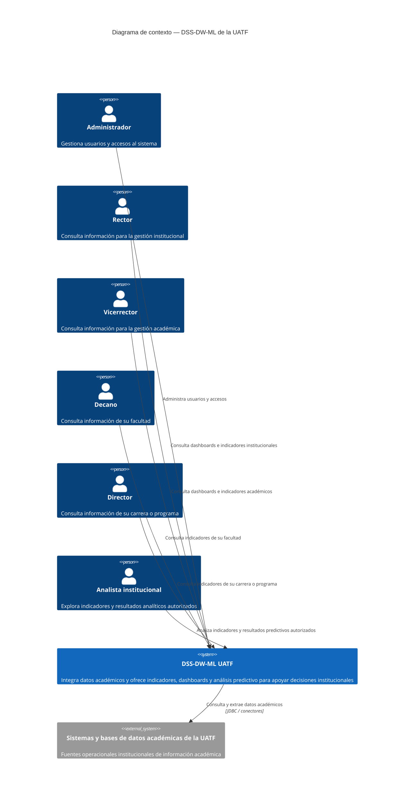

# Diagrama de contexto C4 — DSS-DW-ML de la UATF

Este diagrama muestra quién utiliza el Sistema de Soporte a Decisiones y qué fuente institucional alimenta sus análisis. Resume como una sola unidad el DSS de la arquitectura de referencia; no representa sus microservicios ni tecnologías internas.

## Inventario y evidencias

| Elemento | Evidencia |
|---|---|
| DSS-DW-ML UATF | Imagen `DssSoftwareArchitecture-Software.drawio (1).png`, que presenta ETL, almacén de datos, OLAP, predicción, IAM, BFF y dashboards; `DSS-PASTED.docx`, que describe el DSS, el Data Warehouse, Machine Learning y dashboards institucionales. |
| Administrador | Solicitud del usuario; `auth-service/docs/keycloak/keycloak_specification.md` (rol `SUPERADMIN`, gestión de usuarios y sistema). |
| Rector | Solicitud del usuario; `infra/keycloak/realm/uatf-dss-realm-realm.json` (rol `RECTOR` y acceso a métricas, reportes y dashboards institucionales). |
| Vicerrector | Solicitud del usuario; rol específico no verificado en la configuración consultada. |
| Decano | Solicitud del usuario; `infra/keycloak/realm/uatf-dss-realm-realm.json` (rol `DECANO`); `auth-service/README.md` (alcance de datos por facultad). |
| Director | Solicitud del usuario; `infra/keycloak/realm/uatf-dss-realm-realm.json` (rol `DIRECTOR`); `auth-service/README.md` (alcance de datos por carrera). |
| Analista institucional | Solicitud del usuario y `DSS-PASTED.docx` (usuarios institucionales autorizados); el rol específico no se verificó en Keycloak. |
| Fuentes académicas UATF | Imagen de referencia (base de datos UATF y sistemas académicos); `DSS-PASTED.docx` (información académica administrada por la DSA y fuentes institucionales). |
| Extracción de datos | Imagen de referencia (conexión JDBC y conectores hacia la carga); la descripción del protocolo se conserva solo donde aparece explícito en la imagen. |

## Suposiciones y puntos por confirmar

- Se modela la solución completa, incluido IAM/Keycloak, como un único sistema DSS; el diagrama de contexto no separa componentes internos.
- Se agrupan en un sistema externo las bases y aplicaciones académicas mostradas en la imagen porque sus nombres e interfaces no están detallados en los adjuntos.
- Rector, Vicerrector, Decano y Director se muestran como personas distintas. El Vicerrector y el Analista institucional fueron indicados por el usuario, pero no se encontró un rol equivalente definido en la configuración de Keycloak consultada.
- La relación JDBC/conectores resume la imagen de arquitectura; los protocolos y las fuentes concretas deben confirmarse contra las integraciones implementadas.
