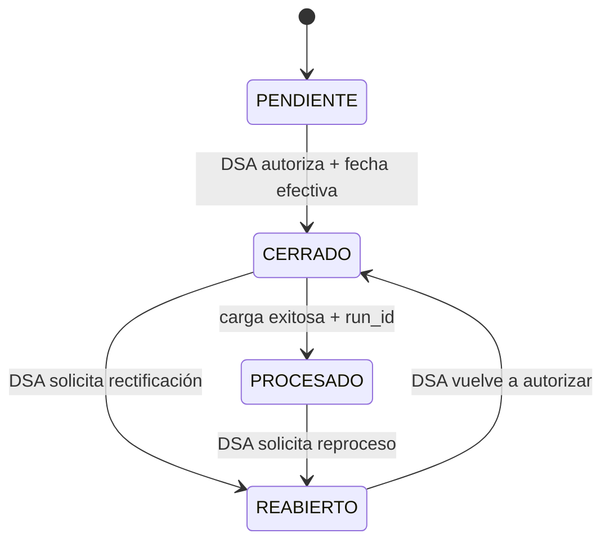

# DW-002 — Calendario de cierres académicos

`etl_control.academic_period_closure` es la única fuente de verdad para decidir si un corte puede entrar al pipeline DW. Los valores operativos de Jachasun, como `public.gestion_periodo`, son referencias y no habilitan cargas.

## Estados y transiciones



Un periodo admite cualquier código positivo: semestres regulares, invierno, verano o nuevos tipos institucionales. No se crean cierres académicos reales mediante la migración.

## Responsabilidades

| Rol | Responsabilidad |
| --- | --- |
| DSA | Crear cortes pendientes y autorizar su cierre o reapertura, siempre con sujeto identificable y motivo. |
| TI/DBA | Aplicar migraciones, administrar permisos de base de datos y revisar la bitácora. |
| Load Manager futuro | Marcar un corte como `PROCESADO` solo tras una carga publicada exitosamente y con `run_id`. |

La futura API/BFF debe verificar autorización DSA antes de invocar `etl_control.transition_academic_period_closure`; la función SQL exige actor, motivo y la transición válida, pero no reemplaza la autorización JWT de DW-015/DW-016.

## Elegibilidad y reapertura

Un scheduler futuro podrá solicitar una carga solo cuando el corte esté en `CERRADO`, `effective_at <= now()` y `processed_at IS NULL`. La reapertura limpia la marca de procesamiento vigente, bloquea cargas automáticas y conserva los eventos históricos, incluido el `run_id` previamente publicado. El contenido DW publicado no se reemplaza hasta que un reproceso posterior finalice exitosamente.

## Operación manual

Crear un corte pendiente requiere insertar `gestion`, `periodo`, `created_by_subject` y `closure_reason`. Las transiciones se realizan exclusivamente mediante:

```sql
SELECT etl_control.transition_academic_period_closure(
  :gestion, :periodo, :to_status, :actor_subject, :reason,
  :effective_at, :processed_run_id
);
```

`CERRADO` exige fecha efectiva; `PROCESADO` exige UUID de ejecución. La tabla de eventos es inmutable y toda actualización directa de campos de estado es rechazada.

## Despliegue y prueba

Para validar localmente en un PostgreSQL aislado, ejecutar desde la raíz del repositorio:

```bash
docker compose -f infra/dw-schema/dw-test-docker.yml up \
  --abort-on-container-exit --exit-code-from dw-schema-test
docker compose -f infra/dw-schema/dw-test-docker.yml down --volumes
```

El entorno no publica puertos ni persiste datos: PostgreSQL usa almacenamiento temporal y el contenedor `dw-schema-test` aplica primero la migración con `ON_ERROR_STOP` y luego ejecuta la prueba reversible. Un código de salida cero confirma ambas operaciones.

TI/DBA puede aplicar los mismos archivos en un entorno administrado con `psql -v ON_ERROR_STOP=1`; la prueba abre una transacción y finaliza en `ROLLBACK`, por lo que no conserva registros de prueba.

Los permisos productivos se concederán cuando exista el rol de aplicación del Load Manager. Hasta entonces, TI/DBA debe restringir la escritura directa y utilizar la función de transición para los cambios operativos autorizados por DSA.
