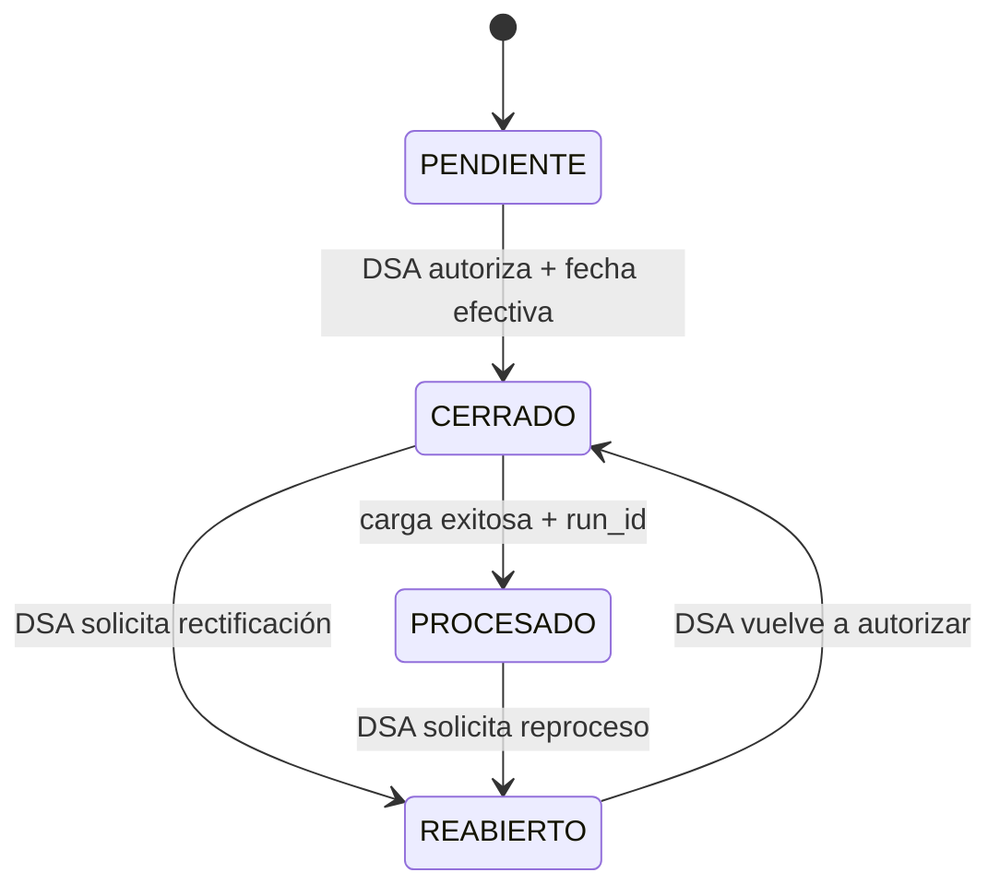

# DW-002 — Calendario de cierres académicos

`etl_control.academic_period_closure` es la única fuente de verdad para decidir si un corte puede entrar al pipeline DW. Los valores operativos de Jachasun, como `public.gestion_periodo`, son referencias y no habilitan cargas.

## Estados y transiciones



Un periodo admite cualquier código positivo: semestres regulares, invierno, verano o nuevos tipos institucionales. No se crean cierres académicos reales mediante la migración.

El diagrama separa la autorización funcional de la ejecución técnica. DSA habilita el cierre y puede reabrirlo; solo una carga exitosa del mismo cierre permite `PROCESADO`. Reabrir conserva la auditoría y obliga a un reproceso autorizado, no a borrar automáticamente la publicación anterior.

## Responsabilidades

| Rol | Responsabilidad |
| --- | --- |
| DSA | Crear cortes pendientes y autorizar su cierre o reapertura, siempre con sujeto identificable y motivo. |
| TI/DBA | Aplicar migraciones, administrar permisos de base de datos y revisar la bitácora. |
| Apache Hop y operador autorizado | Registrar la ejecución técnica y marcar el corte como `PROCESADO` mediante la función, solo tras publicación exitosa con `run_id` del mismo cierre. |

La API `dw-control-service` implementa los comandos DSA de la issue #177. Valida el permiso `DW_CLOSURE_MANAGE`, deriva el actor del `sub` del JWT validado y solo invoca funciones SQL auditadas para crear, cerrar o reabrir. La función de bajo nivel `etl_control.transition_academic_period_closure` permanece reservada a los propietarios y flujos técnicos autorizados; no se concede directamente al rol del API.

## Elegibilidad y reapertura

El workflow Hop deberá solicitar una carga por cierre solo cuando el corte esté en `CERRADO`, `effective_at <= now()` y `processed_at IS NULL`; esta regla se aplica también a la ejecución manual, no solo a un scheduler futuro. La reapertura limpia la marca vigente, bloquea nuevas cargas por cierre y conserva los eventos históricos, incluido el `run_id` previamente publicado. El contenido DW publicado no se reemplaza hasta que un reproceso posterior finalice exitosamente. Las cargas históricas tendrán autorización explícita separada.

## Operación manual

Las operaciones ordinarias se realizan mediante `dw-control-service` con un JWT que tenga `DW_CLOSURE_MANAGE`. La API no acepta el actor en el body. El rol SQL del servicio no tiene DML directo; la migración `0024_add_academic_closure_commands.sql` concede únicamente estas funciones:

```sql
SELECT etl_control.create_academic_period_closure(
  :gestion, :periodo, :actor_subject, :reason
);

SELECT etl_control.request_academic_period_closure_transition(
  :closure_id, :to_status, :actor_subject, :reason, :effective_at
);
```

Son ejemplos del contrato interno SQL, no credenciales para operaciones manuales. `CERRADO` exige fecha efectiva; la función expuesta al API solo permite `CERRADO` y `REABIERTO`, nunca `PROCESADO`. Este último exige un UUID de ejecución `EXITOSA` vinculada al mismo cierre y sigue bajo el flujo técnico de Hop. La tabla de eventos es inmutable y toda actualización directa de campos de estado es rechazada.

## Despliegue y prueba

Para validar localmente en un PostgreSQL aislado, ejecutar desde la raíz del repositorio:

```bash
docker compose -f infra/dw-schema/dw-test-docker.yml up \
  --abort-on-container-exit --exit-code-from dw-schema-test
docker compose -f infra/dw-schema/dw-test-docker.yml down --volumes
```

El entorno no publica puertos ni persiste datos: PostgreSQL usa almacenamiento temporal y el contenedor `dw-schema-test` aplica primero la migración con `ON_ERROR_STOP` y luego ejecuta la prueba reversible. Un código de salida cero confirma ambas operaciones.

TI/DBA puede aplicar los mismos archivos en un entorno administrado con `psql -v ON_ERROR_STOP=1`; la prueba abre una transacción y finaliza en `ROLLBACK`, por lo que no conserva registros de prueba.

`dw_control_operator` se conserva para compatibilidad de operación manual y no debe asignarse a `dw-control-service`. TI/DBA provisiona `dw_control_runtime` como LOGIN dedicado miembro solo de `dw_control_service`, con contraseña en el gestor de secretos; el calendario funciona sin Load Manager. El runtime Hop conserva su grupo y funciones técnicas: no recibe autoridad DSA implícita. Véase [la base consolidada](mvp-direct-hop.md).
