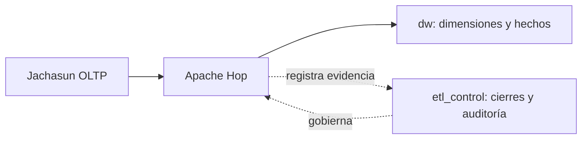

# DW-003 — Fundamentos de la plataforma analítica

DW-003 establece los esquemas y controles de acceso de la base analítica. DW-004 incorpora el control de ejecuciones, DW-005 documenta el modelo dimensional lógico y DW-006 materializa sus dimensiones conformadas. Para el MVP de la issue #133, la ruta activa será **Jachasun → Apache Hop → dw**, con `etl_control` como control lateral. La [base consolidada del MVP](mvp-direct-hop.md) distingue los objetos existentes de las cargas y migraciones aún pendientes. Load Manager y el aterrizaje RAW se conservan como implementación futura, no como dependencias del MVP.

## Capas



El diagrama representa la arquitectura objetivo del MVP, no una carga ya implementada. Hop extrae, valida y transforma los datos antes de publicar en `dw`; `etl_control` registra autorización y evidencia, sin ser almacenamiento intermedio de negocio. `staging`, `etl_work` y `ml_workspace` ya existen por `0002`, pero no son etapas activas de este flujo y no se eliminan.

## Roles de grupo

Los roles son `NOLOGIN`; TI/DBA crea las cuentas de usuario o servicio por ambiente, las asigna al grupo correspondiente y conserva las credenciales fuera del repositorio. La matriz siguiente describe los privilegios de la base histórica, no una recomendación de asignar todos esos roles a Hop. Los grants mínimos para su ruta directa deberán adaptarse por migración y probarse antes de operar.

| Rol | Acceso permitido |
| --- | --- |
| `dw_staging_writer` | DML en `staging`; no accede a `dw`. |
| `dw_transformer` | Lee `staging`, opera `etl_work` y consulta control mínimo. |
| `dw_control_operator` | Crea cierres pendientes, consulta auditoría y ejecuta la transición autorizada. |
| `dw_publisher` | Rol legado con DML DW; no asignarlo al runtime de Hop. |
| `dw_hop_runtime` | Grupo runtime creado en 0010; APIs de control/landing y publisher 0011 por `SECURITY DEFINER`, sin DML directo en `dw`. |
| `dw_ml_writer` | Lee `dw` y opera `ml_workspace`. |
| `dw_reader` | Solo lectura sobre `dw`. |

`dw_owner` posee los esquemas y objetos. El rol que ejecuta migraciones debe ser superusuario o contar con privilegios administrativos suficientes para crear roles y asumir `dw_owner`; no debe utilizarse para servicios de aplicación.

Las funciones de cierre no están disponibles para `PUBLIC`. Las operaciones que deben escribir la bitácora se ejecutan como `dw_owner` mediante funciones `SECURITY DEFINER` con `search_path` fijo; así `dw_control_operator` no recibe permisos directos de actualización. El rol SQL no sustituye la autorización funcional DSA: en el MVP se registrará mediante operación manual autorizada; la futura API/BFF podrá automatizar su comprobación.

## Migraciones

`infra/dw-schema/scripts/apply-migrations.sh` aplica archivos `NNNN_nombre.sql` en orden léxico. Para cada archivo normaliza CRLF/LF, calcula SHA-256 y contrasta el valor con `etl_control.schema_migration` antes de omitir una migración ya aplicada.

El primer uso desde DW-002 aplica `0001` de manera idempotente y luego `0002`, que registra el hash base de `0001`. Las aplicaciones posteriores solo ejecutan migraciones no registradas; un hash diferente detiene el despliegue antes de modificar el esquema.

En Docker, `dw-migrator` espera a que `postgres-dw` esté saludable y finaliza tras aplicar las migraciones. Hop depende de esa finalización exitosa. El antiguo script de `public` deja de montarse: las tablas legacy existentes no se borran, pero quedan fuera de la ruta soportada.

## Operación y rollback

Las cinco dimensiones proceden de `0004`; `0008` añade vigencias SCD2 de estudiante, `0009` crea los tres hechos y `0015` prepara admisión/cursado para Hop, según [la base consolidada](mvp-direct-hop.md). No se agrega un segundo modelo de dimensiones ni de auditoría. El runtime Hop cuenta con contrato de control y publicación atómica. Las fases 6.2–6.5 tienen flujos y pruebas sintéticas; retención, validación con datos reales de Jachasun y la verificación end-to-end de producción permanecen pendientes. El compose histórico no constituye evidencia de esa integración.

Para una validación aislada:

```bash
docker compose -f infra/dw-schema/dw-test-docker.yml up \
  --abort-on-container-exit --exit-code-from dw-schema-test
docker compose -f infra/dw-schema/dw-test-docker.yml down --volumes
```

En un entorno administrado, TI/DBA debe realizar un respaldo verificable antes de ejecutar el migrador. No se admiten ediciones ni eliminaciones de migraciones aplicadas. Si una migración falla, su transacción revierte; si ya fue aplicada, la corrección se realiza mediante una nueva migración hacia adelante o mediante restauración del respaldo. No se ejecuta `DROP SCHEMA ... CASCADE` como mecanismo de rollback.
