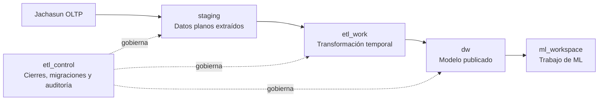

# DW-003 — Fundamentos de la plataforma analítica

DW-003 establece las capas y controles de acceso de la base analítica. No crea dimensiones, hechos ni tablas RAW; el control de ejecuciones se incorpora posteriormente en DW-004 y el modelado permanece en issues posteriores.

## Capas



`staging` conserva la observación de las fuentes sin transformación analítica. `etl_work` contiene resultados temporales de transformación. `dw` es la única capa para el modelo dimensional publicado. `ml_workspace` no publica datos al DW. `etl_control` conserva metadatos operativos; DW-004 incorpora allí el registro auditable de ejecuciones.

## Roles de grupo

Los roles son `NOLOGIN`; TI/DBA crea las cuentas de usuario o servicio por ambiente, las asigna al grupo correspondiente y conserva las credenciales fuera del repositorio.

| Rol | Acceso permitido |
| --- | --- |
| `dw_staging_writer` | DML en `staging`; no accede a `dw`. |
| `dw_transformer` | Lee `staging`, opera `etl_work` y consulta control mínimo. |
| `dw_control_operator` | Crea cierres pendientes, consulta auditoría y ejecuta la transición autorizada. |
| `dw_publisher` | Lee `etl_work` y publica datos en `dw`. |
| `dw_ml_writer` | Lee `dw` y opera `ml_workspace`. |
| `dw_reader` | Solo lectura sobre `dw`. |

`dw_owner` posee los esquemas y objetos. El rol que ejecuta migraciones debe ser superusuario o contar con privilegios administrativos suficientes para crear roles y asumir `dw_owner`; no debe utilizarse para servicios de aplicación.

Las funciones de cierre no están disponibles para `PUBLIC`. Las operaciones que deben escribir la bitácora se ejecutan como `dw_owner` mediante funciones `SECURITY DEFINER` con `search_path` fijo; así `dw_control_operator` no recibe permisos directos de actualización. El control de que una acción provenga de DSA se mantiene en la futura API/BFF; el rol SQL limita quién puede invocar la función, pero no sustituye la autorización funcional.

## Migraciones

`infra/dw-schema/scripts/apply-migrations.sh` aplica archivos `NNNN_nombre.sql` en orden léxico. Para cada archivo normaliza CRLF/LF, calcula SHA-256 y contrasta el valor con `etl_control.schema_migration` antes de omitir una migración ya aplicada.

El primer uso desde DW-002 aplica `0001` de manera idempotente y luego `0002`, que registra el hash base de `0001`. Las aplicaciones posteriores solo ejecutan migraciones no registradas; un hash diferente detiene el despliegue antes de modificar el esquema.

En Docker, `dw-migrator` espera a que `postgres-dw` esté saludable y finaliza tras aplicar las migraciones. Hop depende de esa finalización exitosa. El antiguo script de `public` deja de montarse: las tablas legacy existentes no se borran, pero quedan fuera de la ruta soportada.

## Operación y rollback

Para una validación aislada:

```bash
docker compose -f infra/dw-schema/dw-test-docker.yml up \
  --abort-on-container-exit --exit-code-from dw-schema-test
docker compose -f infra/dw-schema/dw-test-docker.yml down --volumes
```

En un entorno administrado, TI/DBA debe realizar un respaldo verificable antes de ejecutar el migrador. No se admiten ediciones ni eliminaciones de migraciones aplicadas. Si una migración falla, su transacción revierte; si ya fue aplicada, la corrección se realiza mediante una nueva migración hacia adelante o mediante restauración del respaldo. No se ejecuta `DROP SCHEMA ... CASCADE` como mecanismo de rollback.
