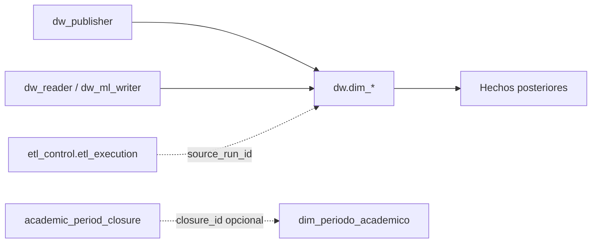

# DW-006 — Dimensiones conformadas y miembros técnicos

DW-006 implementa la base física de las dimensiones conformadas definidas por DW-005. La migración `0004_create_conformed_dimensions.sql` crea únicamente estructura, restricciones, auditoría técnica y miembros de reserva; no lee Jachasun, no carga datos de negocio y no crea hechos.

## Alcance físico

| Tabla | Clave sustituta | Clave natural de miembros estándar | Proceso que la reutilizará |
| --- | --- | --- | --- |
| `dw.dim_estudiante` | `estudiante_sk` | `id_ra` canónico cuando exista; `id_alumno` alterno | Admisión, cursado, retención/deserción |
| `dw.dim_programa` | `programa_sk` | `id_programa` | Admisión, cursado, retención/deserción |
| `dw.dim_materia` | `materia_sk` | `id_materia` | Cursado |
| `dw.dim_periodo_academico` | `periodo_academico_sk` | `(gestion, periodo)` | Admisión, cursado, retención/deserción |
| `dw.dim_admision` | `admision_sk` | `id_acceso` | Admisión |

Las claves sustitutas son `BIGINT GENERATED BY DEFAULT AS IDENTITY`. Las claves naturales siguen siendo atributos de trazabilidad y no reemplazan la clave primaria DW. Los índices únicos se aplican solo a miembros `STANDARD`, por lo que no afectan a las filas de reserva.



El diagrama representa la propiedad y el consumo de las dimensiones, no una carga activa. `dw_publisher` será el único rol operativo que escriba en `dw`; lectores y ML solo las consultarán. `source_run_id` conserva el vínculo opcional con la ejecución que observó o actualizó un atributo. La dimensión de periodo puede referenciar un cierre DSA, pero no calcula sucesores ni autoriza cargas.

## Miembros `UNKNOWN` y `NOT_APPLICABLE`

Cada dimensión contiene exactamente dos filas técnicas sembradas por la migración:

| Surrogate key | `member_type` | Etiqueta | Uso permitido |
| --- | --- | --- |
| `-1` | `UNKNOWN` | `Desconocido` | La relación era necesaria, pero la clave no llegó, no pudo resolverse o fue rechazada por calidad. |
| `0` | `NOT_APPLICABLE` | `No aplica` | El concepto no corresponde al proceso o a la fila publicada. |

Las restricciones prohíben que un miembro técnico tenga una clave natural o un `source_run_id`. También impiden que un miembro estándar use `-1` o `0`. Un trigger bloquea toda actualización o eliminación de estas filas, de modo que su semántica no dependa de una convención del ETL.

No se usa `0` como sustituto de una nota, estado, conteo, programa o periodo faltante. La decisión entre `UNKNOWN` y `NOT_APPLICABLE` debe quedar registrada por la transformación que publique el hecho.

## Atributos autorizados

Los atributos provienen exclusivamente de los contratos DW-001. No se almacenan nombres, documentos, teléfonos, direcciones, correos ni fecha de nacimiento.

| Dimensión | Atributos descriptivos iniciales |
| --- | --- |
| Estudiante | Sexo, estado civil, país de nacimiento, colegio y localidad de procedencia, gestión de egreso de colegio, inscripción, egreso, estado académico y tipo de alumno. |
| Programa | Nombre, facultad, nivel, sede, tipo académico y marca operativa de activo. |
| Materia | Sigla, nombre, programa, plan, materia padre, ciclo, nivel, horas y créditos. |
| Periodo académico | Gestión, periodo, `closure_id` y fecha efectiva opcional del cierre DSA. |
| Admisión | Solo `id_acceso`; no existe aún un catálogo aprobado para una descripción de modalidad. |

La relación de materia con programa o materia padre no se declara como FK en esta issue: los contratos notifican posibles referencias huérfanas y la compatibilidad de tipos entre materias y notas sigue pendiente de validación real. Asimismo, colegio, localidad y facultad son atributos y no dimensiones adicionales en esta primera publicación.

## Auditoría y permisos

Cada tabla contiene `created_at`, `updated_at` y `source_run_id` opcional. El último es una FK a `etl_control.etl_execution`; la migración no exige que las filas técnicas tengan ejecución asociada. Un trigger actualiza `updated_at` en cambios a miembros estándar.

| Rol | Acceso sobre dimensiones |
| --- | --- |
| `dw_owner` | Propietario y DDL. |
| `dw_publisher` | `SELECT`, `INSERT`, `UPDATE`, `DELETE`; `USAGE` y `SELECT` sobre secuencias identity. |
| `dw_reader`, `dw_ml_writer` | Solo `SELECT`. |
| `dw_staging_writer`, `dw_transformer`, `dw_control_operator`, `PUBLIC` | Sin `USAGE` en `dw` ni acceso a las tablas. |

La migración repite los `REVOKE` y `GRANT` explícitos para que la seguridad no dependa solamente de privilegios por defecto históricos.

## Límites con las siguientes issues

- DW-007 define vigencias, versiones y la [política SCD de persona/estudiante](scd2-person-student-policy.md). DW-006 no crea `valid_from`, `valid_to`, `is_current` ni lógica de historización.
- DW-019 cargará dimensiones desde las capas RAW y de trabajo. DW-006 no inserta datos OLTP ni interpreta códigos de estado.
- DW-020 a DW-022 crearán los hechos. Los campos de notas, conteos, PPA, retención, deserción y grupo permanecen fuera de estas tablas.
- La validación de `public.postulantes`, los dominios de estado, la semántica de egreso y los joins OLTP continúan bajo la aprobación DSA/TI definida en DW-001 y DW-005.

## Validación local

Desde la raíz del repositorio:

```powershell
docker compose -f infra/dw-schema/dw-test-docker.yml up --build --abort-on-container-exit
docker compose -f infra/dw-schema/dw-test-docker.yml ps -a
docker compose -f infra/dw-schema/dw-test-docker.yml logs dw-schema-test
docker compose -f infra/dw-schema/dw-test-docker.yml down --volumes
```

El resultado correcto es `dw-schema-test` con `Exited (0)`. La suite ejecuta el migrador dos veces, preserva las regresiones DW-002 a DW-004 y finalmente prueba semillas, restricciones, FK de `source_run_id`, protección de miembros técnicos y privilegios de DW-006 dentro de `BEGIN ... ROLLBACK`. También altera una copia temporal de `0004` para comprobar que el runner rechaza un SHA-256 normalizado que no coincide con el historial registrado.
