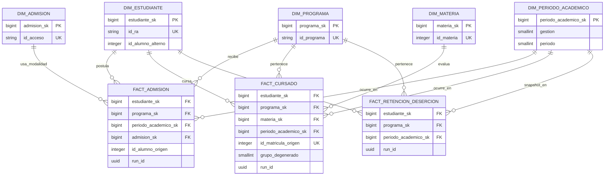

# DW-005 — Modelo dimensional de constelación de hechos

## Propósito y alcance

Este documento define el modelo lógico aprobable del primer Data Warehouse relacional de Jachasun: una constelación de hechos para admisión, cursado y retención/deserción. Su propósito es fijar significados, granos y agregaciones antes de crear objetos físicos.

No crea DDL, tablas, dimensiones, cargas, transformaciones Apache Hop ni procesos de extracción. DW-006 materializa las dimensiones y sus miembros técnicos en [conformed-dimensions.md](conformed-dimensions.md); DW-007 decidirá la historización SCD; y las issues de staging, transformación y publicación materializarán los hechos. Las fuentes continúan siendo de solo lectura y los contratos de DW-001 son la referencia de campos y filtros autorizados.

## Principios de diseño

- Cada hecho responde a un proceso de negocio y tiene un grano propio. No existe una tabla de hechos única que mezcle admisiones, calificaciones y snapshots de permanencia.
- Las dimensiones conformadas permiten comparar procesos sin duplicar definiciones: estudiante, programa y periodo académico son comunes cuando el proceso dispone de ellas.
- Las claves sustitutas se crearán en DW-006. Hasta entonces, las claves naturales documentadas aquí conservan trazabilidad con Jachasun.
- `run_id` conserva el linaje técnico de una publicación y referencia el control de DW-004; no es una dimensión para filtros ni agregaciones analíticas.
- Los valores ausentes, desconocidos o no aplicables no se reemplazan por ceros. DW-006 definirá los miembros técnicos `UNKNOWN` y `NO_APLICA` donde corresponda.
- El filtro de programas aprobado en DW-001 se aplica antes de publicar cualquiera de los hechos: programas activos y de tipo académico permitido. La implementación concreta reutilizará el contrato de `academico.alm_programas` y no inventará un segundo criterio.

## Dimensiones conformadas

| Dimensión lógica | Futura clave sustituta | Clave natural o identidad de negocio | Atributos y fuente principal | Hechos que la usan |
| --- | --- | --- | --- | --- |
| `DIM_ESTUDIANTE` | `estudiante_sk` | `id_ra` es la identidad canónica cuando existe; `id_alumno` es el identificador académico alterno. | Persona y atributos académicos de `public.uatf_datos` y `academico.alumnos`; colegio (`public.prs_colegios`) y localidad (`public.lugar_localidad`) son atributos del estudiante. | Admisión, cursado, retención/deserción |
| `DIM_PROGRAMA` | `programa_sk` | `id_programa` | Nombre, facultad, nivel, sede y atributos autorizados de `academico.alm_programas` y su relación de facultad. | Admisión, cursado, retención/deserción |
| `DIM_MATERIA` | `materia_sk` | `id_materia` | Sigla, nombre, plan, programa y atributos curriculares de `academico.pln_materias`. | Cursado |
| `DIM_PERIODO_ACADEMICO` | `periodo_academico_sk` | `(gestion, periodo)` | Gestión, código de periodo y metadatos del cierre DSA en `etl_control.academic_period_closure`. | Admisión, cursado, retención/deserción |
| `DIM_ADMISION` | `admision_sk` | `id_acceso` cuando esté informado | Modalidad o vía de acceso de `public.postulantes`; los valores no clasificados se resolverán con el miembro técnico adecuado. | Admisión |

### Identidad de estudiante

`DIM_ESTUDIANTE` está centrada en persona, no en una matrícula. Cuando `id_ra` esté presente, representa la identidad canónica y permite conciliar las fuentes autorizadas. `id_alumno` se conserva como identificador académico alterno y como clave de trazabilidad para cursado y postulación. Si una fuente trae solo `id_alumno`, se podrá representar temporalmente al estudiante mediante ese identificador; la reconciliación posterior con `id_ra` no deberá crear dos personas analíticas.

Si faltan ambos identificadores, el hecho no se atribuye a una persona artificial ni se rellena con cero: se aplicará el miembro `UNKNOWN` y se registrará la incidencia de calidad. Colegio y localidad no son dimensiones independientes en esta primera constelación, porque describen al estudiante y no habilitan un proceso de negocio con grano propio.

### Periodos y sucesión temporal

La clave natural del periodo es siempre `(gestion, periodo)`. Un periodo puede usar cualquier código positivo; el modelo no presupone los semestres I y II ni calcula un sucesor mediante `periodo + 1`. Para retención, el periodo posterior válido es el siguiente cierre académico autorizado por DSA según `effective_at` y el orden operativo de `etl_control.academic_period_closure`. Esta regla absorbe cursos de verano, invierno u otros periodos institucionales.

## Constelación de hechos

### Interpretación del diagrama

Las líneas del diagrama representan relaciones uno-a-muchos desde una dimensión hacia su hecho: un estudiante, programa o periodo puede aparecer en muchas filas, pero cada fila publicada conserva una sola referencia a cada dimensión aplicable. Estudiante, programa y periodo son conformadas, por lo que permiten analizar los tres procesos con filtros consistentes. Materia solo participa en cursado porque una postulación o un snapshot de retención no tienen el mismo grano curricular; modalidad de admisión solo participa en admisión por la misma razón.

`FACT_ADMISION` describe una postulación, `FACT_CURSADO` un intento de cursado y `FACT_RETENCION_DESERCION` el estado de permanencia de un estudiante en un corte. Comparten dimensiones sin que sus medidas puedan sumarse entre sí. Por ejemplo, un puntaje de examen no es una nota final, y una fila de retención no es una matrícula. El `run_id` dibujado en los hechos preserva qué ejecución de DW-004 publicó una fila; se usa para auditoría y reproceso, no para segmentar indicadores de negocio.

## Diccionario de hechos

### `FACT_ADMISION`

| Elemento | Definición |
| --- | --- |
| Proceso | Postulación y resultado de admisión a un programa. |
| Grano | Una fila por registro operativo de `public.postulantes`, provisionalmente identificado por `postulantes.id_alumno`, asociado al programa y periodo informados. |
| Clave operacional de trazabilidad | `postulantes.id_alumno`, con `id_programa`, `id_gestion` e `id_periodo` conservados para conciliación. La unicidad real frente a programa y periodo sigue pendiente de validación en Jachasun. |
| Claves dimensionales futuras | `estudiante_sk`, `programa_sk`, `periodo_academico_sk`, `admision_sk`. |
| Fuente y dependencias | Contrato 03 de DW-001 (`public.postulantes`), `DIM_ESTUDIANTE`, `DIM_PROGRAMA`, `DIM_PERIODO_ACADEMICO`, `DIM_ADMISION` y filtro de programas aprobado. |
| Linaje técnico | `run_id` de la ejecución publicada y versión del contrato/manifiesto de origen. |
| Restricción de agregación | No se une con calificaciones para producir un indicador a nivel de fila. Los embudos se calculan exclusivamente sobre este hecho. |

| Medida o flag | Origen o derivación posterior | Tipo de aditividad | Agregación válida |
| --- | --- | --- | --- |
| `conteo_postulacion` | Constante `1` por fila de hecho. | Aditiva en sus dimensiones. | `SUM`; para personas únicas, `COUNT DISTINCT` de una identidad aprobada. |
| `conteo_admitido` | Derivado de `estado` solo después de aprobar su dominio funcional. | Aditiva si el flag es evaluable. | `SUM`; tasa de admisión = `SUM(conteo_admitido) / SUM(conteo_postulacion)` sobre el mismo filtro. |
| `puntaje_examen` | `postulantes.nota`. | No aditiva. | `AVG`, mínimo, máximo o percentiles; nunca `SUM`. |

Los valores de estado desconocidos no se convierten en rechazo ni en admisión. Se conservan como incidencia de calidad hasta que DSA/TI apruebe el mapeo de dominio.

### `FACT_CURSADO`

| Elemento | Definición |
| --- | --- |
| Proceso | Intento de cursado y registro de calificación por materia. |
| Grano | Una fila por `academico.notas_planilla.id_matricula`. |
| Clave operacional de trazabilidad | `notas_planilla.id_matricula`; `grupo` se conserva como dimensión degenerada, porque identifica el paralelo dentro de la fila pero no requiere dimensión propia. |
| Claves dimensionales futuras | `estudiante_sk`, `programa_sk`, `materia_sk`, `periodo_academico_sk`. |
| Fuente y dependencias | Contrato 06 de DW-001 (`academico.notas_planilla`), contratos de alumnos, programas y materias, y el filtro de programas aprobado. |
| Linaje técnico | `run_id`, versión del contrato y manifiesto de snapshot. |
| Restricción de agregación | Las tasas de desempeño se calculan con intentos de cursado; no se mezclan con postulación ni con snapshots de retención. |

| Medida o flag | Origen o derivación posterior | Tipo de aditividad | Agregación válida |
| --- | --- | --- | --- |
| `conteo_intento` | Constante `1` por `id_matricula`. | Aditiva. | `SUM`. |
| `nota_final`, `nota_complementaria`, `nota_examen_mesa` | `nota`, `nota_2da`, `nota_ex_mesa`; los nombres físicos se confirmarán durante implementación. | No aditiva. | `AVG`, mínimo, máximo o percentiles, ignorando valores no evaluables. |
| `nota_parcial_1` a `nota_parcial_4` | `pparcial`, `sparcial`, `tparcial`, `cparcial`. | No aditiva. | `AVG` y distribución; nunca `SUM`. |
| `conteo_aprobado`, `conteo_reprobado`, `conteo_abandono` | Flags derivados de `estado` y reglas de calificación aprobadas. | Aditiva por fila evaluable. | `SUM`; las tasas usan el denominador de intentos o evaluables declarado por DSA. |
| `conteo_repeticion` | Derivado posterior de la secuencia de intentos de un estudiante en la misma materia, sin crear una métrica inventada cuando falte historia. | Aditiva por intento clasificado. | `SUM`; análisis de repetición por estudiante requiere identidad reconciliada. |

DW-005 no congela códigos de `estado` como A/R/U/Z/T. DSA/TI debe validar el dominio vigente y el significado de notas complementarias antes de que DW-006/DW-007 implementen flags físicos.

### `FACT_RETENCION_DESERCION`

| Elemento | Definición |
| --- | --- |
| Proceso | Evaluación de permanencia para un estudiante y programa al cierre de un periodo académico. |
| Grano | Un snapshot por estudiante, programa y periodo académico cerrado por DSA. |
| Clave operacional de trazabilidad | Composición derivada de la identidad de estudiante, `id_programa` y `(gestion, periodo)`, junto con el cierre DSA y la ejecución que lo publicó. No sustituye las claves de `FACT_CURSADO`. |
| Claves dimensionales futuras | `estudiante_sk`, `programa_sk`, `periodo_academico_sk`. |
| Fuente y dependencias | Derivación posterior a partir de cursado publicado, dimensiones conformadas y el calendario `etl_control.academic_period_closure`; no existe una extracción OLTP independiente para este hecho. |
| Linaje técnico | `run_id`, cierre origen y manifiestos de cursado utilizados. |
| Restricción de agregación | Representa estados en el tiempo. No se suman snapshots de periodos distintos como si fueran estudiantes únicos. |

| Medida, flag o resultado | Origen o derivación posterior | Tipo de aditividad | Agregación válida |
| --- | --- | --- | --- |
| `conteo_snapshot` | Constante `1` por estudiante-programa-periodo. | Semiaditiva en el tiempo. | `SUM` dentro de un periodo; en varios periodos representa estudiante-periodos, no estudiantes únicos. |
| `materias_cursadas`, `materias_aprobadas`, `materias_reprobadas`, `materias_arrastradas` | Derivación de `FACT_CURSADO` y reglas curriculares validadas. | Semiaditivas en el tiempo. | `SUM` para una cohorte y corte determinados; no sumar entre cortes para describir estado actual. |
| `ppa_acumulado` | Derivación posterior con la regla institucional aprobada. | No aditiva. | `AVG` sobre snapshots comparables; nunca `SUM`. |
| `resultado_retencion` | Clasificación derivada: `RETENIDO`, `DESERTOR` o `NO_EVALUABLE`; puede incluir un estado de egreso no evaluable mientras se valida su fuente. | No aditiva. | Filtrar o contar por categoría; no sumar ni reemplazar por cero. |
| `conteo_evaluable` | `1` solo para resultados de retención válidos para tasa. | Aditiva sobre registros evaluables. | `SUM`; denominador de las tasas. |
| `conteo_desercion` | `1` únicamente si el resultado es deserción evaluable. | Aditiva sobre registros evaluables. | `SUM`; tasa = `SUM(conteo_desercion) / SUM(conteo_evaluable)`. |
| `es_desercion` | `true` o `false` solo cuando es evaluable; `NULL` si no lo es. | No aditiva como atributo booleano. | Contar o promediar únicamente sobre el conjunto evaluable. |

#### Política de `NO_EVALUABLE` y egreso

Si todavía no existe un periodo posterior cerrado por DSA, el snapshot se clasifica como `NO_EVALUABLE`, `es_desercion = NULL` y `conteo_evaluable = 0`. No participa en tasas de deserción/retención ni en entrenamiento de modelos. Cuando exista el periodo posterior autorizado, la derivación podrá comparar continuidad bajo las reglas aprobadas.

Los casos con indicio de egreso conocido también quedan fuera del denominador hasta que DSA/TI valide la calidad y semántica de `estado` y `fec_egreso`. No se los etiqueta artificialmente como retenidos o desertores. La definición final de continuidad, deserción y egreso es una aprobación funcional previa a cualquier carga productiva.

## Mapa de KPI a hechos

| Necesidad de Features e informe técnico | Hecho propietario | Dimensiones de análisis | Regla de agregación o límite |
| --- | --- | --- | --- |
| Demanda y volumen de postulaciones | `FACT_ADMISION` | Programa, periodo, modalidad, estudiante | `SUM(conteo_postulacion)`. |
| Admisiones y tasa de admisión | `FACT_ADMISION` | Programa, periodo, modalidad | Numerador y denominador del mismo hecho; estado pendiente de aprobación. |
| Puntaje de ingreso | `FACT_ADMISION` | Programa, periodo, modalidad | `AVG(puntaje_examen)`, no suma. |
| Aprobación, reprobación y abandono por materia | `FACT_CURSADO` | Programa, materia, periodo, grupo | Suma de flags y tasas sobre intentos/evaluables del mismo hecho. |
| Rendimiento en notas finales o complementarias | `FACT_CURSADO` | Programa, materia, periodo, estudiante | Promedios y distribuciones de notas; no se combina con examen de admisión. |
| Materias arrastradas y PPA | `FACT_RETENCION_DESERCION` | Programa, periodo, estudiante | Snapshot de un corte; medidas semiaditivas o no aditivas según la tabla. |
| Retención, deserción, cohortes y permanencia | `FACT_RETENCION_DESERCION` | Programa, periodo, estudiante | Solo registros evaluables; `NO_EVALUABLE` y egreso no validado quedan fuera. |
| Señales para riesgo académico/ML | `FACT_RETENCION_DESERCION` y hechos previos con corte temporal | Programa, periodo, estudiante | La preparación para ML debe respetar el corte y no usar información futura; no es una carga DW-005. |

Cada KPI tiene un único hecho propietario. Los tableros que comparen procesos pueden colocar métricas separadas en el mismo panel, pero no unir filas de hechos incompatibles para sumar o promediar valores.

## Decisiones y trazabilidad de implementación

| Decisión | Aplicación | Seguimiento |
| --- | --- | --- |
| Identidad centrada en persona | `id_ra` canónico cuando existe; `id_alumno` alterno y trazable. | DW-006 implementa miembros técnicos; DW-007 resuelve historización y reconciliación. |
| Filtro de programas único | Todos los hechos heredan el filtro autorizado por DW-001. | Validar con DSA/TI la lista y valores operativos antes de publicación. |
| Unknown y No aplica | Se usarán únicamente como miembros técnicos explícitos; no ceros sustitutos. | Diseño físico en DW-006. |
| Periodo posterior DSA | Retención sigue cierres autorizados, no aritmética sobre `periodo`. | Validar orden y criterios de continuidad con DSA. |
| `NO_EVALUABLE` | Sin siguiente cierre DSA: `es_desercion = NULL`, fuera de tasa y entrenamiento. | Regla física y pruebas en la issue de transformación/retención. |
| Egreso no validado | Excluir del denominador hasta validar `estado` y `fec_egreso`. | DSA/TI aprueban dominio y calidad. |
| Linaje | `run_id` en hechos para auditoría, sin dimensión analítica de ejecución. | Implementación de publicación posterior a DW-004. |
| Sin métricas inventadas | Datos ausentes mantienen nulabilidad o estado de calidad; no se fabrican notas, estados ni conteos. | Pruebas de calidad en ETL posterior. |

## Validación pendiente y aprobación DSA/TI

La especificación es apta para revisión. Antes de DDL o publicación productiva, DSA/TI debe registrar evidencia para los siguientes puntos:

| Validación | Responsable principal | Evidencia requerida |
| --- | --- | --- |
| `public.postulantes` es la fuente operativa y el grano por `id_alumno` es suficiente frente a programa y periodo. | TI/DBA con DSA | Consulta acotada, cardinalidades y aprobación del contrato 03 de DW-001. |
| Dominio y significado de `postulantes.estado`, `notas_planilla.estado` y notas complementarias. | DSA | Tabla de mapeo funcional aprobada, con tratamiento de valores no reconocidos. |
| Regla de continuidad, deserción y egreso. | DSA | Criterio aprobado para periodo posterior, `estado` y `fec_egreso`. |
| Orden de periodos especiales. | DSA/TI | Cierres autorizados en `academic_period_closure` y orden operativo verificable. |
| Cobertura de atributos y tipos. | TI/DBA | Validación contra Jachasun con el usuario de solo lectura definido en DW-001. |

Una vez aprobados estos puntos, DW-006 podrá convertir el modelo lógico en dimensiones físicas sin modificar su grano, y DW-007 podrá definir SCD y vigencias sin alterar la propiedad de los KPI.
