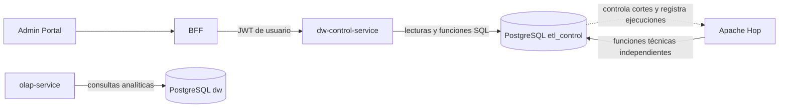

# DW-CONTROL-001 — Arquitectura y contratos de `dw-control-service`

**Estado:** contrato base de las issues #175–#181. La issue #177 implementa los comandos auditados de cierres y roles PostgreSQL mediante migración versionada; no se aplica a una base de datos desde este cambio.

## Objetivo y límites

`dw-control-service` expone las operaciones administrativas del DW: consultar cierres académicos, registrar solicitudes de cierre, autorizar su cierre o reapertura y consultar ejecuciones de Apache Hop. La base PostgreSQL del DW conserva el estado y la auditoría.

| Componente | Responsabilidad | Fuera de su límite |
| --- | --- | --- |
| Portal administrador | Interfaz, formularios y acciones permitidas al usuario. | Acceso directo al DW. |
| BFF | Sesión del portal, propagación de identidad y agregación de respuestas. | Ser la única capa que aplica autorización. |
| `dw-control-service` | API privada, autorización funcional, validación, consultas y comandos administrativos auditables. | Ejecutar o reintentar pipelines. |
| PostgreSQL DW (`etl_control`) | Fuente de verdad de cierres, transiciones, bitácora y estado de ejecuciones. | Decidir roles de usuario de Keycloak. |
| Apache Hop | Orquestar la extracción, transformación y publicación; registrar evidencia técnica mediante sus funciones autorizadas. | Autorizar cierres en nombre de DSA. |
| `olap-service` | Consultas analíticas sobre los datos publicados. | Administrar cierres y controles ETL. |



La API queda en la red interna y se consume desde el BFF. No se expondrán credenciales SQL ni endpoints de escritura del DW al navegador. `dw-control-service` valida nuevamente firma, emisor, audiencia, expiración y permisos del JWT recibido; el control del BFF no sustituye esa validación.

## Contrato REST v1

El borrador OpenAPI está en [`contracts/dw-control-service-v1.yaml`](contracts/dw-control-service-v1.yaml). Los comandos de cambio de estado son acciones explícitas y no un `PATCH status`, para que la intención y validación sean inequívocas.

| Operación | Permiso | Efecto |
| --- | --- | --- |
| `GET /api/v1/academic-closures` | `DW_CLOSURE_READ` | Lista paginada, filtrable por gestión, periodo y estado. |
| `GET /api/v1/academic-closures/{closureId}` | `DW_CLOSURE_READ` | Detalle del cierre y su versión actual. |
| `GET /api/v1/academic-closures/{closureId}/events` | `DW_CLOSURE_READ` | Bitácora inmutable, paginada en orden cronológico inverso. |
| `POST /api/v1/academic-closures` | `DW_CLOSURE_MANAGE` | Crea un cierre en `PENDIENTE`; no autoriza una carga. |
| `POST /api/v1/academic-closures/{closureId}/close` | `DW_CLOSURE_MANAGE` | Transiciona `PENDIENTE` o `REABIERTO` a `CERRADO`; exige fecha efectiva y motivo. |
| `POST /api/v1/academic-closures/{closureId}/reopen` | `DW_CLOSURE_MANAGE` | Transiciona `CERRADO` o `PROCESADO` a `REABIERTO`; exige motivo. |
| `GET /api/v1/etl/executions` | `DW_ETL_MONITOR_READ` | Lista ejecuciones con filtros y paginación. |
| `GET /api/v1/etl/executions/{runId}` | `DW_ETL_MONITOR_READ` | Detalle con pasos, métricas y errores saneados. |

No habrá operaciones HTTP para iniciar, cancelar o reintentar cargas en esta entrega. Esas operaciones pertenecen al contrato de orquestación de Hop y requieren una decisión posterior.

### Reglas comunes

- Paginación basada en `page` (base cero) y `size` (por defecto 20, máximo 100). Respuestas incluyen `items`, `page`, `size`, `totalElements` y `totalPages`.
- Ordenamiento solo por campos permitidos por endpoint; nunca interpolar un campo arbitrario en SQL.
- Respuestas de error usan `application/problem+json` (RFC 9457), con `type`, `title`, `status`, `detail` seguro, `instance` y `code` estable. No incluyen SQL, stack traces, credenciales, datos personales ni errores internos sin sanear.
- Códigos esperados: `400` validación/filtro inválido, `401` token ausente o inválido, `403` permiso insuficiente, `404` recurso no encontrado, `409` transición/duplicado/conflicto de estado, `429` límite excedido y `500/503` fallo interno o dependencia no disponible.
- El `actorSubject` siempre se deriva del `sub` del JWT validado. Se rechaza cualquier intento del cliente de enviar o reemplazar el actor.
- La base de datos serializa las transiciones con bloqueo de fila y valida el estado anterior. La API convierte la transición no permitida o el cierre duplicado en `409`.
- `PROCESADO` no es una acción de usuario: solo se registra después de una ejecución `EXITOSA` de Hop vinculada al mismo `closure_id`, conforme a la función SQL ya existente.
- Los errores de ejecución se devuelven saneados y limitados; la API omite `details` técnicos que puedan contener SQL, datos personales o secretos.

## Permisos de aplicación

Estos son permisos de aplicación, independientes de los roles PostgreSQL:

| Permiso | Capacidades |
| --- | --- |
| `DW_CLOSURE_READ` | Leer cierres y eventos. |
| `DW_CLOSURE_MANAGE` | Crear cierres pendientes, cerrar y reabrir. No concede consultas ETL automáticamente. |
| `DW_ETL_MONITOR_READ` | Consultar ejecuciones, pasos, métricas y errores saneados. |

El mapeo desde roles/grupos de Keycloak a estos permisos queda explícito para #175/#179; el inventario actual no define aún roles DW dedicados. No asumir `SUPERADMIN` como política de autorización dentro del servicio ni aceptar permisos declarados por el navegador. La política se resuelve desde claims de confianza del token validado y se prueba en el servicio.

## Roles objetivo en PostgreSQL

Los roles PostgreSQL son grupos `NOLOGIN`. TI/DBA crea identidades `LOGIN` distintas por ambiente, asigna membresías y gestiona secretos fuera del repositorio. Las migraciones `0023` y `0024` implementan lectura de cierres y comandos auditados; los roles de monitoreo siguen siendo objetivos para su alcance correspondiente.

| Rol de grupo | Lectura | Escritura/comandos | Asignación |
| --- | --- | --- | --- |
| `dw_control_reader` (implementado en 0023) | `etl_control.academic_period_closure` y `etl_control.academic_period_closure_event`. | Ninguna; no posee DML ni ejecución de funciones de transición. | Miembro de `dw_control_service`. |
| `dw_control_api` (implementado en 0024) | Ninguna. | `EXECUTE` solo en funciones para crear pendientes y cerrar/reabrir; sin DML directo. | Miembro de `dw_control_service`; no asignar a usuarios humanos. |
| `dw_control_service` (implementado en 0024) | Hereda `dw_control_reader`. | Hereda solo las funciones aprobadas de `dw_control_api`; sin DML directo. | Composición `NOLOGIN` asignada al login dedicado del servicio. |
| `dw_control_operator` (existente) | Permisos operativos actuales de cierres. | Compatibilidad/manual; revisar y retirar gradualmente `INSERT`/secuencia al migrar operadores a funciones. No asignar al login API. | Identidades operativas autorizadas durante la transición. |
| `dw_hop_runtime` (existente) | Evidencia técnica que necesita Hop. | Funciones técnicas Hop ya autorizadas, independiente del servicio. | Login de Apache Hop; nunca compartir con la API. |
| `dw_owner` (existente) | Propietario técnico. | DDL y funciones `SECURITY DEFINER`. | Migrador/administración, nunca runtime. |

### Contrato SQL implementado

La migración 0024 ofrece estas funciones, propiedad de `dw_owner`, con `SECURITY DEFINER`, `search_path` fijo (`pg_catalog, etl_control`) y ejecución revocada a `PUBLIC`:

```text
etl_control.create_academic_period_closure(
  p_gestion SMALLINT,
  p_periodo SMALLINT,
  p_actor_subject VARCHAR(255),
  p_reason TEXT
) RETURNS etl_control.academic_period_closure

etl_control.request_academic_period_closure_transition(
  p_closure_id BIGINT,
  p_to_status VARCHAR(16), -- solo CERRADO o REABIERTO
  p_actor_subject VARCHAR(255),
  p_reason TEXT,
  p_effective_at TIMESTAMPTZ DEFAULT NULL
) RETURNS etl_control.academic_period_closure
```

La migración `0024_add_academic_closure_commands.sql` implementa estas funciones. La de creación inserta `PENDIENTE` y el trigger escribe el evento inicial dentro de la misma transacción. La función de transición resuelve el `closure_id` a gestión/periodo, limita los estados invocables por la API a `CERRADO`/`REABIERTO` y delega las reglas de bloqueo y transición en `transition_academic_period_closure`; no expone `PROCESADO` ni acepta un `run_id`. La concesión de `dw_control_api` se limita a estas dos funciones. Hop conserva sus funciones técnicas y la transición a `PROCESADO` bajo su contrato independiente.

`dw-control-service` aplica autorización funcional antes de invocarlas: PostgreSQL registra el sujeto derivado del JWT validado, pero no valida por sí mismo el JWT. Los permisos directos `INSERT` y de secuencia que la migración actual otorga a `dw_control_operator` son estado existente; retirarlos requiere una migración hacia adelante y una transición de las operaciones manuales a la función de creación. No se cambia esa concesión como parte de la issue #177.

La conexión del servicio usa un LOGIN dedicado, normalmente `dw_control_runtime`, que recibe membresía únicamente en `dw_control_service`. No debe heredar `dw_owner`, `dw_publisher`, `dw_hop_runtime`, `dw_reader`, `dw_control_operator` ni otros roles de escritura. Las contraseñas de ese LOGIN se aprovisionan por ambiente como secretos, fuera de migraciones y del repositorio. Las transacciones de consulta se marcan `readOnly`; los permisos PostgreSQL mantienen la restricción aun si se omite esa indicación en la aplicación. La capacidad de ejecutar funciones SQL no reemplaza los permisos de aplicación: la API debe comprobar el permiso requerido en cada ruta.

## Estados y responsabilidades

La máquina de estados existente se mantiene: `PENDIENTE → CERRADO → PROCESADO`, con reapertura `CERRADO/PROCESADO → REABIERTO → CERRADO`. Solo DSA tiene autoridad funcional para crear, cerrar o reabrir. Hop conserva la responsabilidad técnica de registrar ejecución y resultado; la API no marca un corte `PROCESADO` por una acción administrativa.

El detalle de las funciones vigentes y reglas de elegibilidad permanece en [`academic-closure-calendar.md`](academic-closure-calendar.md) y [`execution-control.md`](execution-control.md). Esta especificación no modifica esas migraciones.

## Dependencias y entregables siguientes

1. **#175:** base Spring Boot/Java 21, validación JWT, autorización de permisos, health/readiness, OpenAPI y logging sin secretos.
2. **#176–#178:** adaptar consultas y comandos a este contrato; sanear errores ETL y mantener Hop como dueño de ejecución/publicación.
3. **#179:** cliente/rutas BFF con propagación de identidad y normalización del contrato.
4. **#180–#181:** interfaz administrativa para cierres y monitoreo de ejecuciones.

Los nombres y payloads de este contrato deben tratarse como baseline para esas issues. Cambios incompatibles requieren actualizar primero OpenAPI y esta documentación.
