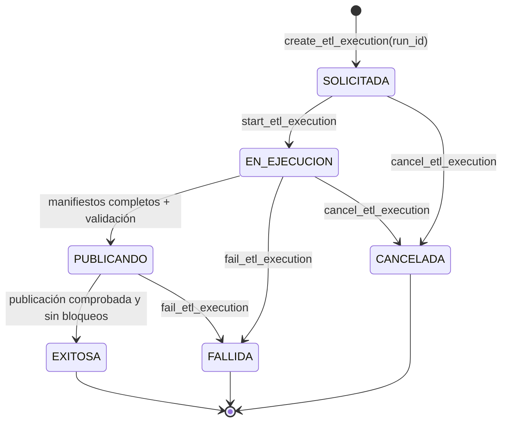
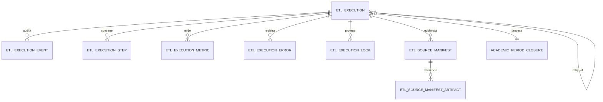

# Control de ejecuciones DW

DW-004 convierte `etl_control` en la bitácora técnica de cada carga del Data Warehouse. No ejecuta consultas contra Jachasun, no transforma datos y no publica dimensiones o hechos: conserva únicamente evidencia y aplica las reglas que impiden declarar exitosa una carga incompleta.

Para la issue #133, Apache Hop reutiliza este modelo en el flujo directo Jachasun → Hop → `dw`. No se crean tablas paralelas `etl_run`, `etl_log` ni `etl_error`. Véase [la base consolidada del MVP](mvp-direct-hop.md). Las migraciones 0010–0012 añaden gates, rol `dw_hop_runtime`, landing privado por ejecución, publisher atómico y aborto auditado. El workflow de publicación está implementado; los workflows de extracción y transformación son el siguiente requerimiento.

La interfaz y el preflight se especifican en el [contrato de ejecución Hop](hop-execution-contract.md). `create_hop_etl_execution` valida cierres, reintentos, mismo alcance y evita dos ejecuciones activas por cierre; `begin_hop_publication` exige lease vigente y exactamente los nueve manifiestos.

## Modelo y flujo



El diagrama representa una ejecución individual, identificada por un `run_id` que nunca se reutiliza. El paso de `EN_EJECUCION` a `PUBLICANDO` no supone que ya se hayan publicado datos: demuestra que la extracción documentada y la validación están completas. `EXITOSA` exige, adicionalmente, evidencia de un paso de publicación, manifiestos completos, ausencia de errores bloqueantes y locks liberados. Un reintento se registra como otra ejecución `REPROCESO` enlazada a la anterior mediante `retry_of_run_id`.



La relación con el cierre académico es opcional para permitir cargas históricas. Para una carga por cierre, el `closure_id` se conserva en la ejecución y, una vez que esta es `EXITOSA`, el operador autorizado puede marcar el cierre como `PROCESADO`. La clave foránea de `processed_run_id` se instala como `NOT VALID`: protege datos nuevos sin invalidar cierres antiguos registrados antes de DW-004.

## Entidades y evidencia

| Entidad | Responsabilidad |
| --- | --- |
| `etl_execution` | Solicitud, periodo/corte, estado y resultado de un `run_id`. |
| `etl_execution_event` | Transiciones inmutables con actor y motivo. |
| `etl_execution_step` | Fases de extracción, transformación, validación y publicación; `STAGING` queda disponible para compatibilidad histórica, no es obligatorio en el MVP. |
| `etl_execution_metric` | Conteos y métricas extensibles, opcionalmente asociadas a un paso. |
| `etl_execution_error` | Código, causa, mensaje, severidad y referencia al paso que falló. |
| `etl_execution_lock` | Lease exclusivo por recurso; un recurso no admite dos locks activos. |
| `etl_source_manifest` | Contrato fuente, orden estable, periodo/corte, conteo y hashes de extracción. |
| `etl_source_manifest_artifact` | Referencia y SHA-256 de evidencia histórica u opcional; no requiere generar archivos RAW para el MVP directo. |

Los hashes SHA-256 son hexadecimales en minúscula. Las URI de artefactos no pueden incluir credenciales embebidas. Los detalles JSON no deben contener datos personales, secretos, SQL con valores sensibles ni contenido de archivos; solo metadatos técnicos saneados.

## Roles y operación

La matriz describe los grants existentes de DW-004. No implica que Hop deba asumir todos los roles históricos: se definirán por nueva migración los permisos estrictamente necesarios de su cuenta, preservando la separación con la autorización DSA de cierres.

| Rol de grupo | Acceso DW-004 |
| --- | --- |
| `dw_staging_writer` | Rol legado del diseño Load Manager; no asignar al Hop directo del MVP. |
| `dw_transformer` | Consulta el control y registra pasos, métricas, errores o fallos de transformación. |
| `dw_publisher` | Rol legado con DML DW; no asignar al runtime Hop. |
| `dw_hop_runtime` | Grupo `NOLOGIN`: consulta de evidencia y funciones Hop de control/landing; no tiene DML directo sobre tablas DW, `etl_work` o `etl_control`. Solo `publish_hop_staged_run` puede escribir datos DW bajo `dw_owner`. |
| `dw_control_operator` | Consulta auditoría y mantiene la autorización de cierres académicos mediante la función existente. |
| `dw_owner` | Propietario técnico de tablas, funciones y administración DDL. |

El login de Hop no debe recibir DML directo sobre tablas de control o DW. `dw_hop_runtime` usa funciones `SECURITY DEFINER` con `search_path` fijo. TI/DBA debe asignar al login del ambiente este grupo dedicado, no `dw_publisher` ni `dw_staging_writer`. `PUBLIC` no recibe acceso.

## Límite con otras issues

DW-004 define la entidad lock; 0010 añade lease con adquisición, renovación, liberación y recuperación de expirados. 0011 revalida y bloquea el lease dentro de la transacción de publicación; 0012 audita la salida fallida y libera el lease mediante token. No depende del coordinador Go. Cron, API/BFF y Load Manager quedan fuera del MVP.

El gate SQL Hop comprueba el catálogo de nueve fuentes y los reintentos usan otro `run_id`. El publisher sustituye hechos/dimensiones dentro de una sola transacción; un rechazo en cualquier paso revierte la publicación completa y mantiene visible la versión anterior. Las pruebas SQL cubren éxito, fallo por restricción, recuperación del estado y conservación de la publicación previa. Falta probar el flujo ETL integral contra Hop en el requerimiento 6.

## Validación local

```powershell
docker compose -f infra/dw-schema/dw-test-docker.yml up --build --abort-on-container-exit
docker compose -f infra/dw-schema/dw-test-docker.yml ps -a
docker compose -f infra/dw-schema/dw-test-docker.yml logs dw-schema-test
```

La evidencia esperada es `dw-schema-test` con `Exited (0)`. La suite aplica las migraciones dos veces, conserva un cierre legado, prueba la máquina de estados, verifica permisos mínimos y ejecuta dos sesiones PostgreSQL para comprobar la exclusión del lock activo.
