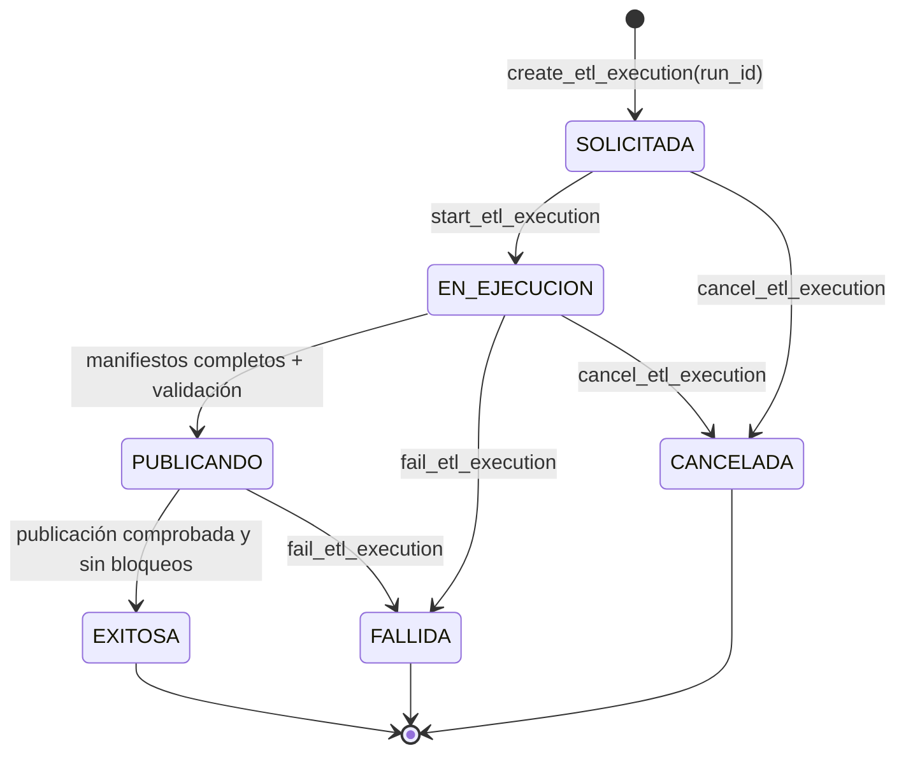
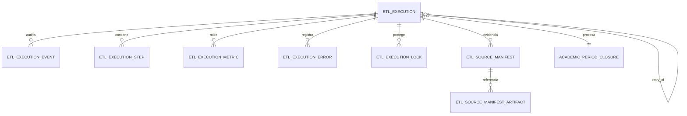

# Control de ejecuciones DW

DW-004 convierte `etl_control` en la bitácora técnica de cada carga del Data Warehouse. No ejecuta consultas contra Jachasun, no transforma datos y no publica dimensiones o hechos: conserva únicamente evidencia y aplica las reglas que impiden declarar exitosa una carga incompleta.

## Modelo y flujo



El diagrama representa una ejecución individual, identificada por un `run_id` que nunca se reutiliza. El paso de `EN_EJECUCION` a `PUBLICANDO` no supone que ya se hayan publicado datos: demuestra que la extracción documentada y la validación están completas. `EXITOSA` exige, adicionalmente, evidencia de un paso de publicación, manifiestos completos, ausencia de errores bloqueantes y locks liberados. Un reintento se registra como otra ejecución `REPROCESO` enlazada a la anterior mediante `retry_of_run_id`.



La relación con el cierre académico es opcional para permitir cargas históricas. Para una carga por cierre, el `closure_id` se conserva en la ejecución y, una vez que esta es `EXITOSA`, el operador autorizado puede marcar el cierre como `PROCESADO`. La clave foránea de `processed_run_id` se instala como `NOT VALID`: protege datos nuevos sin invalidar cierres antiguos registrados antes de DW-004.

## Entidades y evidencia

| Entidad | Responsabilidad |
| --- | --- |
| `etl_execution` | Solicitud, periodo/corte, estado y resultado de un `run_id`. |
| `etl_execution_event` | Transiciones inmutables con actor y motivo. |
| `etl_execution_step` | Fases de extracción, staging, transformación, validación o publicación. |
| `etl_execution_metric` | Conteos y métricas extensibles, opcionalmente asociadas a un paso. |
| `etl_execution_error` | Código, causa, mensaje, severidad y referencia al paso que falló. |
| `etl_execution_lock` | Lease exclusivo por recurso; un recurso no admite dos locks activos. |
| `etl_source_manifest` | Contrato fuente, orden estable, periodo/corte, conteo y hashes de extracción. |
| `etl_source_manifest_artifact` | Referencia y SHA-256 de evidencia producida por un manifiesto. |

Los hashes SHA-256 son hexadecimales en minúscula. Las URI de artefactos no pueden incluir credenciales embebidas. Los detalles JSON no deben contener datos personales, secretos, SQL con valores sensibles ni contenido de archivos; solo metadatos técnicos saneados.

## Roles y operación

| Rol de grupo | Acceso DW-004 |
| --- | --- |
| `dw_staging_writer` | Consulta cierres elegibles, crea e inicia ejecuciones; registra manifiestos, artefactos, pasos, métricas y errores de extracción. |
| `dw_transformer` | Consulta el control y registra pasos, métricas, errores o fallos de transformación. |
| `dw_publisher` | Consulta el control, registra evidencia de publicación e invoca las transiciones a `PUBLICANDO` y `EXITOSA`. |
| `dw_control_operator` | Consulta auditoría y mantiene la autorización de cierres académicos mediante la función existente. |
| `dw_owner` | Propietario técnico de tablas, funciones y administración DDL. |

Los roles operativos no reciben DML directo sobre las tablas DW-004. Las operaciones permitidas se exponen como funciones `SECURITY DEFINER` con `search_path` fijo. `PUBLIC` no recibe acceso a esquemas, tablas, secuencias ni funciones de control.

## Límite con otras issues

DW-004 define el contrato persistente del lock y su exclusión mediante un índice parcial. DW-013 implementará el coordinador, la renovación de leases, la recuperación de locks vencidos y las decisiones de reintento. DW-004 tampoco implementa el scheduler (DW-014), el Load Manager (DW-009), la expansión del aterrizaje RAW a todas las fuentes aprobadas (DW-012), Apache Hop ni la API/BFF. La vertical `uatf_datos` de DW-009 incluye solo la tabla RAW mínima necesaria para validar extracción, snapshot y manifiesto; no sustituye el alcance general de DW-012.

## Validación local

```powershell
docker compose -f infra/dw-schema/dw-test-docker.yml up --build --abort-on-container-exit
docker compose -f infra/dw-schema/dw-test-docker.yml ps -a
docker compose -f infra/dw-schema/dw-test-docker.yml logs dw-schema-test
```

La evidencia esperada es `dw-schema-test` con `Exited (0)`. La suite aplica las migraciones dos veces, conserva un cierre legado, prueba la máquina de estados, verifica permisos mínimos y ejecuta dos sesiones PostgreSQL para comprobar la exclusión del lock activo.
