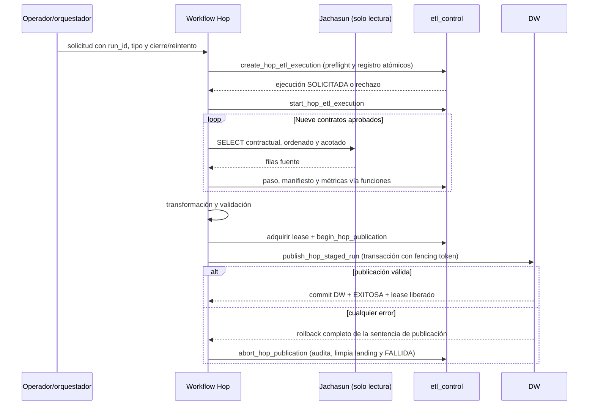

# Contrato de ejecución ETL en Apache Hop

Este documento fija la interfaz de ejecución del workflow `dss-uatf-etl`. Las migraciones 0010–0012 exponen funciones limitadas para control, landing privado y publicación atómica; no conceden DML directo a Hop sobre las tablas dimensionales.

## Solicitud y actor

| Entrada | Regla |
| --- | --- |
| `P_RUN_ID` | UUID nuevo por intento, generado por el solicitante/orquestador y propagado sin cambios. Un reintento siempre usa otro UUID. |
| `P_EXECUTION_KIND` | `HISTORICA`, `CIERRE_ACADEMICO` o `REPROCESO`. |
| `P_CLOSURE_ID` | Obligatorio para `CIERRE_ACADEMICO` y para un reproceso de cierre; nulo en la carga histórica global. |
| `P_RETRY_OF_RUN_ID` | Obligatorio solo para `REPROCESO`; identifica un intento terminal y nunca se reutiliza como `run_id`. |
| `P_REQUEST_REASON` | No vacío; queda en el evento `SOLICITADA`. |
| Actor técnico | PostgreSQL `session_user`, el login del runtime Hop. No confiar en un parámetro de texto libre para identificar al actor. |

En el MVP manual, la identidad de base de datos identifica el servicio Hop, no a quien hizo clic. DSA mantiene la autoridad de cierre en `academic_period_closure_event`; una carga histórica requiere autorización funcional independiente. Hop no debe inventar una identidad humana. El futuro generador de solicitud debe producir un UUID4 por intento; ver [Generate Random Value](https://hop.apache.org/manual/latest/pipeline/transforms/generaterandomvalue.html).

## Preflight atómico

El workflow llama `create_hop_etl_execution` antes de consultar OLTP y `start_hop_etl_execution` antes de iniciar las fases:

- `CIERRE_ACADEMICO`: el cierre debe existir, estar `CERRADO`, haber llegado a `effective_at` y no tener procesamiento vigente. Gestión, periodo y corte se copian de la fila autorizada, no de parámetros del operador.
- `REPROCESO`: el intento padre debe estar `EXITOSA`, `FALLIDA` o `CANCELADA` y el nuevo `run_id` se enlaza a él. Si corresponde a un cierre, debe conservar su `closure_id`; ante publicación previa, el periodo debe haberse reabierto y vuelto a cerrar después de esa publicación.
- `HISTORICA`: no tiene cierre implícito. Gestión/periodo se entregan como par o ambos nulos y requieren autorización funcional previa.

La función registra la identidad real de conexión (`session_user`) y el motivo de solicitud. El workflow no debe comenzar extracción si el preflight o el inicio fallan.

## Secuencia del workflow

Hop debe usar únicamente funciones autorizadas: `create_hop_etl_execution`, `start_hop_etl_execution`, `register_etl_execution_step`, `record_etl_execution_metric`, `record_etl_execution_error`, `register_etl_source_manifest`, `acquire_hop_publication_lock`, `renew_hop_publication_lock`, `release_hop_publication_lock`, `begin_hop_publication` y `fail_hop_etl_execution`. `assert_hop_source_manifests` es interna. El workflow no hace `INSERT`, `UPDATE` o `DELETE` directo en `etl_control`.

## Manifiestos y publicación

`begin_hop_publication` exige el token de un lease vigente y llama `assert_hop_source_manifests`. Este gate verifica que para el `run_id` existan exactamente estos nueve contratos, cada uno una sola vez, completos y con conteo y hash de esquema:

| ID del contrato | Objeto origen | Orden estable |
| --- | --- | --- |
| `public.uatf_datos` | `public.uatf_datos` | `id_ra` |
| `academico.alumnos` | `academico.alumnos` | `id_alumno` |
| `public.postulantes` | `public.postulantes` | `id_gestion, id_periodo, id_alumno` |
| `academico.alm_programas` | `academico.alm_programas` | `id_programa` |
| `academico.pln_materias` | `academico.pln_materias` | `id_materia` |
| `academico.notas_planilla` | `academico.notas_planilla` | `id_matricula` |
| `academico.alm_programas_facultades` | `academico.alm_programas_facultades` | `id_facultad` |
| `public.prs_colegios` | `public.prs_colegios` | `id_colegio` |
| `public.lugar_localidad` | `public.lugar_localidad` | `cod_loc` |

El manifiesto guarda versión de contrato, SHA-256 de SQL canónico y esquema observado, corte, orden y conteo. El gate relacional no prueba que el workflow haya leído ni validado realmente las filas o los archivos: Hop debe verificar origen, tipos, nulos, cardinalidad, hashes de artefactos y reglas de calidad antes de registrar `COMPLETO`.

`dw_hop_runtime` no puede invocar `complete_etl_execution`, la transición genérica de publicación ni hacer DML sobre las tablas DW. `wf_hop_publish_staged_run.hwf` solo publica datos ya preparados por las funciones `stage_hop_publication_row` y `seal_hop_publication_batch`; rechaza lotes ausentes, alterados o de conteo distinto. El publisher valida y bloquea la fila del lease/fencing token dentro de la transacción que reemplaza hechos y actualiza dimensiones. Por MVCC, el conjunto anterior permanece visible hasta commit; cualquier error revierte la operación completa. El workflow llama luego `abort_hop_publication`, que audita el fallo, libera solo el lease identificado por el token y elimina las filas del landing fallido. No conectar pipelines de negocio directamente a `dw`.

## Locks, errores y roles

La migración 0010 agrega lease global `dw:mvp-publication` con adquisición, renovación y liberación transaccionales. Al recuperar un lease vencido, se registra el error y la ejecución activa anterior se marca fallida antes de adquirir un nuevo lease. El futuro publisher debe revalidar el token dentro de la transacción de publicación para impedir que un propietario antiguo publique después de vencer su lease.

El rol `dw_hop_runtime` es `NOLOGIN`, puede consultar evidencia de ejecución y ejecutar solo las funciones listadas. No recibe DML directo en `etl_control` ni `dw`, ni permisos de finalización exitosa. TI/DBA crea un LOGIN por ambiente y lo asigna al grupo fuera del repositorio. No utilizar `dw_owner`, el login migrador ni `dw_staging_writer`. Los secretos nunca se versionan. El responsable confirmó el login OLTP de solo lectura; al desplegar cada ambiente se verifican sus grants efectivos y endpoint.

En cualquier fallo, el workflow debe registrar paso/error saneado y llamar `fail_hop_etl_execution` con timeout de limpieza. No registrar datos personales, secretos ni SQL con valores sensibles. Un fallo al auditar también debe formar parte del resultado operativo.

## Estado implementado y operación

El contrato está implementado en las migraciones y workflows de la issue #133. La integración Docker ejecuta el flujo E2E de nueve fuentes, transformaciones, cinco dimensiones, tres hechos, gates y publicación atómica; las pruebas también cubren rutas de fallo y regresiones del publisher. La issue fue fusionada en la PR #142 y cerrada.

El acceso OLTP de solo lectura fue confirmado por el responsable del proyecto. Antes de ejecutar en un ambiente productivo, TI/DBA provisiona las credenciales runtime restringidas y valida endpoint/grants; DSA autoriza el cierre o la carga histórica correspondiente. No se debe usar el usuario migrador ni inferir que el entorno de pruebas constituye autorización productiva.
