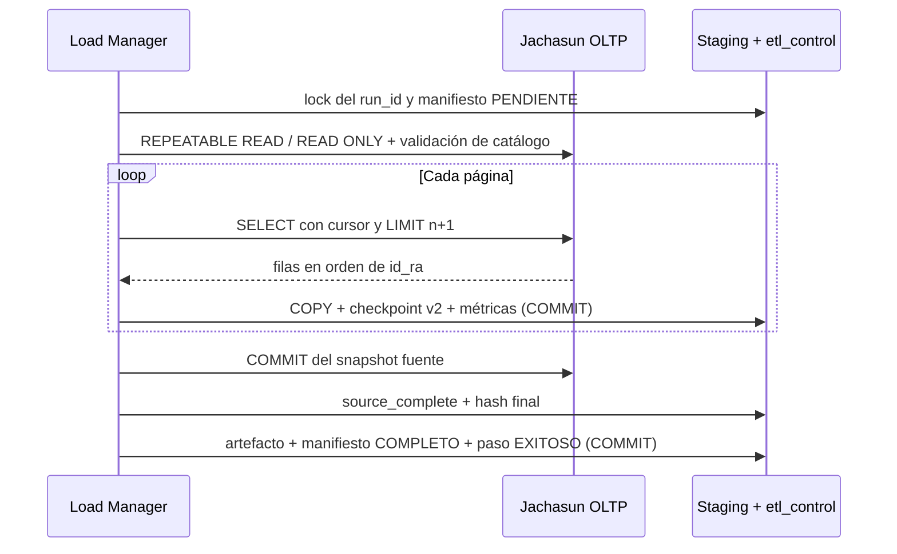

# DW-011 — Snapshot paginado de `public.uatf_datos`

> Implementación conservada para el futuro y pausada en el MVP de #133. Este documento no define su ruta activa ni impone dependencia de Go/RAW. La arquitectura vigente se describe en [mvp-direct-hop.md](mvp-direct-hop.md); el código y sus migraciones se conservan sin cambios.

## Contrato y límites

El primer extractor solo cubre `public.uatf_datos` → `staging.raw_uatf_datos`. La consulta SQL parametrizada se compara contra el SHA-256 de la versión DW-001 aprobada; añadir filtros o cambiar la proyección exige otra versión. Antes de leer filas, se inspeccionan catálogo PostgreSQL, tipos, longitudes, nulabilidad, colación y un índice único válido de `id_ra`. La excepción de fixture para `id_colegio` e `id_loc` (`integer` en vez de `smallint`) no aprueba esos tipos en producción: TI/DBA debe confirmarlos en Jachasun. La cuenta fuente es de solo lectura.

Una sola extracción por proceso toma un slot y un advisory lock por `run_id`; el lock usa un pool distinto del de escritura DW y conserva la clave anterior. No hay cron, API de ejecución ni leases entre procesos en DW-011. La transacción OLTP es `REPEATABLE READ, READ ONLY`, con duración total, timeout de consulta e inactividad configurables. El filtro `id_ra > $1`, el orden `ORDER BY id_ra ASC` y el índice único emplean la semántica de colación PostgreSQL; Go solo detecta igualdad adyacente, sin imponer orden binario. El lote trae `n+1` filas para identificar duplicados en el borde. `id_ra`, `estado_civil` y `_modificado` nulos, o una clave duplicada, hacen fallar el snapshot.

## Persistencia y estados

Cada lote confirma `COPY` RAW, checkpoint v2 (cursor, conteos, bytes y número de lote) y métricas en una transacción DW. El SHA-256 total se calcula durante una sola lectura de la fuente y se conserva al llegar a `source_complete`. Una fila RAW nueva debe tener los campos obligatorios; `dw_staging_writer` solo puede `SELECT`/`INSERT` en RAW. La migración `0007` agrega la restricción `NOT VALID` para no borrar ni reescribir filas históricas incompatibles; su validación global requiere auditoría previa. `0001`–`0006` no se modifican.

El diagrama separa dos confirmaciones: primero la lectura OLTP termina y se marca `source_complete`; después se publica **solo la evidencia** de extracción. Si se pierde la confirmación de esa última transacción, la reconciliación consulta DW y finaliza el manifiesto sin abrir otra lectura OLTP. Una caída antes de `source_complete` deja una lectura parcial: el run se marca `FALLIDA`, su manifiesto `FALLIDO` y se crea un `REPROCESO` con otro `run_id`. Los RAW confirmados del intento anterior se conservan para auditoría, pero nunca se publican como snapshot completo. Una ejecución v1 completa sigue consultable; una v1 parcial no se reanuda.

Los errores de fase, paso, manifiesto y ejecución se registran juntos con un contexto de limpieza acotado. Si el destino también está caído, el error devuelto incluye que la auditoría no pudo confirmarse. Los logs y métricas incluyen `run_id`, fase, lote, conteos y duraciones, nunca valores personales ni credenciales. `RecoverInterruptedRun` es una operación interna, no un endpoint público: exige el actor y los parámetros originales y solo opera una vez libre el lock.

## Despliegue y aceptación

Detener primero procesos antiguos; reconciliar sus runs parciales; aplicar `0007` con el runner idempotente; comprobar permisos; arrancar el binario nuevo. Antes de crear checkpoints v2 puede revertirse el binario; después corresponde corregir hacia adelante o restaurar un respaldo. No se borra RAW ni historial. El script local ejecuta siempre el migrador y solo siembra fixtures faltantes. La imagen final incluye YAML no secreto y la consulta versionada.

Las pruebas sintéticas históricas cubren migración limpia/repetida, permisos, snapshots completos, recuperación y concurrencia. Este servicio quedó pausado para priorizar el MVP directo con Apache Hop; no se activa ni se amplía como parte de la issue #133. Si se retoma, requiere una nueva decisión de alcance, revisión del plan de migración y validación del contrato/performance antes de producción.

En el fixture de 2 002 filas, una página acotada de 257 filas con cursor `id_ra > 'V000000500'` usó `Index Scan using uatf_datos_pkey`, 6 buffers compartidos y 0,106 ms de ejecución (`EXPLAIN (ANALYZE, BUFFERS)`). Esto valida la forma de la consulta local, **no** representa el costo ni la duración de una transacción larga en Jachasun real.
