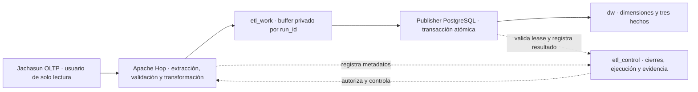

# DW_MVP-001 — Base consolidada del MVP directo

Decisión de alcance para la [issue #133](https://github.com/KEVIN-117/dss-system-architecture/issues/133). Esta guía consolida la base existente y el trabajo pendiente; no acredita que el ETL directo esté implementado ni aprobado para producción.

## Arquitectura activa

**Interpretación:** Hop lee exclusivamente las nueve fuentes contractuales. Prepara las filas por `run_id` en el buffer privado `etl_work`; el publisher las valida y sustituye el corte en `dw` dentro de una transacción atómica. `etl_control` aporta autorización, locks y auditoría. El buffer privado no es una zona de consumo ni una etapa de extracción desde OLTP.

### Límite del staging en el MVP

- **Pausado:** el staging de extracción del Load Manager en Go, incluidas las escrituras nuevas a `staging.raw_*`, los checkpoints del extractor y los artefactos JSONL/gzip. Se conserva su código, esquema e historial para una evolución futura.
- **Activo y sin rediseño:** `etl_work.hop_publication_row` y sus lotes son el buffer transaccional privado que ya utiliza el publisher de Hop. Las pipelines lo alimentan exclusivamente mediante las funciones autorizadas; el runtime no tiene DML directo sobre `etl_work`.
- **Publicación:** `publish_hop_staged_run` continúa siendo la única ruta que escribe las tablas visibles de `dw`, validando los lotes y ejecutando el cambio dentro de una transacción. Un fallo no publica una carga parcial.

Por tanto, “ETL directo Jachasun → Hop → DW” significa que no se implementa el microservicio Go ni una capa RAW de extracción para transportar los datos. No significa eliminar el buffer privado que necesita el publisher atómico.

## Base física que se conserva

| Migración existente | Responsabilidad | Uso en el MVP |
| --- | --- | --- |
| `0001_create_academic_closure_calendar.sql` | Calendario y eventos de cierres DSA | Autorizar cortes y auditar reaperturas. |
| `0002_create_analytical_layers_and_roles.sql` | Esquemas, propietarios, roles e historial de migraciones | Reutilizar `dw`, `etl_control`, propiedad y runner. |
| `0003_create_execution_control.sql` | Ejecuciones, pasos, errores, locks y manifiestos | Reutilizar el control desde Hop. |
| `0004_create_conformed_dimensions.sql` | Cinco dimensiones y miembros técnicos | Base física dimensional, sin recrearla con nombres alternativos. |
| `0005`–`0007` | RAW histórico y endurecimiento del extractor anterior | Conservar inmutables; no forman parte del flujo de datos del MVP. |
| `0008_add_student_scd2_versions.sql` | Vigencias e identidad temporal para `dim_estudiante` | Requisito para asignar la versión dimensional según fecha efectiva. |
| `0009_create_constellation_facts.sql` | Tres tablas de hechos, granos, FKs, restricciones e índices | Destino físico de la carga posterior de Hop. |
| `0010_add_hop_execution_gates.sql` | API de preflight, manifiestos exactos, leases de publicación y grupo `dw_hop_runtime` | Base de control para Hop; no transforma ni publica datos de negocio. |
| `0011_create_hop_atomic_publisher.sql` | Buffer privado por `run_id` en `etl_work`, sellado SHA-256 canónico y publisher transaccional con fencing token | Única ruta autorizada que sustituye el corte DW y finaliza un run exitoso. |
| `0012_add_hop_publication_abort.sql` | Salida de error con token, error/paso auditables, lease liberado, limpieza del landing y estado FALLIDA | La ruta de fallo no escribe en DW y conserva la publicación previa. |
| `0013`–`0015` | Contratos de ejecución y preparación segura de dimensiones SCD2 y hechos de admisión/cursado | Extensiones controladas para el workflow Hop. |
| `0016_add_hop_retention_fact_preparation.sql` | Cálculo de retención/deserción desde el lote privado de cursado y gate de staging completo | Prepara el tercer hecho antes de invocar la publicación atómica. |

Los esquemas adicionales creados por `0002` permanecen físicamente presentes; no son etapas del flujo activo. No se cambia ninguna migración existente ni se eliminan objetos o datos de una base desplegada. Retirar los borradores locales `0000_create_schemas.sql`, `0008_create_dw_model.sql` y `0009_create_etl_control_model.sql` no equivale a revertir DDL ya ejecutado. Si alguno fue aplicado manualmente, TI/DBA deberá inventariar objetos e historial antes de continuar; no se borrarán automáticamente.

## Modelo del MVP y ubicación de los hechos

Las dimensiones existentes son `dw.dim_estudiante`, `dw.dim_programa`, `dw.dim_materia`, `dw.dim_periodo_academico` y `dw.dim_admision`. Se mantienen sus surrogate keys y miembros `UNKNOWN = -1` y `NOT_APPLICABLE = 0`.

| Hecho creado; carga pendiente | Grano y trazabilidad | Fuente / derivación |
| --- | --- | --- |
| `dw.fact_admision` | Registro por `public.postulantes.id_alumno`; el DDL local declara unicidad, pendiente de confirmación en instancia real antes de producción. | `public.postulantes`. |
| `dw.fact_cursado` | Intento por `notas_planilla.id_matricula`, con grupo degenerado. | `academico.notas_planilla` y dimensiones conformadas. |
| `dw.fact_retencion_desercion` | Estudiante, programa y periodo cerrado. | Cursado publicado y secuencia de cierres DSA. |

El DDL de los hechos está en `infra/dw-schema/migrations/0009_create_constellation_facts.sql`. La migración `0008_add_student_scd2_versions.sql` implementa el prerrequisito temporal de estudiante. El runner aplica ambas antes de las cargas Hop; el orden y los SHA-256 registrados preservan la inmutabilidad.

Las migraciones definen columnas del diccionario, PK, FKs a las surrogate keys de `0004`, claves operacionales, `run_id` vinculado a `etl_control.etl_execution`, restricciones del grano e índices. `fact_cursado` aplica unicidad a `id_matricula`; retención aplica unicidad estudiante/programa/periodo y valida el cierre. La migración `0015` alinea admisión a `UNIQUE (id_alumno)` observado en el DDL local. `run_id` es linaje, no una clave para permitir duplicar el mismo hecho en cada reintento. Las tres preparaciones de hechos usan el landing privado; el workflow completo requiere todavía regresión Docker antes de considerarse validado.

El [modelo dimensional](dimensional-model.md) sigue siendo la definición de medidas y agregaciones. Sin siguiente periodo cerrado, retención será `NO_EVALUABLE` y `es_desercion = NULL`, fuera de tasas y entrenamiento. No se inventan ceros ni se mezclan granos.

### Fuera del MVP

- `fact_enrollment`: se pospone. Indicadores de matriculados administrativos no se inferirán de notas o postulaciones; requerirán fuente, contrato y grano propios antes de incorporarse.
- `fact_graduation`: se pospone su DDL y carga. La fuente oficial indicada por el responsable del proyecto es `actas_graduacion.graduados`; queda registrada para el análisis futuro. Falta resolver el significado del evento/estado válido y su correspondencia temporal con el periodo académico. Una fecha de graduación no demuestra por sí sola un código de periodo. La existencia de acceso a la fuente no sustituye esas decisiones.
- Estas fuentes no amplían los nueve contratos DW-001 ni los permisos OLTP del MVP. No se usa `alumnos.fec_egreso` como sustituto automático de una graduación oficial. Su calidad y los estados académicos siguen requiriendo aprobación para los denominadores de retención.

## ETL_CONTROL reutilizable por Hop

| Entidades existentes | Uso |
| --- | --- |
| `schema_migration` | Versión, archivo y SHA-256 normalizado de migraciones. |
| `academic_period_closure`, `academic_period_closure_event` | Autorización DSA y transiciones auditables. |
| `etl_execution`, `etl_execution_event` | Identidad del intento, estado, actor y reintento enlazado. |
| `etl_execution_step`, `etl_execution_metric`, `etl_execution_error` | Evidencia por fase, conteos y fallos saneados. |
| `etl_source_manifest` | Contrato/versiones, consulta/esquema, orden, corte y conteo de cada fuente. |
| `etl_execution_lock` | Lease global de publicación; 0010 lo adquiere y 0011 revalida y bloquea su fila durante el publish. |
| `etl_source_manifest_artifact` | Se conserva para evidencia histórica/opcional; no exige archivos en el flujo directo. |

No se crean `etl_run`, `etl_log` ni `etl_error` paralelos. El grupo `dw_hop_runtime` invoca una API de control dedicada, sin DML directo en control o DW ni facultad de declarar `EXITOSA`. Las fases activas serán `EXTRACCION`, `TRANSFORMACION`, `VALIDACION` y `PUBLICACION`; no es necesario un paso `STAGING` por el mero hecho de que el modelo lo permita.

Se conservan los gates de DW-004: validación exitosa, manifiestos completos y ausencia de errores bloqueantes antes de `PUBLICANDO`; publicación exitosa y ausencia de locks activos antes de `EXITOSA`. `begin_hop_publication` añade el gate del lease y el conjunto exacto de nueve fuentes. Un cierre pasa a `PROCESADO` únicamente con una ejecución `EXITOSA` asociada al mismo cierre.

## Permisos, consistencia y publicación

- TI/DBA provisiona cuentas `LOGIN` externas. La lectura Jachasun mantiene únicamente `CONNECT`, `USAGE` y `SELECT` sobre las fuentes aprobadas; no se amplía a graduación o matrícula.
- `dw_hop_runtime` es el grupo dedicado a Hop: lectura de evidencia y funciones de control/landing únicamente. No tiene DML directo sobre `dw` ni acceso directo a `etl_work`; las filas de preparación entran por API y solo el publisher SECURITY DEFINER escribe dimensiones/hechos.
- La autorización funcional DSA puede ser manual en el MVP; una futura API/BFF no es requisito para ejecutar Hop. El actor declarado en una función SQL no prueba por sí solo esa autorización.
- Un `run_id` común no garantiza snapshot compartido entre conexiones JDBC. La lectura multisource todavía requiere política de corte y validación operativa. La sustitución del conjunto DW sí es atómica: PostgreSQL MVCC conserva el conjunto anterior hasta el commit; una excepción revierte deletes, upserts, cierre de lease y éxito.
- Reintentar exige un nuevo `run_id` y volver a leer OLTP para preparar un nuevo buffer privado; el buffer no es un checkpoint de extracción ni permite reanudar una lectura parcial. Un fallo no debe dejar datos parciales visibles ni alterar el corte ya publicado.

## Estado y siguientes validaciones

1. El workflow de 6.2–6.7 pasó el compose de integración: nueve fuentes, cinco dimensiones, tres hechos, readiness gate y publisher atómico.
2. Añadir o completar casos E2E adicionales de fallo de transformación/publicación, reintento con nuevo `run_id` y conservación del corte anterior; la ejecución feliz ya está verificada.
3. Confirmar con DSA/TI los contratos reales, volúmenes, unicidad de postulantes, semántica de notas y fiabilidad de `fec_egreso`; no inferir graduaciones automáticamente.
4. La carga histórica completa 2000–2025 requiere validar la secuencia de cierres, el baseline SCD2 y la estrategia operativa antes de ejecutarse.

La implementación del flujo vertical y la migración `0016` están probadas únicamente contra bases y fixtures sintéticos. Esto no cambia permisos ni datos desplegados en Jachasun y no sustituye la aprobación DSA/TI; las suites históricas se conservan como regresión.
