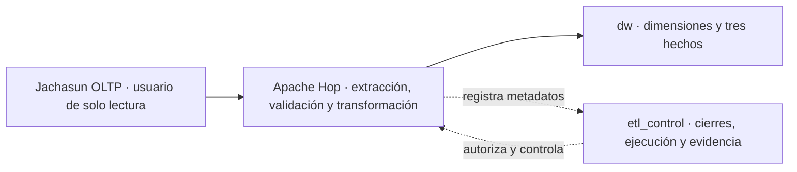

# DW_MVP-001 — Base consolidada del MVP directo

Decisión de alcance para la [issue #133](https://github.com/KEVIN-117/dss-system-architecture/issues/133). Esta guía consolida la base existente y el trabajo pendiente; no acredita que el ETL directo esté implementado ni aprobado para producción.

## Arquitectura activa

**Interpretación:** Hop lee exclusivamente las nueve fuentes contractuales y carga el modelo dimensional en `dw`. `etl_control` es control lateral, no una capa por la que circulan los datos de negocio. No hay dependencia activa de Load Manager, `raw-verify`, archivos JSONL/gzip, `staging` ni `etl_work`. La implementación Go y sus datos históricos se conservan para una evolución futura, sin eliminarlos.

## Base física que se conserva

| Migración existente | Responsabilidad | Uso en el MVP |
| --- | --- | --- |
| `0001_create_academic_closure_calendar.sql` | Calendario y eventos de cierres DSA | Autorizar cortes y auditar reaperturas. |
| `0002_create_analytical_layers_and_roles.sql` | Esquemas, propietarios, roles e historial de migraciones | Reutilizar `dw`, `etl_control`, propiedad y runner. |
| `0003_create_execution_control.sql` | Ejecuciones, pasos, errores, locks y manifiestos | Reutilizar el control desde Hop. |
| `0004_create_conformed_dimensions.sql` | Cinco dimensiones y miembros técnicos | Base física dimensional, sin recrearla con nombres alternativos. |
| `0005`–`0007` | RAW histórico y endurecimiento del extractor anterior | Conservar inmutables; no forman parte del flujo de datos del MVP. |
| `0008_add_student_scd2_versions.sql` | Vigencias e identidad temporal para `dim_estudiante` | Requisito para asignar la versión dimensional según fecha efectiva. |
| `0009_create_constellation_facts.sql` | Tres tablas de hechos, granos, FKs, restricciones e índices | Destino físico de la carga posterior de Hop. |
| `0010_add_hop_execution_gates.sql` | API de preflight, manifiestos exactos, leases de publicación y grupo `dw_hop_runtime` | Base de control para Hop; no transforma ni publica datos de negocio. |
| `0011_create_hop_atomic_publisher.sql` | Lotes privados por `run_id`, sellado SHA-256 canónico y publisher transaccional con fencing token | Única ruta autorizada que sustituye el corte DW y finaliza un run exitoso. |
| `0012_add_hop_publication_abort.sql` | Salida de error con token, error/paso auditables, lease liberado, limpieza del landing y estado FALLIDA | La ruta de fallo no escribe en DW y conserva la publicación previa. |

Los esquemas adicionales creados por `0002` permanecen físicamente presentes; no son etapas del flujo activo. No se cambia ninguna migración existente ni se eliminan objetos o datos de una base desplegada. Retirar los borradores locales `0000_create_schemas.sql`, `0008_create_dw_model.sql` y `0009_create_etl_control_model.sql` no equivale a revertir DDL ya ejecutado. Si alguno fue aplicado manualmente, TI/DBA deberá inventariar objetos e historial antes de continuar; no se borrarán automáticamente.

## Modelo del MVP y ubicación de los hechos

Las dimensiones existentes son `dw.dim_estudiante`, `dw.dim_programa`, `dw.dim_materia`, `dw.dim_periodo_academico` y `dw.dim_admision`. Se mantienen sus surrogate keys y miembros `UNKNOWN = -1` y `NOT_APPLICABLE = 0`.

| Hecho creado; carga pendiente | Grano y trazabilidad | Fuente / derivación |
| --- | --- | --- |
| `dw.fact_admision` | Registro por `public.postulantes.id_alumno`; el DDL local declara unicidad, pendiente de confirmación en instancia real antes de producción. | `public.postulantes`. |
| `dw.fact_cursado` | Intento por `notas_planilla.id_matricula`, con grupo degenerado. | `academico.notas_planilla` y dimensiones conformadas. |
| `dw.fact_retencion_desercion` | Estudiante, programa y periodo cerrado. | Cursado publicado y secuencia de cierres DSA. |

El DDL de los hechos está en `infra/dw-schema/migrations/0009_create_constellation_facts.sql`. La migración `0008_add_student_scd2_versions.sql` implementa el prerrequisito temporal de estudiante. El runner aplica ambas antes de las cargas Hop; el orden y los SHA-256 registrados preservan la inmutabilidad.

Las migraciones definen columnas del diccionario, PK, FKs a las surrogate keys de `0004`, claves operacionales, `run_id` vinculado a `etl_control.etl_execution`, restricciones del grano e índices. `fact_cursado` aplica unicidad a `id_matricula`; retención aplica unicidad estudiante/programa/periodo y valida el cierre. La migración `0015` alinea admisión a `UNIQUE (id_alumno)` observado en el DDL local. `run_id` es linaje, no una clave para permitir duplicar el mismo hecho en cada reintento. Admisión y cursado ya se preparan en staging privado; retención y publicación completa quedan pendientes.

El [modelo dimensional](dimensional-model.md) sigue siendo la definición de medidas y agregaciones. Sin siguiente periodo cerrado, retención será `NO_EVALUABLE` y `es_desercion = NULL`, fuera de tasas y entrenamiento. No se inventan ceros ni se mezclan granos.

### Fuera del MVP

- `fact_enrollment`: se pospone. Indicadores de matriculados administrativos no se inferirán de notas o postulaciones; requerirán fuente, contrato y grano propios antes de incorporarse.
- `fact_graduation`: se pospone su DDL y carga. La fuente oficial indicada por el responsable del proyecto es `actas_graduacion.graduados`; queda registrada para el análisis futuro. Falta resolver el significado del evento/estado válido y su correspondencia temporal con el periodo académico. Una fecha de graduación no demuestra por sí sola un código de periodo. La existencia de acceso a la fuente no sustituye esas decisiones.
- Estas fuentes no amplían los nueve contratos DW-001 ni los permisos OLTP del MVP. No se usa `alumnos.fec_egreso` como sustituto automático de una graduación oficial. Su calidad y los estados académicos siguen requiriendo aprobación para los denominadores de retención.

## ETL_CONTROL reutilizable por Hop

| Entidades existentes | Uso |
| --- | --- |
| `schema_migration` | Versión, archivo y SHA-256 normalizado de migraciones. |
| `academic_period_closure`, `academic_period_closure_event` | Autorización DSA y transiciones auditables. |
| `etl_execution`, `etl_execution_event` | Identidad del intento, estado, actor y reintento enlazado. |
| `etl_execution_step`, `etl_execution_metric`, `etl_execution_error` | Evidencia por fase, conteos y fallos saneados. |
| `etl_source_manifest` | Contrato/versiones, consulta/esquema, orden, corte y conteo de cada fuente. |
| `etl_execution_lock` | Lease global de publicación; 0010 lo adquiere y 0011 revalida y bloquea su fila durante el publish. |
| `etl_source_manifest_artifact` | Se conserva para evidencia histórica/opcional; no exige archivos en el flujo directo. |

No se crean `etl_run`, `etl_log` ni `etl_error` paralelos. El grupo `dw_hop_runtime` invoca una API de control dedicada, sin DML directo en control o DW ni facultad de declarar `EXITOSA`. Las fases activas serán `EXTRACCION`, `TRANSFORMACION`, `VALIDACION` y `PUBLICACION`; no es necesario un paso `STAGING` por el mero hecho de que el modelo lo permita.

Se conservan los gates de DW-004: validación exitosa, manifiestos completos y ausencia de errores bloqueantes antes de `PUBLICANDO`; publicación exitosa y ausencia de locks activos antes de `EXITOSA`. `begin_hop_publication` añade el gate del lease y el conjunto exacto de nueve fuentes. Un cierre pasa a `PROCESADO` únicamente con una ejecución `EXITOSA` asociada al mismo cierre.

## Permisos, consistencia y publicación

- TI/DBA provisiona cuentas `LOGIN` externas. La lectura Jachasun mantiene únicamente `CONNECT`, `USAGE` y `SELECT` sobre las fuentes aprobadas; no se amplía a graduación o matrícula.
- `dw_hop_runtime` es el grupo dedicado a Hop: lectura de evidencia y funciones de control/landing únicamente. No tiene DML directo sobre `dw` ni acceso directo a `etl_work`; las filas de preparación entran por API y solo el publisher SECURITY DEFINER escribe dimensiones/hechos.
- La autorización funcional DSA puede ser manual en el MVP; una futura API/BFF no es requisito para ejecutar Hop. El actor declarado en una función SQL no prueba por sí solo esa autorización.
- Un `run_id` común no garantiza snapshot compartido entre conexiones JDBC. La lectura multisource todavía requiere política de corte y validación operativa. La sustitución del conjunto DW sí es atómica: PostgreSQL MVCC conserva el conjunto anterior hasta el commit; una excepción revierte deletes, upserts, cierre de lease y éxito.
- Reintentar exige un nuevo `run_id`; sin landing persistente se vuelve a leer OLTP. Un fallo no debe dejar datos parciales visibles ni alterar el corte ya publicado.

## Implementación incremental pendiente

1. Revisar contratos reales, dominios, identidad y autorización con DSA/TI; configurar conexiones Hop de solo lectura y fixture.
2. Aplicar `0008` y `0009` mediante el runner. Las filas estándar preexistentes de estudiante reciben `created_at` como baseline técnico con hash nulo; esa fecha no afirma historia OLTP. Conciliar baseline y hashes con DSA/TI antes de cargar snapshots históricos.
3. Construir una vertical inicial en Hop contra fixture y aplicar el contrato/gates SQL de 0010. `0008` incorpora vigencias SCD2 y evita solapamientos; Hop aún debe producir hashes canónicos, asignar fechas efectivas y resolver la versión estudiantil correcta para cada hecho.
4. Incorporar admisión y retención; conciliar medidas, casos no evaluables y reintentos.
5. Publisher implementado en 0011 y workflow reutilizable `wf_hop_publish_staged_run.hwf`: adquiere lease, exige nueve manifiestos, cambia a PUBLICANDO, verifica ocho lotes sellados y hashes, sustituye solo el corte, libera lease y marca EXITOSA en una operación atómica. El handler de error registra evidencia saneada y deja FALLIDA mediante 0012.
6. Pendiente para Req. 6: construir e integrar las pipelines que extraen las nueve fuentes, transforman dimensiones/hechos y llaman a la API de staging; ejecutar éxito/fallos del flujo completo con fixtures, además de aprobar contratos/permisos con DSA/TI. La prueba del publisher no demuestra por sí misma la carga semántica ni la consistencia multisource.

Esta consolidación es documental y de limpieza de borradores. No cambia pipelines, permisos efectivos ni datos desplegados. Las suites históricas se conservan como regresión, no como prueba de que la nueva ruta directa ya funciona.
