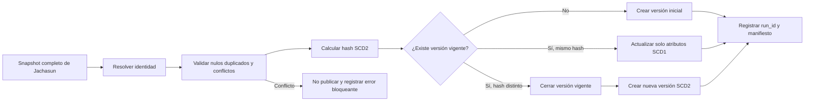

# DW-007 — Política SCD para persona y estudiante

## Propósito y alcance

Este documento define la política aprobable para conservar la historia de la persona y del estudiante en el Data Warehouse. Complementa el modelo lógico de DW-005 y las dimensiones físicas de DW-006, pero no crea migraciones, no carga datos y no ejecuta procesos ETL.

La prioridad es preservar la interpretación histórica de los hechos: una fila publicada debe poder resolverse contra la versión de estudiante vigente para el cierre académico correspondiente. La política se aplica inicialmente a `dw.dim_estudiante`; las dimensiones de programa, materia, periodo y admisión conservan sus propias decisiones cuando una issue posterior las requiera.

## Principios normativos

- Jachasun se consulta exclusivamente mediante los contratos aprobados en DW-001.
- La carga normativa es un snapshot completo por cierre académico. Los timestamps de origen sirven como evidencia, no como watermark obligatorio.
- Cada observación queda vinculada a un `run_id` de DW-004 y, cuando existe, al cierre DSA que determina su fecha efectiva.
- Una ejecución fallida, parcial o sin manifiestos completos no puede publicar una nueva versión.
- La historia publicada es inmutable en sentido lógico: una corrección se expresa cerrando una versión y creando otra, nunca sobrescribiendo silenciosamente el pasado.
- Los miembros `UNKNOWN (-1)` y `NOT_APPLICABLE (0)` de DW-006 son técnicos y no participan en la historización de estudiantes reales.
- La política no inventa estados, fechas ni identidad cuando la fuente no los entrega; los casos ambiguos se conservan como excepciones de calidad.

## Identidad y claves naturales

### Identidad canónica

`id_ra` es la identidad canónica de persona cuando está presente y validada. `id_alumno` es el identificador académico alterno para una observación de estudiante. Para comparar snapshots se utiliza una clave lógica de resolución:

| Situación | Clave lógica propuesta | Acción |
| --- | --- | --- |
| `id_ra` presente | `RA:<id_ra>` | Usar como identidad principal. |
| `id_ra` nulo e `id_alumno` presente | `ALUMNO:<id_alumno>` | Crear una identidad académica provisional, sin afirmar equivalencia personal. |
| Ambos presentes | `RA:<id_ra>` y asociación verificable con `id_alumno` | Conservar ambos identificadores y auditar la asociación. |
| Ambos nulos | Ninguna | No crear estudiante estándar; enrutar a `UNKNOWN` y registrar excepción. |
| Un `id_alumno` asociado a varios `id_ra` | Ambigua | Bloquear reconciliación automática y requerir revisión DSA/TI. |

La aparición posterior de un `id_ra` para una fila que antes solo tenía `id_alumno` no debe crear automáticamente una segunda persona ni cambiar retrospectivamente la clave natural. Una reconciliación aprobada debe registrar la evidencia, el `run_id`, el actor y el alcance temporal del cambio. La implementación de un catálogo de identidades o de una tabla puente queda fuera de DW-007 y deberá ser definida antes de resolver fusiones.

La surrogate key (`estudiante_sk`) identifica una versión física del DW, no reemplaza la identidad natural ni debe reutilizarse entre personas. Los miembros técnicos no tienen clave natural.

## Clasificación de atributos

La siguiente matriz es la propuesta normativa para aprobación DSA/TI. Los atributos técnicos (`created_at`, `updated_at`, `source_run_id`) no son atributos de negocio y nunca participan del hash SCD2.

| Atributo de `dim_estudiante` | Clasificación | Regla de cambio |
| --- | --- | --- |
| `id_ra` | SCD0 / identidad | No se sustituye por otro valor dentro de la misma identidad sin reconciliación aprobada. |
| `id_alumno` | SCD0 / identidad alterna | Se conserva como evidencia académica; una reasignación requiere revisión. |
| `id_sexo` | SCD2 | Un cambio observado genera nueva versión efectiva desde el corte autorizado. |
| `estado_civil` | SCD2 | Se conserva la evolución observada; `NULL` no se convierte en una categoría inventada. |
| `nac_pais` | SCD2 | Cambio historizable, sujeto a validación de catálogo. |
| `id_colegio`, `colegio` | SCD2 | Se conserva procedencia y descripción del estado observado. |
| `tipo_colegio`, `turno_colegio`, `area_colegio` | SCD2 | El cambio describe otra condición de procedencia. |
| `cod_localidad`, `localidad` | SCD2 | Se historiza la localidad observada; no se reemplaza por una localidad inferida. |
| `cod_pais`, `cod_departamento`, `cod_provincia` | SCD2 | Cambio historizable; debe respetar las validaciones de catálogo disponibles. |
| `gestion_egreso_colegio` | SCD2 | Se conserva el valor del snapshot y sus correcciones aprobadas. |
| `fec_inscripcion` | SCD2 | Se historiza solo cuando la fuente confirma una modificación válida. |
| `fec_egreso` | SCD2 | Un valor posterior o una corrección de egreso crea evidencia histórica; no se interpreta como egreso si la fuente no lo confirma. |
| `estado_academico` | SCD2 | El cambio de estado debe conservar la fecha efectiva del snapshot. |
| `tipo_alumno` | SCD2 | Se historiza porque puede modificar la interpretación académica del estudiante. |
| `technical_label` | SCD0 técnico | Solo aplica a miembros técnicos; no se usa para estudiantes estándar. |
| `member_type` | SCD0 técnico | No cambia en una fila estándar; los miembros técnicos son inmutables. |

Esta clasificación evita tratar como SCD1 los cambios que alteran la interpretación de un hecho histórico. Las correcciones puramente técnicas o de formato deberán resolverse antes de publicar; si modifican un atributo SCD2, siguen las reglas de nueva versión.

## Detección mediante hash

La detección utiliza un hash de atributos SCD2, denominado conceptualmente `attribute_hash_scd2`. No se incluye todavía como columna física en DW-006; esta sección fija el contrato para la futura carga.

### Serialización canónica

Antes de calcular SHA-256, cada campo debe normalizarse de forma determinista:

1. Mantener el orden de columnas definido en la matriz SCD2.
2. Representar `NULL` con el token explícito `<NULL>`.
3. Recortar espacios externos solo cuando el contrato fuente lo permita; no eliminar espacios internos.
4. Usar representación decimal y de fechas estable, con fechas ISO `YYYY-MM-DD`.
5. No convertir un valor vacío en `NULL` sin registrar una regla de calidad explícita.
6. Usar UTF-8 y unir pares `nombre=valor` con un separador no ambiguo.
7. Aplicar SHA-256 y almacenar el resultado hexadecimal en minúsculas.

El hash no incluye surrogate keys, timestamps de procesamiento, `run_id`, estado del manifiesto ni campos derivados. Cambiar únicamente `source_run_id` no crea una versión de negocio. Un cambio SCD1 tampoco altera el hash SCD2.

Si se requiere distinguir una corrección de fuente con los mismos atributos SCD2, se conservarán el `run_id`, el manifiesto y la evidencia de corrección; no se crearán versiones artificiales idénticas solo para aumentar el conteo.

## Vigencias y versiones

La futura implementación usará un intervalo semiabierto:

```text
[valid_from, valid_to)
```

- La versión actual tiene `valid_to = NULL` y una sola versión actual puede existir por identidad lógica.
- `valid_from` representa la fecha/hora efectiva del cierre que observó el cambio, no el momento en que el ETL terminó.
- `observed_at` o el timestamp de procesamiento se conserva como metadato de auditoría separado.
- Al detectar un cambio SCD2, la versión anterior se cierra en el mismo instante efectivo que inicia la nueva versión.
- No se permiten intervalos solapados ni `valid_to <= valid_from`.
- El orden de periodos no se infiere mediante `periodo + 1`; se usa la secuencia de cierres DSA de DW-002.

Para snapshots repetidos con el mismo `valid_from`, el desempate se realiza por el orden de procesamiento y `run_id`. Si dos ejecuciones tienen valores distintos para la misma identidad y fecha efectiva, el caso se bloquea como conflicto hasta que DSA/TI determine cuál observación es válida.

## Reglas de carga conceptual

El flujo futuro deberá seguir esta secuencia:



### Interpretación del diagrama

El snapshot representa una observación completa, no una orden de sobrescritura. Primero se resuelve la identidad y se validan duplicados, claves nulas y conflictos. Solo después se calcula el hash de atributos historizables.

Si la identidad no existe, se crea su primera versión. Si existe y el hash SCD2 no cambió, no se multiplica la historia; como máximo se actualizan atributos SCD1 y la evidencia técnica. Si el hash cambió, se cierra la versión vigente y se crea otra con una fecha efectiva coherente con el cierre DSA. Un conflicto de identidad o de fecha no puede continuar hacia publicación: debe quedar en la auditoría de errores del `run_id`.

## Correcciones tardías y duplicados

### Clasificación de observaciones tardías

| Caso | Tratamiento |
| --- | --- |
| Observación recibida después del cierre, con fecha efectiva posterior | Crear versión futura cuando el cierre esté autorizado. |
| Reejecución del mismo snapshot y mismo hash | No crear nueva versión; registrar ejecución repetida. |
| Mismo cierre, mismo estudiante, atributos diferentes | Bloquear como conflicto; no elegir arbitrariamente. |
| Corrección con fecha efectiva igual a la versión vigente | Reemplazar mediante versión de corrección auditable o conservar una única versión, según decisión DSA. Nunca sobrescribir sin evidencia. |
| Corrección con fecha efectiva anterior a versiones publicadas | Reabrir el cálculo temporal afectado mediante reproceso autorizado; conservar ambos `run_id` y el motivo. |
| Duplicados idénticos dentro de un snapshot | Colapsar para publicación y registrar el conteo de duplicados. |
| Duplicados conflictivos dentro de un snapshot | Rechazar la identidad afectada y generar error bloqueante. |

Una corrección tardía no reemplaza automáticamente hechos ya publicados. Debe generar un reproceso posterior que determine qué hechos requieren actualización. La coordinación de ese reproceso pertenece a las issues de ejecución y carga posteriores, no a esta política.

## Nulos, desconocidos y datos personales

- `NULL` representa ausencia desconocida o no informada, según el contrato fuente; no se convierte automáticamente en cero, cadena vacía o categoría funcional.
- `UNKNOWN` se utiliza cuando el hecho necesita una relación de estudiante, pero la identidad no pudo resolverse de forma confiable.
- `NOT_APPLICABLE` se utiliza cuando la relación no corresponde al proceso analítico.
- Los miembros técnicos no adquieren vigencia SCD2 ni se transforman en filas estándar por actualización directa.
- Nombres, documentos, teléfonos, direcciones, correos y fechas de nacimiento permanecen fuera del alcance autorizado de DW-001.
- Los detalles de error y manifiestos no deben almacenar valores personales ni contenido de archivos; solo referencias técnicas saneadas.

## Linaje, seguridad y responsabilidades

| Responsabilidad | DSA | TI/DBA | ETL futuro |
| --- | --- | --- | --- |
| Aprobar atributos SCD0/SCD1/SCD2 | Responsable | Revisa impacto técnico | Implementa sin reinterpretar |
| Aprobar equivalencia de identidades | Responsable | Audita evidencia | Bloquea casos ambiguos |
| Autorizar cierre o reapertura | Responsable | Ejecuta controles | Consume calendario DW-002 |
| Aplicar cambios de dimensión | Valida resultado | Administra permisos | Ejecuta con `run_id` y manifiesto |
| Resolver errores críticos | Decide funcionalmente | Conserva auditoría | Reintenta o solicita reproceso |

La cuenta de extracción sigue siendo de solo lectura. El publicador futuro debe operar mediante los privilegios de `dw_publisher` definidos en DW-006 y no debe modificar miembros técnicos ni eliminar versiones históricas.

## Casos de aceptación

| Caso | Resultado esperado |
| --- | --- |
| Primera observación de un estudiante válido | Una versión estándar con `valid_from`, hash SCD2 y `run_id`. |
| Cambio de `estado_academico` | Cierre de la versión anterior y creación de una nueva. |
| Cambio de un atributo SCD1 | No aumenta el número de versiones SCD2. |
| Snapshot repetido | No genera duplicados ni intervalos solapados. |
| `id_ra` nulo con `id_alumno` válido | Identidad académica provisional, trazable y no fusionada automáticamente. |
| Duplicado conflictivo | Error bloqueante; la ejecución no publica información parcial. |
| Corrección retroactiva | Reproceso autorizado, con evidencia y preservación de los `run_id`. |
| Miembro `UNKNOWN` o `NOT_APPLICABLE` | Permanece técnico y no es actualizado como estudiante real. |
| Ejecución sin manifiesto completo | No crea ni publica nuevas versiones. |

## Validación y aprobación

DW-007 estará lista para cierre cuando DSA/TI aprueben la matriz y los casos anteriores, y exista evidencia documental de:

- clasificación completa de atributos;
- serialización y hash reproducibles;
- intervalos semiabiertos sin solapamiento;
- tratamiento de repetición, duplicados y correcciones tardías;
- separación entre fecha efectiva y fecha observada;
- uso de `run_id`, cierre DSA y manifiestos;
- límites explícitos con DW-006, DW-019 y los hechos DW-020 a DW-022.

La prueba física de estas reglas y la incorporación de columnas o índices serán parte de una issue posterior de implementación. Esta separación evita alterar el esquema estable de DW-006 antes de que la política funcional sea aprobada.

## Límites y dependencias

- DW-001 define los campos y filtros autorizados de Jachasun.
- DW-002 define los cierres y su autorización funcional.
- DW-004 aporta `run_id`, eventos, manifiestos, métricas y errores.
- DW-005 define la constelación y el grano de los hechos.
- DW-006 aporta las dimensiones físicas y los miembros técnicos.
- DW-019 implementará la carga de dimensiones desde RAW/ETL y deberá respetar esta política.
- DW-007 no implementa extracción, transformación Apache Hop, Go, cron, API, hechos ni modelos ML.
