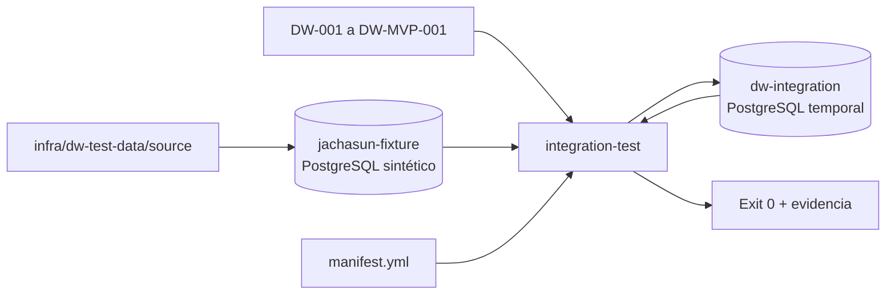

# DW-008 — Estrategia de datos de prueba y entorno de integración

## Propósito

DW-008 proporciona un entorno aislado y reproducible para validar contratos fuente, cierres académicos, ejecuciones y futuras cargas dimensionales sin depender de Jachasun ni de datos reales. El entorno es de integración: no sustituye las pruebas unitarias de migraciones de `infra/dw-schema` y no habilita conexiones hacia producción.

Para el MVP de #133 se reutilizarán estos fixtures al validar el flujo directo Jachasun → Hop → `dw`, según [la base consolidada](mvp-direct-hop.md). Este documento describe la base de pruebas DW-008; los perfiles posteriores de Go/RAW se conservan como regresión histórica y no certifican el nuevo workflow directo. La suite Hop del MVP y las pruebas físicas de hechos/SCD2 todavía deben implementarse.

## Política de privacidad

- El dataset versionado es sintético y no contiene nombres, documentos, teléfonos, correos, direcciones, fechas de nacimiento ni credenciales.
- Los identificadores tienen el prefijo `TEST` y no deben coincidir con identificadores reales de UATF.
- La estructura fuente replica únicamente columnas necesarias para los contratos DW-001.
- Si en el futuro se usa una copia anonimizada, debe generarse fuera del repositorio, con una revisión de privacidad independiente, allowlist de columnas y un secreto de pseudonimización que nunca se versiona.
- Los manifiestos, logs y errores no deben imprimir filas completas ni atributos personales.
- Las contraseñas del compose son exclusivas del entorno efímero y no se reutilizan en ningún ambiente.

## Arquitectura aislada



El servicio fuente representa solo las tablas y columnas requeridas para probar contratos. El runner aplica las migraciones reales del DW sobre un PostgreSQL separado, consulta la fuente, verifica el destino y registra una ejecución sintética con manifiesto completo. No existe conexión hacia `jachasun` real, Neo4j ni servicios productivos. Las migraciones `0008` y `0009` agregan SCD2 de estudiante y hechos; el harness debe incorporar los casos de estas nuevas estructuras antes de considerarlas validadas.

## Dataset y casos cubiertos

El catálogo de casos está separado por responsabilidad en `infra/dw-test-data/expected/scd2-cases.yml`, `closure-cases.yml` y `quality-cases.yml`. Cada fuente tiene su propio SQL dentro de `infra/dw-test-data/source/`.

| Caso | Evidencia sintética | Resultado esperado |
| --- | --- | --- |
| Persona con identidad completa | `RA-T001` + `id_alumno=1001` | Se puede resolver por `id_ra`. |
| Identidad académica provisional | `id_alumno=1002` sin `id_ra` | No se fusiona automáticamente con otra persona. |
| Cambio SCD2 | `1001` cambia de estado entre cortes | La futura carga debe crear una nueva versión. |
| Snapshot repetido | Mismo estudiante y mismos atributos | No debe multiplicar historia. |
| Nulos autorizados | `fec_egreso`, localidad y puntaje ausentes | Se conservan como nulos, no como ceros artificiales. |
| Duplicado idéntico | Caso declarado en fixture esperado | Puede colapsarse con métrica de duplicados. |
| Duplicado conflictivo | Caso declarado en fixture esperado | Debe bloquear publicación. |
| Referencia huérfana | Materia con padre inexistente | Se reporta, no se corrige en la fuente. |
| Cierres | `2025/1` y `2025/2` | Se validan como cortes independientes. |
| Corrección tardía | Caso declarado con fecha efectiva anterior | Requiere reproceso autorizado y trazabilidad. |
| Nota inválida | Caso esperado fuera de `[0,100]` | Se aísla como error de calidad. |

Los casos de SCD2 y hechos se representan como observaciones fuente y expectativas. Aunque `0008` y `0009` ya crean esas estructuras, el harness todavía no carga filas en ellas ni comprueba sus restricciones de grano.

## Linaje y ejecución

El runner usa un UUID fijo de prueba para hacer reproducible la inspección del entorno. En una carga real el orquestador debe generar un UUID nuevo por intento. El test registra:

- ejecución `HISTORICA` en `etl_control.etl_execution`;
- un manifiesto `COMPLETO` para `public.uatf_datos`;
- conteo, orden estable y hashes sintéticos;
- métrica de filas observadas;
- evento auditable de solicitud.

Los datos fuente no se escriben desde el runner hacia Jachasun: el usuario de integración solo consulta la fuente. La implementación de extracción y carga pertenece a issues posteriores.

## Restauración y repetición

Desde la raíz del repositorio:

```powershell
docker compose -f infra/dw-integration/dw-integration-test.yml up --build --abort-on-container-exit
docker compose -f infra/dw-integration/dw-integration-test.yml ps -a
docker compose -f infra/dw-integration/dw-integration-test.yml logs integration-test
docker compose -f infra/dw-integration/dw-integration-test.yml down --volumes
```

La ejecución correcta muestra `integration-test` con `Exited (0)`. La restauración elimina únicamente contenedores, red y almacenamiento temporal del proyecto de integración. Volver a ejecutar `up` desde cero debe producir los mismos conteos, hashes y validaciones.

## Límites

- No se carga información histórica real.
- No se habilita producción ni se modifica `docker-compose.yml` principal.
- No se implementan las cargas SCD2 ni de hechos, workflows Apache Hop, cron ni API en este entorno. Load Manager se conserva como regresión de la arquitectura anterior.
- No se usa `session_replication_role = replica`.
- Los datos de prueba no prueban la cardinalidad real de Jachasun; esa validación permanece en DW-001.

## Definition of Done

- Dataset sintético versionado y revisado por privacidad.
- Conteos y hashes declarados en un manifiesto.
- Compose de integración separado del compose de migraciones unitarias.
- Migraciones de control, dimensiones, SCD2 y hechos aplicadas en una base temporal.
- Fuente consultable mediante las columnas de los contratos.
- Ejecución y manifiesto de prueba registrados con `run_id`.
- Validación de repetición y restauración documentada.
- Runner finaliza con código `0` sin datos persistentes fuera del entorno efímero.
