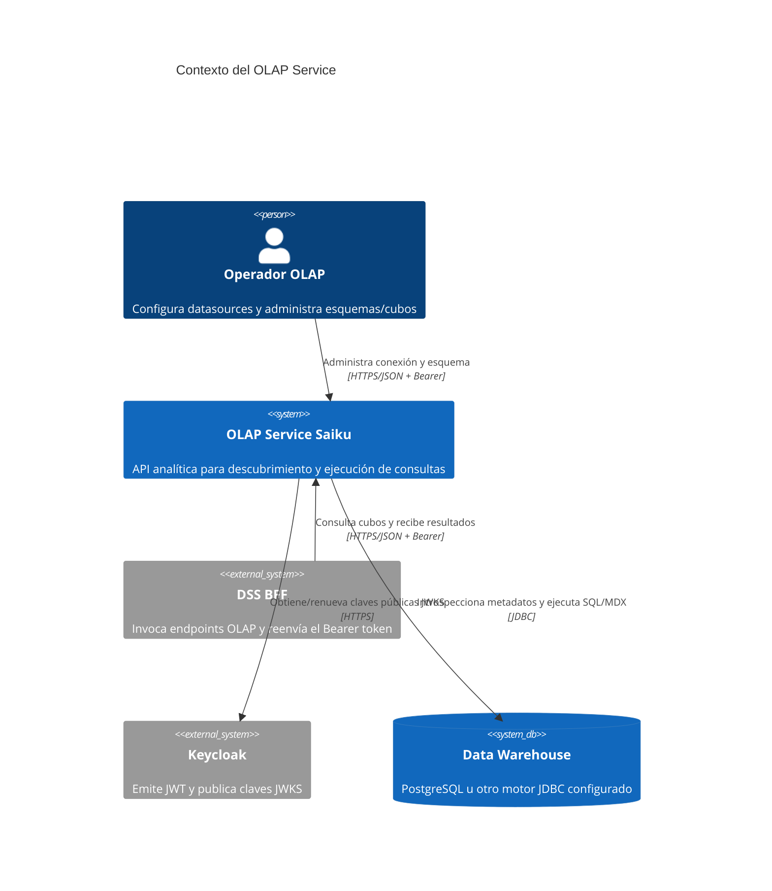
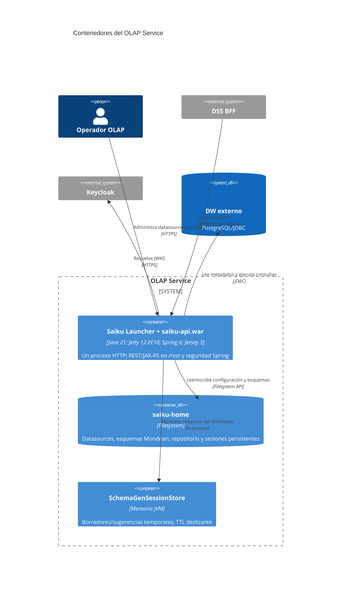
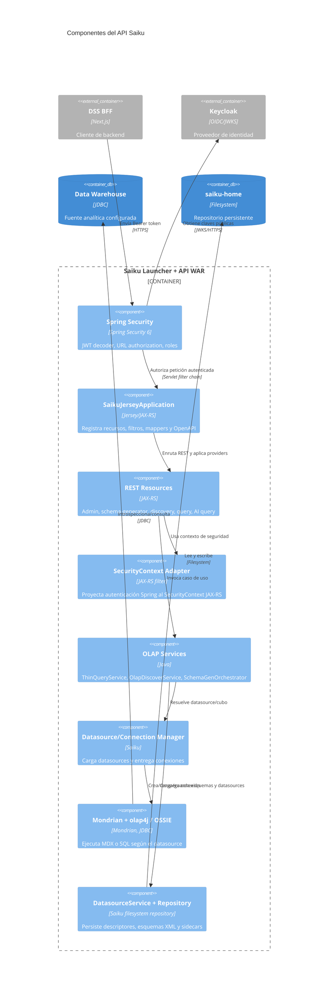
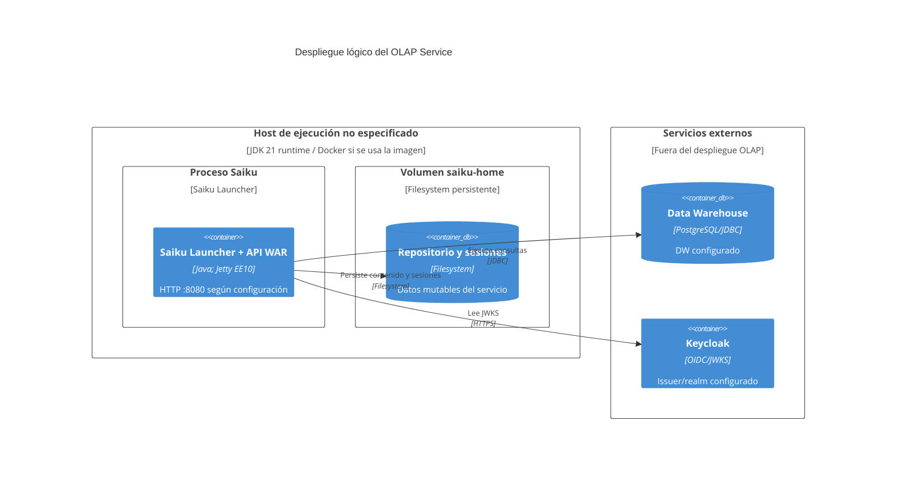

# Arquitectura C4 del OLAP Service

El runtime desplegable es **un proceso Java**: el launcher inicia Jetty y sirve el WAR del API. `saiku-core` reúne servicios y recursos usados por ese proceso; no es otro microservicio en ejecución. La ubicación de despliegue (VM, contenedor/orquestador y topología de red) no se puede deducir del repositorio, por eso el nodo se expresa como host genérico.

## C1 — Contexto

Quién consume el servicio, qué sistemas externos intervienen y los protocolos observados.

El operador puede usar Swagger/curl u otra consola; la interfaz del antiguo frontend Saiku no forma parte del cliente del DSS.

## C2 — Contenedores

El WAR y Jetty se muestran dentro del mismo contenedor ejecutable porque el launcher los hospeda en el mismo proceso. `saiku-home` es almacenamiento de archivos/sesiones montable, no un servidor de base de datos.

## C3 — Componentes del contenedor API

## C4 — Despliegue observado

El repositorio define una imagen Docker, pero no evidencia el clúster o proveedor donde se ejecuta. Este dibujo separa esa incógnita del contenido verificable del contenedor.

## Relaciones que guían los diagramas de secuencia

| Flujo | Entrada | Servicio principal | Salida |
|---|---|---|---|
| Generación de cubo | `POST /rest/saiku/admin/schema-generator/start/{dataSourceId}` | `SchemaGenOrchestrator` | Borrador editable; XML y sidecar al guardar |
| Descubrimiento | recursos REST `/rest/saiku/...` | `OlapDiscoverService` / `OlapMetaExplorer` | conexiones, catálogos, esquemas, cubos y miembros |
| MDX | `POST /rest/saiku/api/query/execute` | `ThinQueryService` | `CellSet` convertido en `QueryResult` JSON o Arrow |
| OSSIE | mismo endpoint con `queryType=OSSIE` | `OssieQueryService` | `CellDataSet` convertido a JSON; no pasa por Mondrian |
| Autenticación | `Authorization: Bearer …` | Spring Security decoder/converter | `Authentication` con autoridades Saiku |

## Evidencia

- Launcher: `saiku-launcher/src/main/java/org/saiku/launcher/SaikuLauncher.java`.
- Mapeo Servlet REST: `saiku-api/src/main/webapp/WEB-INF/web.xml` (`/rest/*`); XMLA va separado por `/xmla/*`.
- Jersey: `saiku-core/saiku-web/src/main/java/org/saiku/web/rest/SaikuJerseyApplication.java`.
- Wiring Spring: `saiku-api/src/main/webapp/WEB-INF/saiku-beans.xml` y `applicationContext-saiku.xml`.
- Datasource/Mondrian: `RepositoryDatasourceManager`, `SaikuConnectionFactory`, `OlapDiscoverService`.
- Autenticación JWT: `KeycloakJwtDecoderFactory`, `SaikuKeycloakJwtAuthenticationConverter`.

## Huecos y supuestos

- Operador y BFF aparecen como consumidores previstos del microservicio; sus procesos viven fuera de este repositorio.
- El host/despliegue real se desconoce. No se dibuja una topología de Kubernetes/Traefik sin manifiestos que la prueben.
- El DW mostrado es una dependencia externa configurable; no se afirma que el XML UATF ya esté instalado.
