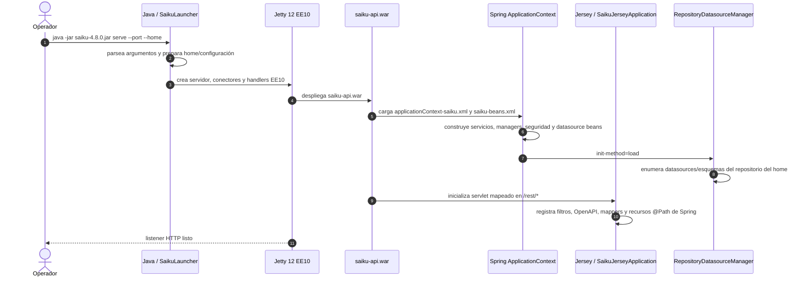
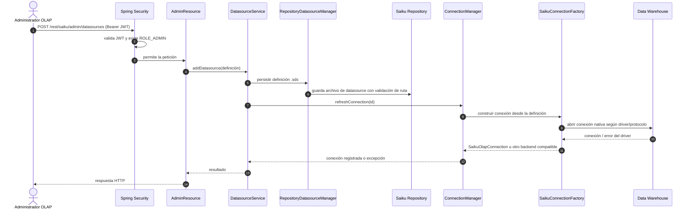
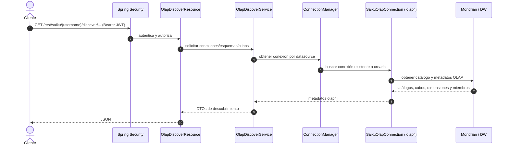

# Arranque, repositorio y datasources

Esta página sigue el recorrido desde el proceso Java hasta una conexión OLAP disponible. El launcher inicia el contenedor HTTP; Spring arma los servicios; el repositorio de Saiku conserva definiciones de datasource y esquemas; Mondrian/olap4j abre conexiones hacia el DW cuando un flujo necesita consultarlo.

## 1. Arranque del servicio

El arranque HTTP no equivale a que todas las conexiones al DW ya estén abiertas. El repositorio se carga durante la inicialización; conexiones nativas pueden crearse o refrescarse por demanda según el `ConnectionManager` y el recurso invocado.

## 2. Registrar o actualizar un datasource

La API expone operaciones administrativas de listado, alta, modificación, borrado, carga/actualización de esquema y refresh. El endpoint de refresh implementado es `GET /rest/saiku/admin/datasources/{id}/refresh`. El límite de seguridad de `/rest/saiku/admin/**` se aplica antes de llegar al recurso.

## 3. Descubrimiento de conexiones y metadatos

Descubrimiento devuelve metadatos del catálogo OLAP que el datasource presenta. No crea automáticamente un cubo ni modifica el DW.
