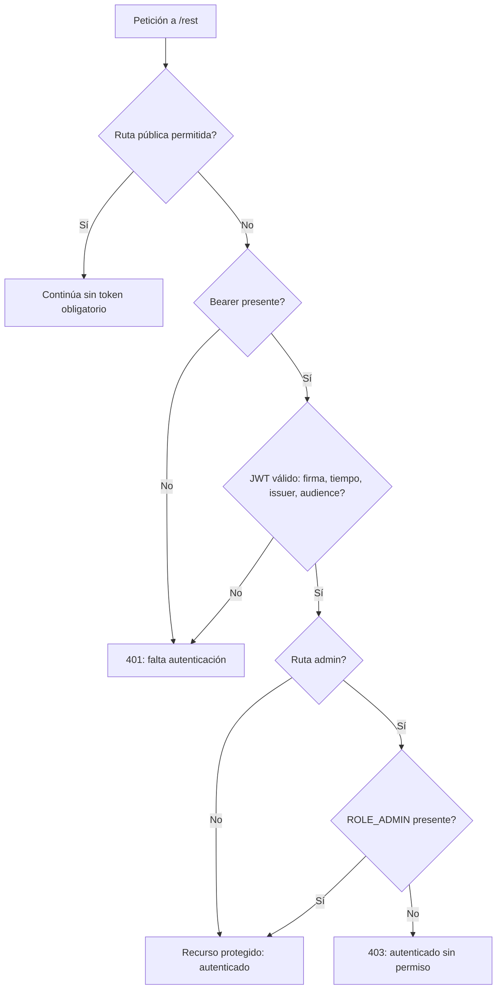

# Autenticación y autorización

## Flujo BFF → OLAP con Keycloak

El usuario inicia sesión en el sistema de identidad y el BFF entrega al cliente un access token. OLAP actúa como Resource Server: no solicita de nuevo usuario/contraseña ni crea la sesión de Keycloak. Cada llamada protegida lleva `Authorization: Bearer <access-token>`.

```mermaid
sequenceDiagram
    autonumber
    actor User as Usuario
    participant BFF as dss-bff / frontend
    participant KC as Keycloak
    participant Jetty as Saiku API en Jetty
    participant Filter as Spring Security OAuth2 Resource Server
    participant Decoder as KeycloakJwtDecoderFactory
    participant Converter as SaikuKeycloakJwtAuthenticationConverter
    participant Jax as SaikuJaxrsSecurityContextFilter
    participant Resource as Recurso Jersey

    User->>BFF: inicia sesión en DSS
    BFF->>KC: flujo OIDC configurado
    KC-->>BFF: access token firmado
    BFF-->>User: sesión del sistema / token según integración
    User->>Jetty: petición REST + Bearer access token
    Jetty->>Filter: petición hacia /rest/**
    Filter->>Decoder: decodificar y validar JWT
    Decoder->>KC: obtiene/usa claves públicas JWKS (cacheadas)
    KC-->>Decoder: JWKS
    Decoder->>Decoder: firma, exp/nbf, issuer y audience
    Decoder-->>Filter: JWT validado o rechazo
    Filter->>Converter: convertir claims de roles
    Converter->>Converter: resource_access.olap-service.roles
    Note over Converter: OLAP_ADMIN → ROLE_ADMIN; OLAP_USER → ROLE_USER
    Converter-->>Filter: Authentication con principal y authorities
    Filter->>Jax: establece contexto Spring autenticado
    Jax->>Resource: SecurityContext JAX-RS para @RolesAllowed
    Resource-->>User: respuesta de endpoint
```

La validación requiere que issuer y audience coincidan con la configuración del servicio. La conversión de autorización consulta los roles del cliente `olap-service`; roles de `uatf-auth-service` o roles de realm no se elevan por sí solos a `ROLE_ADMIN`. Para operaciones bajo `/rest/saiku/admin/**` se exige administración. Las operaciones protegidas generales requieren autenticación; los endpoints públicos son excepciones explícitas de configuración, como OpenAPI/health cuando estén habilitados.

## Resultados de autorización



Una respuesta 401 indica que el token falta o no pasa validación. Una respuesta 403 indica identidad aceptada pero autoridad insuficiente. Errores 404/400 posteriores ya pertenecen al enrutamiento o a la operación solicitada y no implican necesariamente un problema de JWT.

## Cadena de identidad hasta JAX-RS

Spring Security es quien autentica la petición y crea `Authentication`. `SaikuJaxrsSecurityContextFilter` propaga esa identidad al `SecurityContext` de Jersey; esto habilita las anotaciones JAX-RS de roles y permite que recursos consulten el principal. La política de Spring y los guardas del recurso pueden coexistir: revisar ambos al añadir un endpoint administrativo.

El repositorio conserva compatibilidad con mecanismos de autenticación Saiku heredados, incluidos formularios o Basic en ciertas configuraciones. El camino de integración DSS documentado aquí es el bearer token de Keycloak; no se debe interpretar esa compatibilidad como que el frontend deba volver a pedir credenciales.
