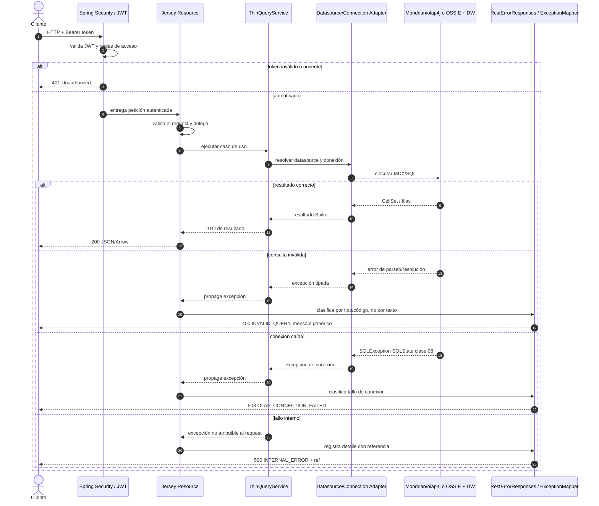

# Capas de aplicación y contrato de errores

Este documento delimita cómo se debe añadir un caso de uso OLAP al API Saiku existente y qué respuesta REST se devuelve cuando falla. El objetivo es evolucionar las capas actuales, no sustituir Jersey/JAX-RS, Spring XML, Mondrian ni las abstracciones de Saiku.

## Responsabilidad por capa

| Capa | Responsabilidad | Ejemplos actuales |
|---|---|---|
| Recurso REST (adaptador de entrada) | Leer path/query/body, validar forma del request, invocar un servicio de aplicación y convertir su resultado a HTTP/JSON/Arrow. No debe construir SQL/MDX ni abrir conexiones al DW. | `Query2Resource`, `OlapDiscoverResource`, `SchemaGeneratorResource`, `AiQueryResource` |
| Servicio de aplicación | Ejecutar el caso de uso y coordinar autorización de datasource, repositorio, caché y engine. | `ThinQueryService`, `OlapDiscoverService`, `SchemaGenOrchestrator` |
| Adaptadores de salida | Resolver conexiones y traducir operaciones de Saiku al motor/repositorio/JDBC. | `RepositoryDatasourceManager`, `SaikuConnectionFactory`, Mondrian/olap4j, `DatasourceJdbcConnectionProvider` |
| Motor o sistema externo | Ejecutar MDX/SQL y acceder al DW. | Mondrian sobre JDBC o OSSIE/JDBC; DW externo |

Los recursos antiguos aún existentes se mantienen por compatibilidad. Las nuevas operaciones deben seguir el camino recurso→servicio de aplicación→adaptador y no deben añadir lógica de negocio ni acceso directo a JDBC en el recurso. Los accesos JDBC existentes en recursos auxiliares deben migrarse al servicio correspondiente cuando esos casos se refactoricen, sin convertir esta issue en una reestructuración total del core.

## Secuencia de una consulta y un fallo

## Contrato HTTP de errores

Los errores de operaciones OLAP responden JSON. Las rutas de consulta preservan `QueryResult.error` para los consumidores Saiku existentes y agregan campos opcionales `status`, `code` y `ref`; dichos campos no se serializan en respuestas exitosas. Los errores del mapper global usan `status`, `code`, `error` y, para 500, `ref`.

| Caso | HTTP | `code` | Mensaje público |
|---|---:|---|---|
| Request mal formado/argumento inválido | 400 | `INVALID_REQUEST` | `Invalid request` |
| MDX inválido o referencia OLAP no resoluble | 400 | `INVALID_QUERY` | `Invalid OLAP query` |
| Usuario autenticado sin autorización al datasource | 403 | `ACCESS_DENIED` | `Access denied` |
| Conexión JDBC/OLAP caída (SQLState `08…` o excepción de conexión tipada) | 503 | `OLAP_CONNECTION_FAILED` | `OLAP datasource unavailable` |
| Error no clasificado | 500 | `INTERNAL_ERROR` | `Internal error` + referencia de correlación |
| Token ausente, inválido o vencido | 401 | Controlado por Spring Security | No entra al recurso REST |

La clasificación usa tipos de excepción y SQLState. No inspecciona el texto del error. Los detalles completos se registran en servidor; el cliente nunca recibe stack trace, URL JDBC, credenciales, SQL interno ni mensajes de driver. Para un 500, buscar `ref` en los logs correlaciona el evento. Los límites/timeout de ejecución se mantienen como 500 hasta que exista un contrato específico para 504.

## Extensión de un caso de uso

1. Crear o ampliar el servicio que representa la operación OLAP.
2. Inyectar ese servicio en un recurso JAX-RS mediante el wiring existente de Spring XML.
3. Mantener validaciones de forma en el recurso; las reglas de negocio y el acceso al motor pertenecen al servicio/adaptador.
4. Ante excepciones, delegar al contrato común `RestErrorResponses`; no devolver `getMessage()`, `getRootCauseMessage()` ni el objeto excepción.
5. Añadir pruebas para 400/403/503/500 y ausencia de secretos según corresponda.

Referencias de implementación: `saiku-core/saiku-web/src/main/java/org/saiku/web/rest/util/RestErrorResponses.java`, `GenericExceptionMapper.java`, `resources/Query2Resource.java`; servicios en `saiku-core/saiku-service` y wiring en `saiku-api/src/main/webapp/WEB-INF`.
