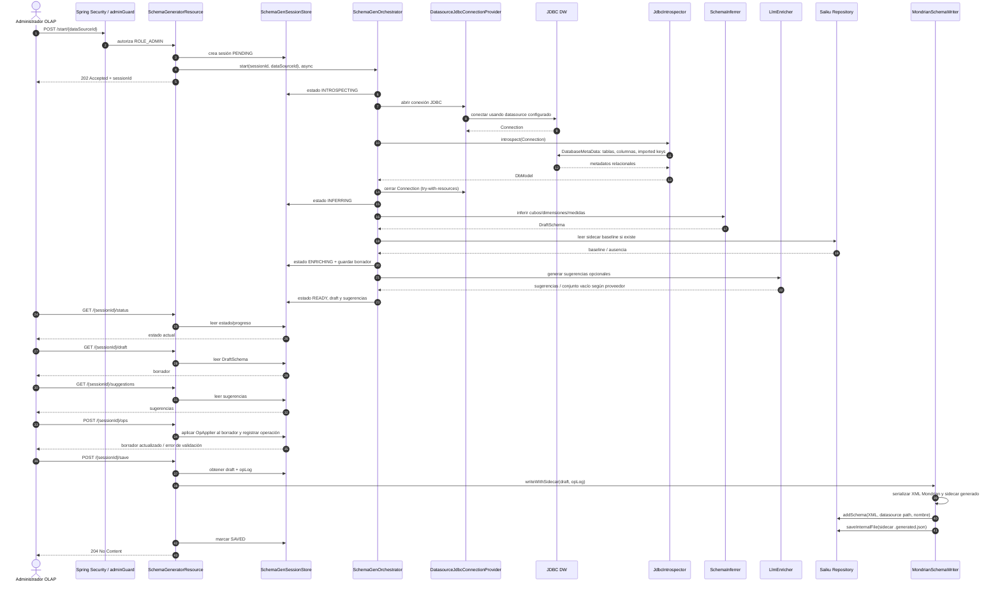
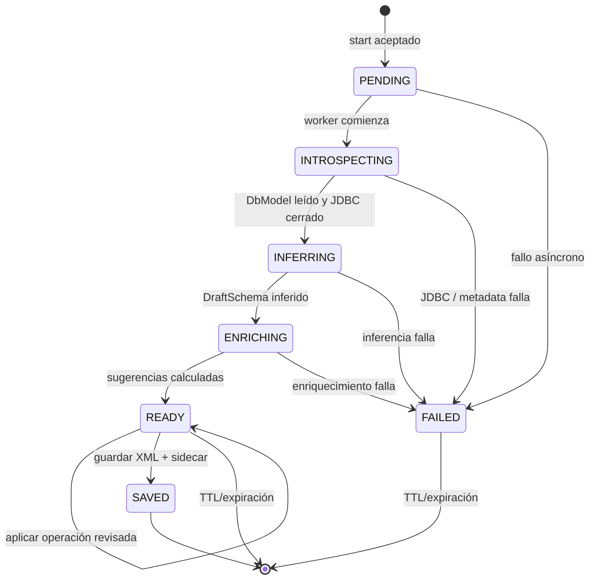
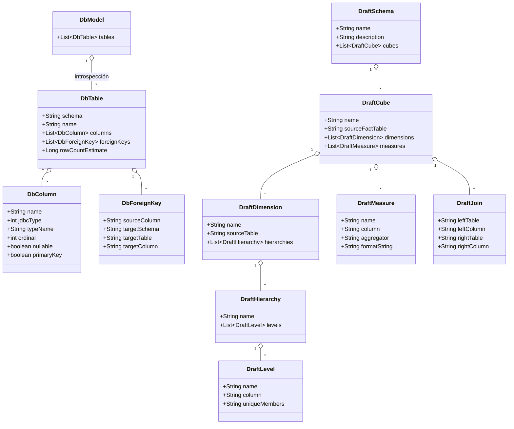
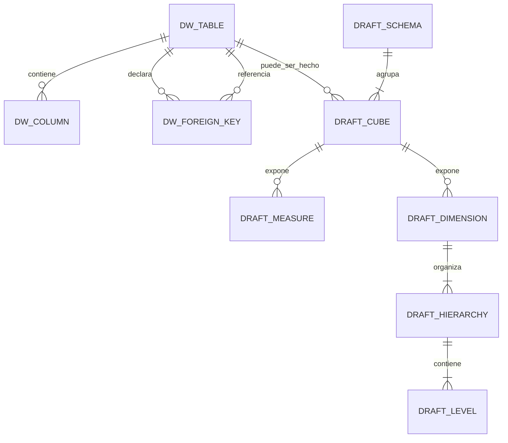
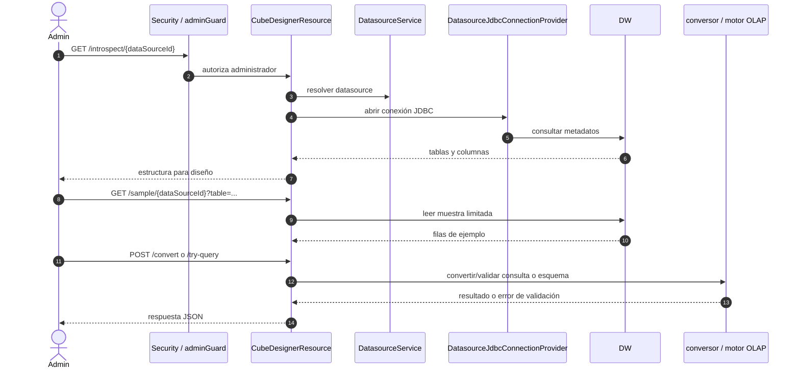

# Ciclo de creación y uso de cubos

## Modelo mental

Saiku no materializa un cubo como tablas propias. El generador inspecciona un datasource JDBC, produce una definición lógica Mondrian XML y la guarda en el repositorio del servicio. Mondrian resuelve esa definición contra el DW cuando una conexión OLAP la consume. El proceso de generación no crea ni altera tablas del DW.

## Generación guiada de esquema Mondrian

Ruta base: `/rest/saiku/admin/schema-generator`. Todas las operaciones pasan por el límite admin. La sesión del generador es estado temporal en memoria, con TTL deslizante por defecto de 30 minutos; reiniciar el proceso la elimina.

### Estados y fallos

`GET status` permite observar la tarea, mientras que draft/suggestions pueden responder conflicto si el borrador todavía no está listo. Las operaciones del usuario se aplican al borrador en memoria y quedan registradas para reproducibilidad mediante el sidecar. Una excepción del pipeline coloca la sesión en `FAILED`; no debe asumirse que las sugerencias de IA son necesarias para producir el esquema base.

## Inspección y significado del modelo

El diagrama siguiente describe clases/metadatos usados por el generador, no tablas de una base OLAP interna. La entidad física del DW depende del datasource concreto y debe documentarse con sus nombres reales al conectarlo.

El ER es conceptual: `DW_TABLE`, `DW_COLUMN` y `DW_FOREIGN_KEY` representan resultados de `DatabaseMetaData`; no son entidades persistidas por Saiku. El mapeo real a `DRAFT_*` es inferencial y editable. El XML final especifica cómo Mondrian enlaza hecho, dimensiones, jerarquías, niveles, medidas y joins.

## Activar y consumir el esquema generado

Guardar el XML en el repositorio es un paso de autoría, no prueba suficiente de que el datasource activo lo esté usando. La definición del datasource debe apuntar al catálogo/esquema Mondrian correspondiente (la convención del proyecto usa `mondrian://...`), después refrescarse o redescubrirse, y finalmente ejecutar una consulta pequeña. Esto confirma resolución del catálogo, acceso JDBC y validez de la definición.

## API Cube Designer

`/rest/saiku/admin/cube-designer` contiene endpoints de apoyo distintos al generador: `GET /introspect/{dataSourceId}`, `GET /sample/{dataSourceId}`, `GET /schema/{dataSourceId}`, `POST /convert`, `POST /try-query` y `POST /turn`. Reutiliza datasource/JDBC y aplica guardas administrativas. `/turn` depende del proveedor AI opcional y puede responder 503 si no está configurado. La eliminación de la SPA no elimina estas rutas API; tampoco las convierte en el pipeline de generación anterior.

