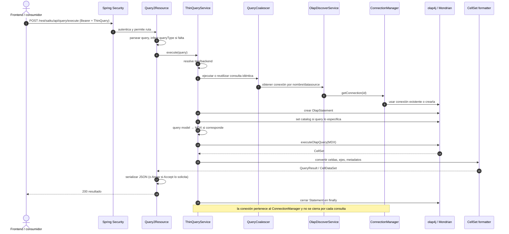

# Descubrimiento y consulta OLAP (MDX)

## Descubrimiento

Los recursos `OlapDiscoverResource` exponen información del usuario/conexiones y metadatos OLAP bajo `/rest/saiku/{username}/discover`. El recorrido llega a `OlapDiscoverService`, que usa el `ConnectionManager` y la conexión olap4j para leer catálogos/cubos/dimensiones/miembros. Es metadato del catálogo configurado, no introspección directa de tablas en esta ruta.

## Consulta sincrónica

El endpoint de ejecución es `POST /rest/saiku/api/query/execute`. El cuerpo es `ThinQuery`; puede contener MDX o un modelo de consulta. Si no trae tipo, el servidor infiere MDX cuando hay campo `mdx`, en caso contrario querymodel.

El coalescing está condicionado por la clave de consulta, que considera rol/identidad relevante para evitar compartir resultados entre contextos distintos. La conexión del datasource tiene ciclo de vida administrado fuera de la consulta individual. Los errores de parser/MDX, conexión o permisos OLAP se traducen por los exception mappers y el contrato HTTP del recurso.

## Resultado Arrow

La representación normal es el resultado JSON de Saiku. Cuando el consumidor negocia `Accept` compatible con Arrow, `Query2Resource` utiliza la ruta de serialización Arrow disponible. El cliente debe enviar la negociación correcta y soportar ese formato; no cambia la ejecución semántica de MDX.

## Drillthrough

Las consultas MDX marcadas para drillthrough pasan por una rama especial del servicio para recuperar filas de detalle. No confundir drillthrough con un endpoint general de SQL arbitrario: el detalle se obtiene a partir de la consulta/celda y del soporte que ofrezca Mondrian/datasource. Las limitaciones dependen del esquema, del driver y de la configuración del cubo.
