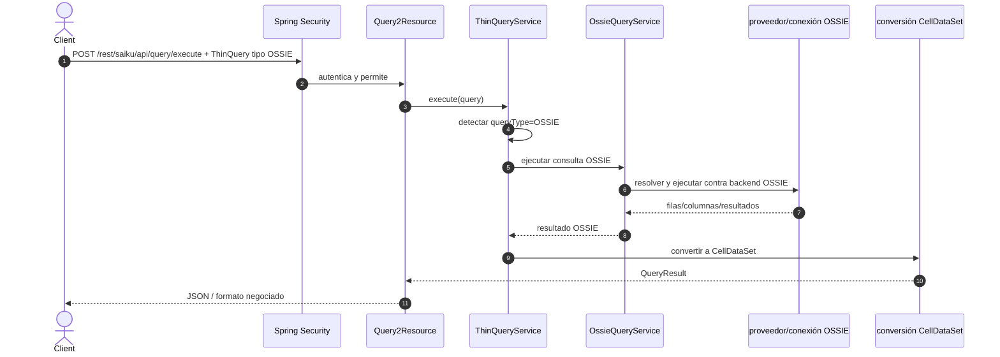

# Consultas OSSIE

`ThinQueryService` detecta el tipo OSSIE y deriva a `OssieQueryService` antes de construir una consulta MDX/olap4j. Este backend es un camino distinto de Mondrian y no debe describirse como si cada query OSSIE ejecutara MDX.

La autenticación HTTP es común a ambos backends; la autorización sobre objetos/filas del motor OSSIE depende de su implementación y configuración. No asumir que roles de Keycloak se traducen automáticamente a reglas de seguridad de datos dentro de OSSIE: verificar el servicio concreto y el modelo de permisos antes de exponerlo a usuarios finales.
