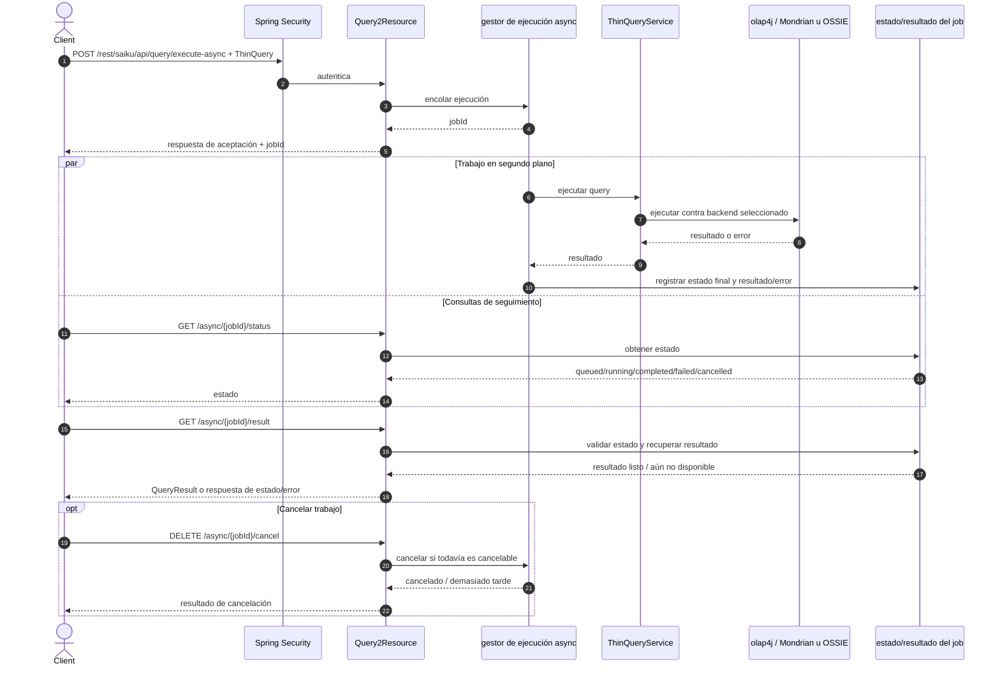

# Ejecución asíncrona y ciclo de resultados

Además de `POST /rest/saiku/api/query/execute`, `Query2Resource` proporciona `POST /rest/saiku/api/query/execute-async`, `GET .../async/{id}/status`, `GET .../async/{id}/result` y `DELETE .../async/{id}/cancel`. El servicio comprueba la propiedad del trabajo contra el principal autenticado y devuelve 404 tanto para IDs inexistentes como para trabajos ajenos; un administrador puede gestionar trabajos ajenos conforme a las reglas del servicio. Los IDs y estados son del trabajo de consulta; no confundirlos con el UUID y TTL de Schema Generator.

El cliente debe tratar el ID como opaco, sondear estado con backoff y solicitar resultado solo cuando el estado indique `DONE`; antes de eso el endpoint de resultado responde conflicto. Las operaciones restringen acceso al propietario, con excepción administrativa prevista en el servicio. El resultado y su retención dependen de la implementación/configuración del gestor; no inferir persistencia durable tras reinicio sin verificar el store concreto.
