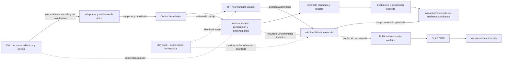

# PRED-001 — Plan de arquitectura y contratos del motor predictivo

**Estado:** entregables de diseño redactados; propuesta lista para revisión
**Rama:** `feature/PRED-001`
**Issue:** [PRED-001](https://github.com/KEVIN-117/dss-system-architecture/issues/144)
**Propósito:** ordenar el análisis y la producción de los entregables de arquitectura. Este plan no fija decisiones de negocio aún no aprobadas ni autoriza ampliar el alcance de la issue.

El trabajo documental ya está desarrollado en [`README.md`](README.md), [`architecture.md`](architecture.md), [`business-understanding.md`](business-understanding.md), [`adr/0001-architecture-and-integration.md`](adr/0001-architecture-and-integration.md) y [`contracts/prediction-api-v1.yaml`](contracts/prediction-api-v1.yaml). Este archivo conserva la secuencia, el registro de decisiones y el chequeo de aceptación. La propuesta todavía requiere revisión/aprobación de los responsables; no se ha modificado el estado remoto de la issue.

## 1. Resultado que buscamos

Al cerrar PRED-001 deberá existir una base revisable para que las issues posteriores implementen el flujo predictivo sin inventar etiquetas, horizontes, población, permisos, interfaces ni almacenamiento. La documentación resultante debe permitir rastrear cada requisito a un componente, contrato, decisión o criterio verificable.

Entregables de PRED-001:

1. Acta del problema predictivo, criterios de éxito y decisiones pendientes.
2. ADR con alternativas, decisión y consecuencias para cada decisión que pueda cerrarse con la evidencia disponible.
3. Diagramas de componentes y flujos de datos, con límites de confianza y recursos compartidos.
4. Borradores versionados de contratos para dataset, trabajo de entrenamiento, artefacto de modelo y predicción.
5. Plan de entregables y ciclos de retorno de CRISP-DM.
6. Matriz de trazabilidad de RF-10, RF-11, RF-12, RNF-08 y RNF-09 a issues y comprobaciones.

| Entregable | Ubicación | Avance |
|---|---|---|
| Acta de problema y criterios de éxito | [`business-understanding.md`](business-understanding.md) | Redactado como propuesta; DSA debe aprobar evento, horizonte, población y aptitud. |
| ADR, alternativas y decisiones abiertas | [`adr/0001-architecture-and-integration.md`](adr/0001-architecture-and-integration.md) | Redactado; decisiones operativas/seguridad pendientes requieren aprobación DSA/IAM/TI. |
| C4 y flujos dinámicos con evidencia | [`architecture.md`](architecture.md), [`diagrams/`](diagrams/) | Redactados desde el código; worker/contratos target se marcan como propuestos. |
| Contratos versionados y errores | [`contracts/prediction-api-v1.yaml`](contracts/prediction-api-v1.yaml), [`contracts/contract-notes.md`](contracts/contract-notes.md) | Borrador v1.0; semántica y permisos pendientes se documentan. |
| Plan CRISP-DM, fases y ciclos de retorno | [`business-understanding.md`](business-understanding.md) | Redactado con gates y tipos de evidencia. |
| Matriz RF/RNF a issues | ADR § trazabilidad | Redactada; mapear los identificadores RF/RNF con el documento de requisitos fuente en la revisión. |

## 2. Evidencia local que condiciona el diseño

- `prediction-service/main.py` solo expone un health check y `/predict` simulado. No hay aún modelo real ni contrato de runtime estable.
- `prediction-service/pyproject.toml` declara FastAPI y el servicio ya tiene configuración runtime para entorno, host, puerto, nivel de log y autoreload. No declara bibliotecas de ML, persistencia de trabajos/modelos ni un proceso worker.
- El DW MVP publica `dw.fact_admision`, `dw.fact_cursado` y `dw.fact_retencion_desercion`. El último contiene `resultado_retencion` (`RETENIDO`, `DESERTOR`, `NO_EVALUABLE`), `es_desercion` nullable y referencia al cierre y `run_id`. `NO_EVALUABLE` no debe convertirse en una etiqueta negativa.
- El grano de retención es estudiante-programa-periodo cerrado. La población observable y el hecho disponible no equivalen automáticamente a la regla de elegibilidad de primer/segundo año que solicita PRED-002.
- La base crea el rol `dw_ml_writer`, con lectura de `dw` y escritura de `ml_workspace`. La arquitectura DW documentada mantiene esa frontera. En el DDL revisado no se encontró `ml_predictions`; su existencia y contrato no se deben presuponer.
- El BFF implementado vive en `dss-monorepo/apps/bff`; autentica sesiones con Keycloak y tiene rutas OLAP. No se encontró una capa GraphQL ni un recorrido predictivo implementado en su código fuente.
- El `docker-compose.yml` raíz también conserva un `graphql-bff` bajo `gateway/graphql-bff` con dependencia de `prediction-service`. Antes de elegir integración hay que determinar si ese servicio está vigente, si su código existe y cómo se relaciona con el BFF Next.js actual.
- El BFF ya valida JWT y resuelve identidad/roles, pero la autorización por facultad/carrera para resultados predictivos debe diseñarse en el servidor y contrastarse con los claims/servicios existentes.

## 3. Propuesta de límites de responsabilidad a validar

| Componente | Responsabilidad candidata | Fuera de su límite |
|---|---|---|
| ETL / DW | Publicar hechos académicos con semántica, periodo/cierre, calidad y permisos documentados. | Entrenar clasificadores o aplicar SMOTE global antes de las particiones. |
| Adaptador de datos predictivos | Leer una extracción/corte permitido del DW, validar el contrato y registrar procedencia. | Cambiar reglas institucionales o corregir silenciosamente datos fuente. |
| Worker de entrenamiento | Preparar particiones, ajustar transformaciones solo con entrenamiento, entrenar candidatos y generar evidencia. | Servir peticiones interactivas o activar un candidato por el solo hecho de terminar. |
| Evaluación/aprobación | Comparar candidatos según protocolo y documentar aptitud, rechazo o evidencia insuficiente. | Alterar el test para lograr una métrica objetivo. |
| Almacenamiento de artefactos | Conservar modelo, preprocesamiento, esquema, clases, versiones y evaluación como conjunto trazable. | Recibir artefactos no confiables enviados por clientes. |
| API de inferencia | Validar entrada y ejecutar un pipeline aprobado e inmutable para cada solicitud. | Ajustar modelo/preprocesamiento o decidir acciones institucionales. |
| Publicación/consulta | Exponer resultados identificables por corte, ejecución y versión a consumidores autorizados. | Filtrar solo en interfaz o presentar lotes parciales como completos. |
| BFF / OLAP / IAM / UI | Integrar peticiones y aplicar autenticación, autorización y ámbito según los contratos vigentes. | Delegar la autorización exclusivamente al motor o al navegador. |

## 4. Flujo candidato para el diagrama de arquitectura

Este diagrama expresa responsabilidades y riesgos a contrastar, no una decisión final de transporte, base de datos, cola o topología de despliegue. El diseño definitivo debe mostrar qué recursos se comparten y quién autentica/autorizá cada salto.

## 5. Contratos que se especificarán

Los contratos se preparan con versión, identidad/corte, validación y errores definidos. Los campos de dominio que dependen de acuerdos institucionales quedarán marcados como pendientes hasta su resolución.

| Contrato | Contenido mínimo a resolver en PRED-001 |
|---|---|
| Dataset | Identificador y versión del snapshot, origen/consulta DW, fecha de corte y cierre, esquema, grano, población, definición de etiqueta, variables elegibles, nulos/exclusiones, recuentos y errores de validación. |
| Trabajo de entrenamiento | `job_id`, algoritmo, versión de configuración/dataset, actor autorizado, estado, tiempos, métricas/conteos, error saneado y forma de consultar progreso. El transporte de progreso (polling/SSE) permanece abierto; SSE no se agrega automáticamente al alcance. |
| Artefacto de modelo | ID/versión, algoritmo, clases y orden, esquema de entrada, pipeline/preprocesamiento, dataset/particiones, hiperparámetros/semilla, dependencias, evaluación, procedencia/integridad y estado candidato/aprobado/retirado. |
| Predicción | Esquema de entrada validado, estudiante y contexto académico permitidos, evento/clase estimada, probabilidad asociada a una clase si existe, versión de modelo, corte temporal, estado/errores. No se fija semáforo ni se fabrica probabilidad. |
| Publicación analítica | Identificador de ejecución/lote, grano, periodo/corte, vínculo a estudiante-programa, clase, probabilidad disponible, versión del modelo, estado de publicación y política de resultado vigente/histórico. No se presupone `ml_predictions`. |
| Autorización | Actor/rol, acción permitida, ámbito académico, fuente de identidad, validación del token, errores 401/403 y control servidor para consultas individuales y por lote. |

## 6. Secuencia de trabajo

1. **Confirmar evidencia y vocabulario**: leer los requisitos funcionales originales y consolidados, los contratos DW vigentes, la implementación del BFF, IAM y topología desplegable. Etiquetar cada afirmación como hecho observado, decisión aprobada o hipótesis.
2. **Acta de comprensión del negocio**: acordar con DSA el evento objetivo, horizonte de predicción, instante de predicción, población elegible, etiqueta negativa/positiva y criterio de utilidad. Mantener los puntos sin respuesta en el registro de decisiones; no inventar valores para cerrar el documento.
3. **Alternativas y ADR**: comparar mínimo dos opciones cuando afecten responsabilidades/operación (worker y API en un proceso o separados; lectura directa/extraída del DW; polling u otro canal para estado; persistencia en `ml_workspace` frente a nueva tabla/esquema; inferencia individual o por lote). Elegir solo lo respaldado por consumo, seguridad y operaciones disponibles.
4. **Contratos y diagramas**: redactar contratos versionados y diagramas coherentes con la opción seleccionada; aclarar fallas, idempotencia, consistencia de versión y autorización por ámbito.
5. **CRISP-DM y trazabilidad**: definir artefacto, criterio de salida y condición de retorno para cada fase; vincular el trabajo que corresponde a PRED-002–008 y a los subsistemas dependientes.
6. **Revisión de aceptación**: recorrer cada criterio de PRED-001 contra una sección/evidencia concreta, conservar desacuerdos como decisiones abiertas con responsable requerido y cerrar la issue solo con los entregables presentes y revisados.

## 7. Registro de decisiones pendientes

| ID | Decisión | Evidencia/condición para resolver | Estado |
|---|---|---|---|
| D-001 | Evento objetivo, horizonte e instante de predicción | Definición y aprobación de DSA; alineación con cierres y campos disponibles en DW. | Pendiente de negocio |
| D-002 | Etiqueta de entrenamiento y tratamiento de `NO_EVALUABLE` | Semántica aprobada y cohorte con cierre observado suficiente. | Pendiente de negocio/datos |
| D-003 | Regla verificable para primer/segundo año y población | Regla académica más evidencia disponible por estudiante/programa/periodo. | Pendiente de negocio/datos |
| D-004 | Inferencia individual, por lote o ambas | Consumidores, frecuencia, volumen y requisitos de latencia. | Pendiente de consumo |
| D-005 | Fuente de datos: lectura DW en entrenamiento o snapshot preparado | Permisos efectivos, tamaño, reproducibilidad, actualización y límites de contención. | Pendiente de arquitectura |
| D-006 | API/worker, control de trabajos y medio de comunicación | Despliegue actual, volumen, concurrencia, fallos y operaciones disponibles. | Pendiente de arquitectura |
| D-007 | Persistencia de candidatos/activos y resultados publicados | Capacidad real de `ml_workspace`, ownership/roles, necesidades OLAP y política de histórico. | Pendiente de arquitectura |
| D-008 | Autenticación y autorización de servicios y usuarios | Contratos BFF/IAM, claims disponibles y regla de ámbito por carrera/facultad. | Pendiente de seguridad/negocio |
| D-009 | Binary risk vs. visual risk bands | La etiqueta objetivo sigue siendo binaria mientras DSA no apruebe categorías/umbrales para visualización. | Pendiente; no inferir tres clases |
| D-010 | GraphQL BFF de Compose vs. BFF Next.js actual | Identificar servicio vigente, rutas expuestas y dirección de integración mantenida. | Pendiente de confirmar implementación |

## 8. Criterios de éxito y límites

### Éxito de PRED-001

- La decisión se puede implementar por etapas y conserva linaje entre snapshot, entrenamiento, evaluación, artefacto, predicción y publicación.
- Un candidato solo se activa tras cumplir una decisión explícita de evaluación/aprobación.
- El sistema rechaza datos fuera de contrato, versiones incompatibles y actores fuera de su ámbito.
- Entrenamiento no bloquea la API ni consultas; la arquitectura identifica y mide la contención de CPU, memoria, almacenamiento y DW.
- El valor analítico e institucional del modelo se decide con DSA, con atención al coste de falsos negativos, pero sin declarar umbrales numéricos no aprobados.

### Fuera de decisión automática de esta issue

- No incorporar por defecto SHAP, What-If ni SSE aunque aparezcan en el consolidado; registrar brecha y decidir alcance explícitamente.
- No fijar un umbral mínimo de Recall/F1 ni afirmar precisión predictiva antes de evaluación institucional.
- No tratar `NO_EVALUABLE` como clase negativa, fabricar cohortes/valores faltantes ni usar variables conocidas después del instante de predicción.
- No asumir que existe GraphQL operativo, una tabla `ml_predictions`, una cola, un registry externo o un permiso de acceso productivo al DW.
- No usar resultados del motor para asignación automática de tutores ni decisiones pedagógicas.

## 9. Trazabilidad inicial de requisitos a issues

La matriz se completará tras confirmar el mapeo de los identificadores RF/RNF de la issue con los requisitos funcionales originales y el consolidado. Este primer mapeo es una guía de planificación, no renumera requisitos.

| Requisito PRED | Cobertura planificada | Issues posteriores / evidencia |
|---|---|---|
| RF-10 — ciclo de modelado CRISP-DM | Objetivo, dataset, entrenamiento, comparación y artefactos. | PRED-001–005; contrato de datos, manifiesto de entrenamiento e informe de evaluación. |
| RF-11 — predicción | Contrato de entrada/respuesta, carga versionada y ejecución real. | PRED-001, PRED-005, PRED-006; esquema versionado y evidencia de inferencia. |
| RF-12 — consulta/publicación | Persistencia/publicación y consumo por analítica/BFF/UI. | PRED-001, PRED-007; flujo integrado y control de autorización. |
| RNF-08 — calidad/evaluación | Particiones válidas, métricas, decisión institucional y evidencia reproducible. | PRED-001, PRED-002, PRED-004, PRED-005. |
| RNF-09 — aislamiento/desacoplamiento | Worker separado, solicitudes independientes y medición de recursos compartidos. | PRED-001, PRED-003, PRED-006, PRED-008. |

## 10. Revisión de criterios de aceptación PRED-001

| Criterio | Evidencia prevista | Estado |
|---|---|---|
| ADR con componentes, datos, límites y alternativas | `adr/0001-architecture-and-integration.md`, `architecture.md`. | Redactado como propuesta para revisión. |
| Contratos versionados de dataset, trabajo, modelo y predicción | `contracts/prediction-api-v1.yaml`, `contracts/contract-notes.md`. | Borrador v1.0 documentado; confirmar contrato de DW e IAM para congelarlo. |
| Separación de recursos y recursos compartidos | ADR D1, C4 L2/L3 y flujos dinámicos; límites medibles en PRED-008. | Topología propuesta; mecanismo/límites numéricos pendientes. |
| Consulta y autorización de resultados | ADR D2/D4 y authz propuesta; salida física coordinada con OLAP/DW. | Ruta lógica propuesta; roles, audiencia y grants pendientes de confirmar. |
| Evento, horizonte, clases y regla primer/segundo año | `business-understanding.md` y ADR § decisiones pendientes. | Registrados con propuesta; aprobación DSA pendiente antes de datos institucionales. |
| Matriz de cinco requisitos | ADR § trazabilidad. | Documentada; verificar nombres exactos RF/RNF contra fuente al revisar. |
| Entregables CRISP-DM y evidencia de validación | `business-understanding.md` §6-7 y ADR plan de evolución. | Plan y gates documentados; evidencia predictiva/operativa se producirá en siguientes issues. |
| Binario vs. bandas visuales | `business-understanding.md` §4, ADR problema/semántica. | Clasificación binaria propuesta; bandas no aprobadas y umbrales no inventados. |
