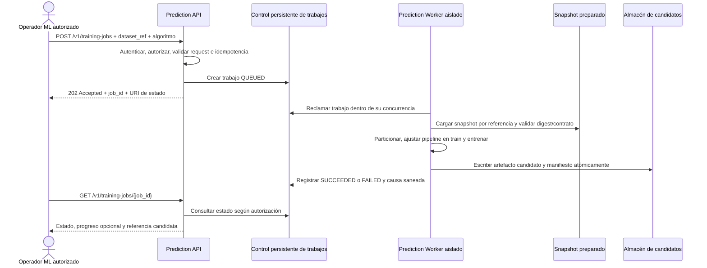

# PRED-003 — Plan de entrenamiento aislado de modelos

**Estado:** Implementación completada y verificada mediante suite automatizada de 41 pruebas unitarias e integración en `feature/PRED-003`.
**Rama:** `feature/PRED-003`.
**Issue:** [PRED-003](https://github.com/KEVIN-117/dss-system-architecture/issues/146).
**Fases CRISP-DM:** preparación de los datos y modelado.
**Dependencias:** PRED-001 y PRED-002.

## 1. Resultado buscado

Permitir que un operador autorizado solicite entrenamientos de Random Forest y XGBoost como trabajos asíncronos en un worker separado de la API. Cada trabajo debe validar un snapshot conforme a `prepared-dataset-v1`, crear particiones reproducibles, ajustar el preprocesamiento solo con entrenamiento, producir un artefacto candidato trazable y dejar un estado consultable. Ningún resultado de PRED-003 se activa como modelo de inferencia.

La evidencia de pruebas usará exclusivamente datos sintéticos marcados como tales. La implementación puede demostrar que el código entrena y conserva artefactos; no puede declarar calidad institucional ni viabilidad predictiva sin una extracción DW autorizada y las decisiones DSA requeridas por PRED-002.

## 2. Estado inicial comprobado

- `prediction-service/main.py` tiene un `GET /` y un `POST /predict` simulado. No existe worker, API de trabajos, lectura de dataset ni registro de artefactos.
- `prediction-service/pyproject.toml` declara FastAPI; `uv.lock` no contiene scikit-learn, XGBoost ni imbalanced-learn. El runtime fijado por proyecto es Python `>=3.14`.
- PRED-002 aporta `dataset_contract.py`, contrato versionado, validador estructural y un fixture sintético de ocho filas. Ese fixture está deliberadamente `BLOCKED`; no es válido para entrenar.
- El validador permite continuar únicamente si el dataset está estructuralmente válido, con objetivo y población aprobados, clases observadas y features declaradas disponibles al corte.
- El DW tiene el esquema `ml_workspace` y el rol `dw_ml_writer`, pero no se han encontrado tablas de trabajos ni catálogo de artefactos. Crear tablas y grants para PRED-003 requiere migración revisada.
- El contrato OpenAPI ya describe `POST /v1/training-jobs` (`202 Accepted`) y `GET /v1/training-jobs/{jobId}`. La autorización del operador ML y algunos detalles de IAM siguen pendientes.
- `docker-compose.yml` raíz orquesta `prediction-service` pero no define worker ni acceso de ML a DW. El propio README del repositorio advierte que el Compose raíz completo referencia contextos ausentes y no demuestra un despliegue integrado.
- PRED-002 aparece cerrada en GitHub y su PR #153 está fusionada; sus documentos conservados todavía indican que no hay extracción institucional perfilada y que evento, horizonte y elegibilidad requieren decisión DSA. El cierre administrativo no se tomará como aprobación de datos.

## 3. Alcance y límites

### Incluido

1. Validación de preparación del dataset antes de aceptar o ejecutar un trabajo.
2. Particiones temporales/reproducibles y tratamiento de observaciones repetidas por estudiante según la definición aprobada del objetivo.
3. Pipelines de preparación y entrenamiento para Random Forest y XGBoost.
4. Evaluación de desbalance y balanceo solo dentro del entrenamiento/folds, con registro del uso o motivo de no uso.
5. Ejecución asíncrona, identificador y estado consultable del trabajo, errores saneados, límites de recursos y concurrencia.
6. Artefactos candidatos inmutables y manifiesto con procedencia reproducible.
7. Pruebas con entrenamiento real pequeño sobre un fixture de software sintético, claramente separado de la evidencia de calidad académica.

### Fuera de PRED-003

- Entrenar o evaluar con extracción institucional, si todavía no pasó los gates DSA y `READY_FOR_PREPARATION`.
- Comparar candidatos y declarar uno apto para uso institucional: pertenece a PRED-004.
- Activar, versionar operacionalmente o reemplazar el modelo activo: pertenece a PRED-005.
- Sustituir la inferencia simulada de `/predict`: pertenece a PRED-006.
- Crear la publicación de predicciones para DW/OLAP: pertenece a PRED-007.
- Pruebas de carga y capacidad de producción: pertenecen a PRED-008.
- SHAP, What-If y semáforos de riesgo: no se agregan implícitamente a esta issue; requieren alcance, contratos y criterios propios.

## 4. Decisiones propuestas antes de ejecutar

Estas propuestas reducen decisiones pendientes de PRED-001; deben confirmarse con los responsables de operación/seguridad antes de exponer trabajos fuera del entorno de desarrollo.

| Tema | Propuesta para el MVP | Alternativa / condición de revisión |
|---|---|---|
| Aislamiento | Contenedor/servicio de worker separado del proceso FastAPI. La API solo valida, registra y despacha. | No ejecutar fit en endpoints ni compartir pool de CPU ilimitado con inferencia/OLAP. |
| Control de trabajos | Persistir metadatos en tablas dedicadas de `ml_workspace`; el worker reclama trabajos pendientes con bloqueo transaccional y concurrencia configurable. | RabbitMQ ya existe para eventos IAM, pero no hay carga de jobs ML medida. Adoptarlo si TI prefiere broker operado o la medición de PRED-008 justifica mayor desacoplamiento. |
| API | Implementar las rutas previstas en OpenAPI: `202` al aceptar e idempotencia por clave; consulta por `job_id`; estados compatibles con el contrato. | Polling mediante `GET` es la primera entrega. SSE de RNF4.1 del consolidado queda como brecha explícita por resolver, no como requisito silencioso de PRED-003. |
| Persistencia de artefactos | Interfaz `ArtifactStore`; filesystem/volumen local solo para desarrollo y pruebas, escritura atómica en una ruta de candidatos. | Acordar medio persistente, cifrado, respaldos y retención antes de operación. No asumir registry externo ni que el volumen local sea producción. |
| Seguridad | Exigir permiso de operador ML definido por IAM; separar creación/consulta de trabajos de permisos académicos de inferencia. Sin permiso aprobado, ruta deshabilitada o denegada por defecto. | No mapear `SUPERADMIN` a operador ML sin aprobación DSA/IAM. |
| Datos | Aceptar solo `dataset_ref` opaco registrado y manifiesto que pase `validate_prepared_dataset` como `READY_FOR_PREPARATION`; no aceptar rutas arbitrarias o features libres. | El fixture PRED-002 bloqueado continúa siendo prueba del rechazo. Un fixture nuevo de entrenamiento debe ser sintético, autocontenido y marcado `synthetic_test_only`. |

La elección de PostgreSQL para la cola aprovecha el workspace ML y el volumen bajo esperado de entrenamientos manuales; no es una decisión irrevocable. La creación de tablas, usuario y grants debe aplicar mínimo privilegio: la API no necesita leer hechos DW ni cargar artefactos, y el worker debe limitar lectura a las relaciones aprobadas y escritura a objetos ML autorizados.

## 5. Flujo propuesto

La solicitud no espera al entrenamiento. Un fallo del worker deja evidencia del trabajo fallido y no toca ningún artefacto activo. El estado y la referencia del candidato se escriben solo después de persistir y verificar su digest.

## 6. Secuencia de implementación

### Fase 0 — Gates y decisión de operación

1. Revalidar `feature/PRED-003` contra `main` y mantener limpio el cambio PRED-002 ya fusionado.
2. Confirmar permiso/actor autorizado para entrenamiento y modo de exposición de la ruta.
3. Confirmar propiedad, usuario SQL, tablas/grants del workspace y ubicación operable de candidatos.
4. Registrar la decisión de cola/estado y la brecha de SSE frente al consolidado.
5. Mantener explícito el bloqueo institucional de PRED-002; no importar exports OLTP ni inferir aprobaciones desde el estado cerrado de GitHub.

**Salida:** decisiones suficientes para implementar el trabajo asíncrono seguro; si no hay autorización o almacenamiento aprobados, limitarse a CLI/fixtures y dejar el endpoint no expuesto.

### Fase 1 — Dependencias y entorno repetible

1. Seleccionar y fijar versiones compatibles de Python, scikit-learn, XGBoost, imbalanced-learn, NumPy, SciPy y dependencias del contrato.
2. Resolver y guardar el lock file; construir imagen de API y worker desde una base reproducible.
3. Probar importación/entrenamiento en el runtime Linux de Docker y en CI, no solo en el host Windows.
4. Configurar límites explícitos de CPU, memoria, hilos nativos y concurrencia de trabajos; valores iniciales configurables, sujetos a PRED-008.

### Fase 2 — Dataset, particiones y preparación

1. Añadir un adaptador de lectura por `dataset_ref` sin aceptar paths del cliente y validar esquema, digest, población, objetivo, duplicados y disponibilidad temporal.
2. Rechazar `BLOCKED`, `INVALID`, `INSUFFICIENT_EVIDENCE`, versiones incompatibles, clases insuficientes y dataset no aprobado.
3. Crear una abstracción de partición reproducible que registre algoritmo de split, seed, cortes incluidos, conteos y política para estudiantes repetidos.
4. Usar particiones cronológicas y agrupación por identidad estable cuando la definición aprobada lo permita; no fijar horizonte ni elegibilidad desde este servicio.
5. Ajustar imputación/codificación/selección únicamente dentro de cada fold de entrenamiento. Serializar una sola unidad con preprocesamiento y clasificador.

### Fase 3 — Balanceo y clasificadores

1. Medir proporciones de clase solo en el dataset aceptado y registrar conteos por partición.
2. Aplicar `SMOTE`/`SMOTENC` únicamente dentro del entrenamiento de cada fold, solo si hay suficientes ejemplos minoritarios y la representación de variables lo permite.
3. Si no corresponde balancear, guardar una razón verificable; evaluar pesos de clase como opción del clasificador sin alterar validación/prueba.
4. Entrenar ambos algoritmos con seed y configuración explícitos. La búsqueda de hiperparámetros usa entrenamiento/validación; el holdout final queda reservado a PRED-004.
5. No emitir métricas de test como resultado de selección ni declarar un ganador institucional.

### Fase 4 — Jobs, artefactos y API

1. Crear registro de trabajo con `job_id`, algoritmo, dataset ID/digest, actor pseudonimizado, seed, configuración, versiones, timestamps, fase/progreso y causa de fallo saneada.
2. Hacer que `POST` retorne `202` luego de registrar/enqueue; implementar consulta de estado y comportamiento idempotente ante reintentos.
3. Ejecutar trabajos solo en el worker con concurrencia acotada y reclamación recuperable tras reinicio; definir política de lease/reintento para no duplicar artefactos.
4. Crear un artefacto candidato con pipeline, esquema/orden de features, clases, manifiesto, parámetros, versiones de paquetes, dataset/partición y digest.
5. Usar escritura atómica y verificar el artefacto antes de marcar el job `SUCCEEDED`. Mantenerlo aislado del artefacto aprobado/activo.

### Fase 5 — Verificación y cierre técnico

1. Ejecutar entrenamiento pequeño real de Random Forest y XGBoost sobre fixture sintético aprobado solo para pruebas, con ambas clases y representación temporal/grupal de prueba.
2. Verificar artefacto de cada modelo y que incluye preprocesamiento, features, clases, seed, dataset sintético, hiperparámetros y versiones.
3. Probar jobs asíncronos, consulta de estado, idempotencia, fallos de validación, fallo/crash del worker, límites de concurrencia y ausencia de reemplazo del modelo activo.
4. Probar SMOTE dentro de folds y preservar sin cambios las distribuciones de validación/prueba; probar el camino que registra no-aplicación.
5. Mantener un test del fixture PRED-002 actualmente bloqueado y confirmar que no inicia entrenamiento.
6. Documentar evidencia sintética separada de evaluación institucional; cerrar PRED-003 solo si todos los criterios de la issue están satisfechos.

## 7. Matriz de aceptación PRED-003

| Criterio de issue #146 | Evidencia para cierre | Límite |
|---|---|---|
| Iniciar trabajo para RF y XGBoost con el mismo contrato | Prueba API/CLI por algoritmo que consume `prepared-dataset-v1` | Fixture sintético no representa la institución |
| Entrenar fuera de API, con límites CPU/memoria/concurrencia | Worker independiente, configuración de recursos y prueba de aislamiento | La capacidad productiva se valida en PRED-008 |
| ID/estado/fallo consultables sin espera síncrona | `202`, estado persistido, consulta y error saneado; prueba de reinicio/worker fallido | No equivale a progreso push/SSE |
| Registrar dataset, variables, hiperparámetros, seed y dependencias | Registro del job más manifiesto reproducible del artefacto | Sin identidad natural ni filas personales en logs |
| Preprocesamiento solo en entrenamiento y guardado con artefacto | Pruebas de pipeline por fold y recarga del pipeline completo | El holdout final no se usa para selección |
| Fallo no invalida modelo activo | Prueba de artefacto candidato aislado; activo sin cambios | Activación pertenece a PRED-005 |
| Prueba real pequeña de ambos algoritmos | Smoke tests RF/XGBoost y verificación de artefactos | No evidencia calidad institucional |
| Entregables CRISP-DM conservados | Plan, configuración, particiones, registro y reporte técnico vinculados | Decisión de aptitud se completa en PRED-004 |
| SMOTE solo en train/folds y test intacto | Pruebas de distribución antes/después y trazabilidad de técnica | No se balancea en ETL ni sobre dataset global |
| Compatibilidad de runtime/dependencias comprobada | Lock resuelto, build Linux y CI con ambos entrenamientos | Registrar versiones exactas del lock |

## 8. Riesgos y controles

| Riesgo | Nivel | Control propuesto |
|---|---|---|
| Entrenar con etiqueta/horizonte/populación no aprobados | Crítico | Dataset `READY_FOR_PREPARATION` y references de aprobación obligatorios; entorno productivo cerrado mientras falten. |
| Fuga por estudiante repetido o corte futuro | Alto | Partición temporal y agrupada conforme a la decisión DSA; prueba de solapamiento; test reservado. |
| SMOTE genera ejemplos inválidos o fuga al validar | Alto | Sampler dentro de fold; `SMOTENC` para categóricas; registrar no-aplicación si no hay soporte. |
| Entrenamiento consume recursos compartidos | Alto | Contenedor worker independiente, `n_jobs`/`nthread`, límites de contenedor y concurrencia; medir en PRED-008. |
| Job queda en RUNNING tras reinicio | Medio | Estado persistente, lease/heartbeat, recuperación acotada e idempotencia por job/artefacto. |
| Fallo de almacenamiento presenta candidato incompleto | Alto | Escritura temporal + rename atómico, digest y transición a `SUCCEEDED` al final. |
| Artefacto no confiable o con dependencia incompatible | Alto | Artefactos solo desde el worker controlado, digest/versiones, no aceptar archivos enviados por cliente; endurecer carga en PRED-005. |
| Estado del ticket induce a usar datos como aprobados | Crítico | Mantener gate de datos visible; cierre de GitHub no sustituye acta DSA ni extracción DW autorizada. |

## 9. Relación con Subsistema 4 consolidado

| Requisito consolidado | Aporte de PRED-003 | Cobertura pendiente |
|---|---|---|
| RF4.1 — entrenar RF/XGBoost desde datos DW bajo CRISP-DM | Worker, validación de snapshot, particiones, preparación y candidatos trazables | Snapshot institucional autorizado; PRED-002 y datos DSA |
| RF4.2 — API de inferencia y What-If | No implementa inferencia: evita ampliar PRED-003 y conserva aislamiento | Inferencia real PRED-006; What-If necesita alcance y contrato aparte |
| RF4.3 — SHAP por predicción | No calculado ni expuesto en esta issue | Debe planificarse explícitamente; no se infiere que el entrenamiento lo cubra |
| RNF4.1 — progreso SSE | API asíncrona y consulta de estado por polling según OpenAPI PRED-001 | SSE no está cubierto literalmente; resolver si es obligatorio o revisar requisito en una issue explícita |
| RNF4.2 — stateless, escalable y aislado | API/worker separados; metadata persistida; límites y concurrencia | Escalabilidad/capacidad se comprueba con métricas PRED-008; el worker mantiene estado de job externo, no en memoria como fuente de verdad |

**Conclusión de cumplimiento:** PRED-003 cubre la ruta de entrenamiento y el aislamiento de RF/XGBoost, y deja explícitos artefactos, límites y trazabilidad. Por sí sola no satisface todo el Subsistema 4: inferencia, What-If, SHAP, SSE y publicación/visualización siguen fuera o pendientes. La implementación no debe declararse como entrega completa del subsistema.

## 10. Decisiones para autorizar la ejecución

1. DSA confirma que PRED-003 solo producirá evidencia de entrenamiento sintético hasta entregar la extracción autorizada y las decisiones faltantes de PRED-002.
2. TI/IAM confirma operador ML y permiso para crear/consultar trabajos antes de exponer rutas en el entorno integrado.
3. Se confirma la recomendación de persistir control de jobs en `ml_workspace` con un worker que reclama trabajos, o se elige RabbitMQ/otra infraestructura operada.
4. Se acuerda ubicación y operación del almacenamiento de candidatos; filesystem local se limita a desarrollo/CI.
5. Se resuelve explícitamente la discrepancia polling/SSE de RNF4.1 y se registra fuera de la implementación base si no forma parte de PRED-003.

Hasta resolver las decisiones que afectan permisos, persistencia y exposición, la ejecución queda restringida al diseño interno y pruebas sintéticas; ninguna solicitud puede activar un modelo ni acceder a datos OLTP.
