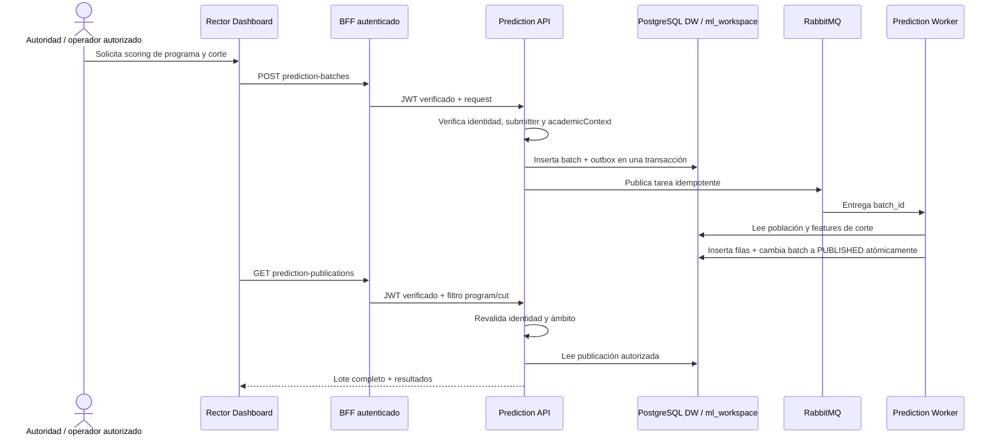

# PRED-007 — Publicación y consulta de predicciones

## Alcance implementado

La publicación poblacional cubre **abandono de programa** por programa y cierre académico. No publica abandono de materia: el indicador disponible en `fact_cursado` se observa después de procesar el período y no sirve como predicción prospectiva con el contrato actual.

PRED-006 mantiene la inferencia puntual. PRED-007 agrega el flujo asíncrono de población:

1. El solicitante envía `POST /v1/prediction-batches` con programa, cierre e `Idempotency-Key`.
2. Prediction Service valida JWT/identidad, rol separado de submitter, programa/cierre y ámbito académico. El lote fija el modelo aprobado por evento/cadencia.
3. API persiste lote y outbox en la misma transacción; RabbitMQ solo transporta la tarea.
4. El worker vuelve a resolver el contexto, verifica que el bundle activo siga siendo el fijado y puntúa la población elegible desde el DW de solo lectura.
5. Resultados, conteos, linaje de ejecuciones DW y estado `PUBLISHED` se confirman en una transacción. Un error deja el lote `FAILED`; las filas no se muestran como publicación vigente.
6. BFF autentica la sesión y reenvía el token. Prediction Service vuelve a validar y filtra por alcance en servidor. El panel del Rector consulta mediante el BFF.

## Contrato de persistencia

La migración [0034_prediction_publications.sql](../../infra/dw-schema/migrations/0034_prediction_publications.sql) crea:

- `ml_workspace.prediction_batch`: identidad de lote, evento, programa/corte, modelo/version, actor, alcance comprobado, estado, conteos, linaje, idempotencia y error saneado.
- `ml_workspace.prediction_batch_outbox`: despacho recuperable con reintentos.
- `ml_workspace.prediction_result`: clase, probabilidad opcional, modelo, corte y fecha por estudiante.
- `ml_workspace.v_published_prediction`: contrato de lectura que filtra por estado publicado.

El grano es lote–estudiante para un programa/corte; cada lote referencia un único modelo. Los lotes históricos no se reemplazan al recalcular. La consulta vigente elige el lote `PUBLISHED` más reciente para el mismo evento/programa/corte; una consulta por `batch_id` conserva el histórico. `fact_retencion_desercion` continúa conteniendo solo outcomes observados. No se concede SELECT irrestricto de las filas a `dw_reader`, `dw_ml_writer` ni `dw_prediction_reader`.

## API y autorización

- `POST /v1/prediction-batches`: exige `Authorization`, `Idempotency-Key`, `program_ref` y `academic_cut.cut_id`; el target está limitado a `program_dropout`.
- `GET /v1/prediction-batches/{batch_id}`: consulta estado/histórico; solo incluye filas si el lote está publicado.
- `GET /v1/prediction-publications?program_ref=…&cut_id=…`: devuelve la publicación vigente o `publication: null`.
- El BFF permite únicamente estos paths, reenvía el bearer validado y no expone la URL del servicio.
- Consulta usa `PREDICTION_ALLOWED_ROLES` + `academicContexts`; inicio de scoring usa `PREDICTION_BATCH_SUBMITTER_ROLES`, separado y cerrado por defecto. Asignar submitters explícitamente en el entorno de desarrollo/IAM antes de probar el submit.
- Las filas incluyen `subject_ref`, el identificador de estudiante utilizado también por inferencia individual. Solo se devuelven después de volver a verificar el rol y el ámbito sobre el programa/corte; no se escriben en logs.

## Reintentos, recálculos y fallos

- `Idempotency-Key` queda acotada al sujeto autenticado. La misma petición devuelve el mismo lote; reutilizar la clave para programa/corte/modelo distintos produce `409`.
- El outbox se inserta con el lote, tiene backoff y se república desde el API o `worker_ready`.
- Celery puede entregar más de una vez. El worker reclama el lote con transición atómica `QUEUED → RUNNING`; la reentrega espera a que venza la lease. La confirmación de resultados y estado publicado ocurre en una transacción.
- Si el modelo activo cambia mientras espera el lote, este falla con causa saneada; no se puntúa con una versión diferente de la que aceptó la solicitud.
- Un nuevo `Idempotency-Key` crea un nuevo lote inmutable. Las filas anteriores permanecen disponibles por `batch_id`; no se mezclan en la consulta vigente.
- Un lote vacío puede completarse como `PUBLISHED` con cero perfiles elegibles. Probabilidad `null` se conserva y se representa como “No disponible”.

## Interfaz representativa

El panel `/predictions` de Rector presenta filtros de programa/cierre, consulta de la publicación vigente, acción de scoring, estado de lote, número de estudiantes, corte, modelo/versión y tabla con clase, probabilidad y fecha. Expone estados vacíos y fallidos; no calcula bandas de riesgo ni presenta la clase como decisión institucional. El control servidor del API sigue siendo la barrera de acceso; el `RoleGuard` del portal solo controla presentación.

## Configuración y grants

- Configurar `PREDICTION_DW_DATABASE_URL` de forma explícita para API y worker, con permiso de lectura sobre el contrato de features.
- Configurar `PREDICTION_BATCH_SUBMITTER_ROLES` solo en un entorno aprobado; el default `[]` falla cerrado.
- `PREDICTION_API_DATABASE_URL` debe usar un login miembro solo de `dw_prediction_runtime`. `PREDICTION_WORKER_DATABASE_URL` debe usar otro login miembro de `dw_prediction_runtime` y `dw_prediction_publisher`: el worker crea/actualiza batches y outbox con el primer rol y escribe resultados con el segundo. No dar `dw_prediction_publisher` al API. El Compose local conserva defaults de desarrollo.
- Aplicar migración con el migrador normal (`docker compose run --rm dw-migrator`) antes de levantar API/worker.

## Evidencia y límites

Las pruebas unitarias/API verifican permisos, idempotencia, outbox, publicación atómica, no exposición de lotes parciales y respuesta vacía. La prueba BFF verifica que el token validado se reenvía y que filtros de programa/corte se preservan. Los checks de base verifican los grants y el filtro de `PUBLISHED` en la vista.

La prueba de código con Faker demuestra integración técnica; no evalúa calidad predictiva institucional ni aprueba el modelo para producción. La visualización expone `subject_ref` solamente bajo ámbito server-side. Este alcance no agrega abandono de materia prospectivo, SHAP, What-If, Superset ni SSE.

### Validación en desarrollo — 2026-11-03

- La migración `0034_prediction_publications.sql` está aplicada en el DW de desarrollo; la fila de historial tiene checksum `22d471e58f1dfd4aa03902544cdedabf34d2d080ce5647b841ee8e3e913ade22`. El test de migración/grants también pasó en PostgreSQL efímero.
- Los grants reales de `dw_prediction_runtime`/`dw_prediction_publisher` fueron comprobados. Sin embargo, los contenedores API y worker activos se conectan como `admin`, que es superusuario y miembro de ambos roles; `PREDICTION_DW_DATABASE_URL` está vacío en ambos. Por tanto, los logins efectivos de mínimo privilegio todavía no están configurados ni verificados.
- Se ejecutó `tests/integration/prediction_publication_faker_e2e.py` en un contenedor worker Linux recién construido. El proceso usó un DSN local de desarrollo en transacciones read-only y un store SQLite/bundles temporales. Publicó **82 resultados elegibles** del DW Faker, consultó publicación actual y detalle por la API, confirmó 401 sin autenticación y 403 fuera de ámbito, y verificó que una recálculo en `integration-v2` conservó el lote anterior mientras estaba en cola, lo reemplazó solo tras terminar y no sobrescribió el historial/versiones.
- El smoke detectó y corrigió dos errores SQL de `list_program_population`: orden de `SELECT DISTINCT` por expresión no proyectada tanto en población como en linaje. La consulta ahora ordena por alias seleccionado.
- Los tests enfocados de publicación/inferencia pasaron en Linux (14 tests). La suite completa de BFF pasó (70 tests) y la de Rector Dashboard pasó (4 tests); los builds de producción de ambos apps también pasaron. Los tests visibles cubren estado vacío, probabilidad ausente y lote fallido sin filas parciales. El recálculo con cambio de versión se validó en el smoke Faker descrito arriba.

### Pendiente para cerrar la integración operativa

1. Completar la prueba de navegador desde una sesión real de Keycloak con las cuentas locales de prueba provisionadas; verificar Rector dentro del ámbito y usuario fuera de ámbito desde BFF, GraphQL y `/predictions`.

La publicación funcional desde datos Faker y las pruebas de estados/versionado están verificadas. El DSN read-only y los logins/roles de runtime se configuran en el entorno local del usuario. Para la validación E2E se agregó un proyecto Compose aislado para API/worker/RabbitMQ, un preparador de bundle de prueba que consulta el DW con ese DSN, y pruebas Playwright que ejecutan Keycloak → BFF → Prediction API/worker → GraphQL → Dashboard. El archivo de cuentas `.env.e2e` debe provisionarse localmente; la ejecución del navegador sigue pendiente hasta contar con esas dos cuentas de prueba.

Instrucciones y configuración están en [PRED-007-e2e.md](PRED-007-e2e.md).
