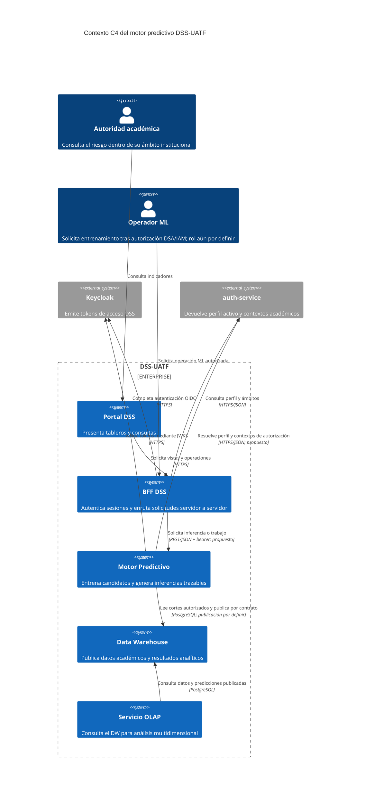
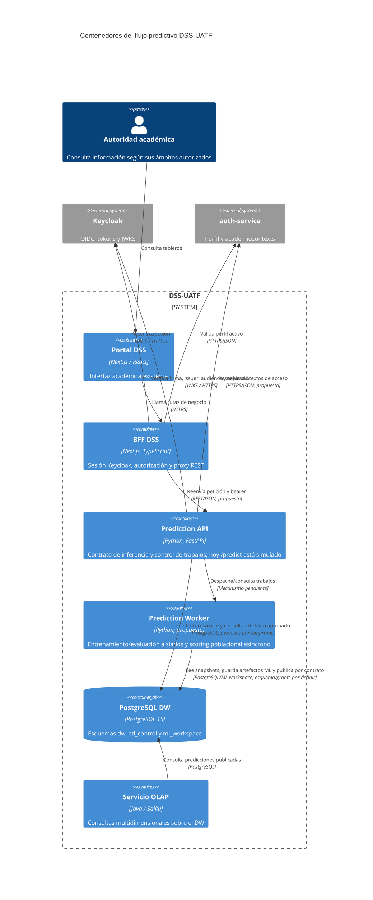
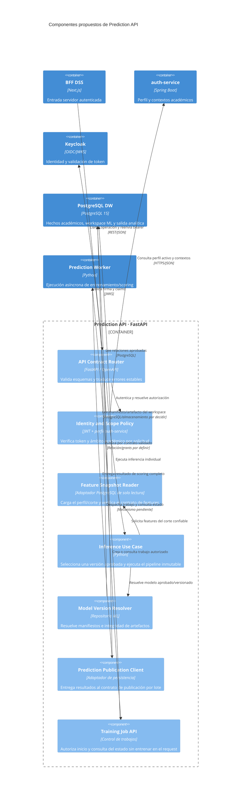
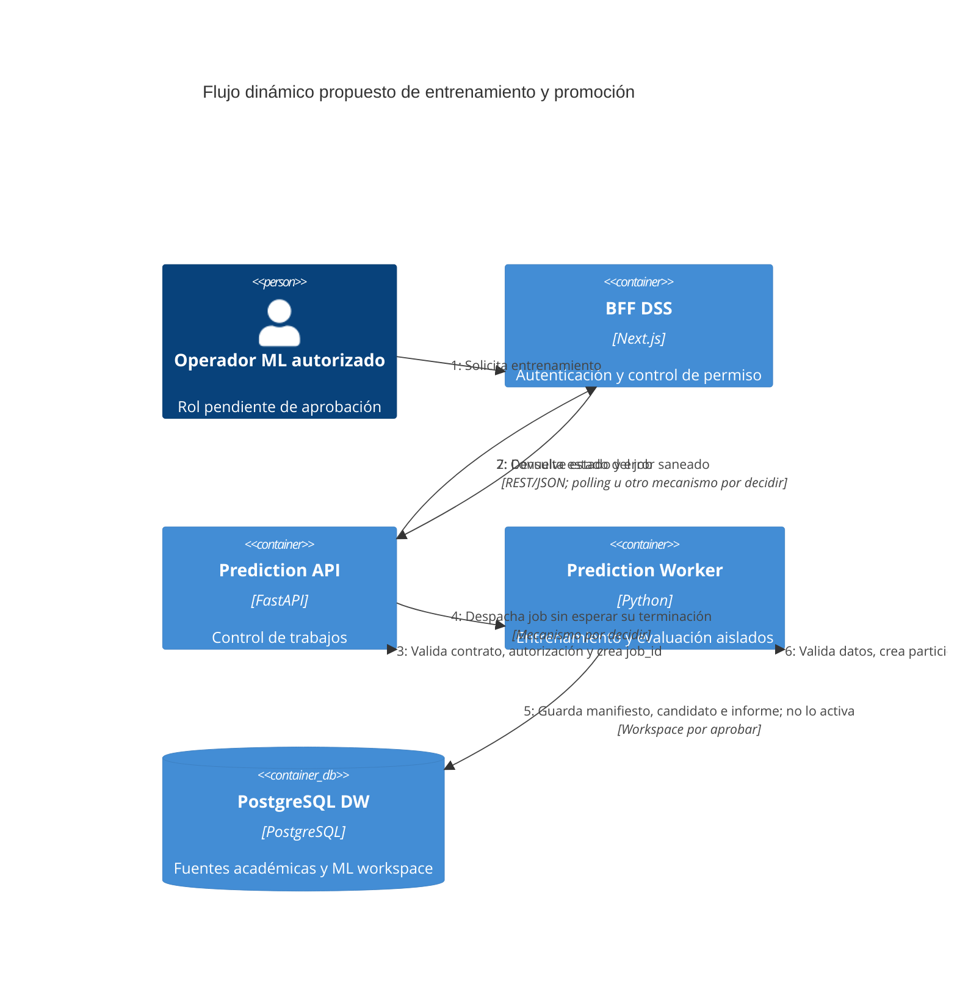
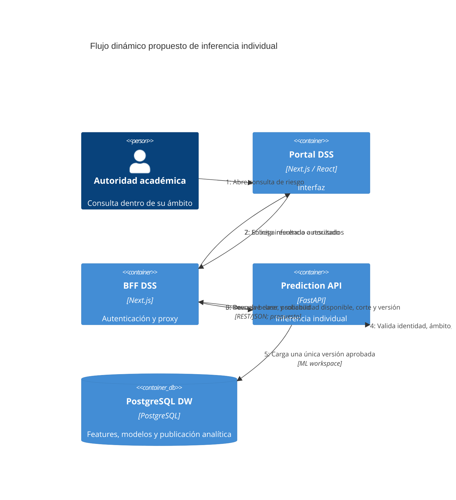
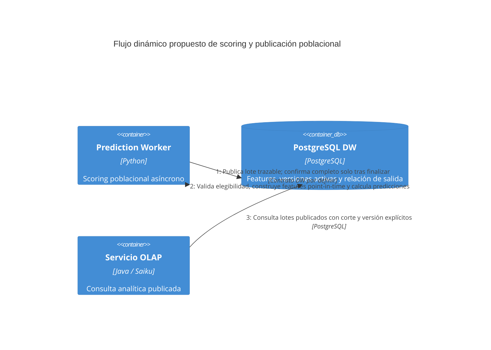

# Arquitectura del Motor Predictivo — C4 e inventario

Documentación de PRED-001 derivada del código y contratos que existen en esta rama. El L1–L3 y los flujos dinámicos describen la arquitectura objetivo **propuesta**, con componentes no implementados identificados en los textos. Los diagramas Mermaid individuales están en [`diagrams/`](diagrams/).

## C1 — Contexto

Muestra actores y servicios con los que el motor intercambia identidad, datos e inferencias. El operador ML es una persona propuesta hasta aprobar responsabilidades.

## C2 — Contenedores

La separación API/worker está recomendada por el coste variable del entrenamiento y RNF-09. El worker aún no existe. PostgreSQL DW sí es activo; el objeto de publicación predictiva y sus grants requieren PRED-007.

## C3 — Componentes de Prediction API

Describe límites internos recomendados para la API, sin afirmar que esos módulos ya estén implementados. Se detalla solo el contenedor con la mayor lógica de dominio.

## Flujos dinámicos

Los diagramas recorren el estado esperado de los contratos. El despacho de worker/estado y la publicación física siguen pendientes de elegir con PRED-003/PRED-007.

### Entrenamiento, evaluación y promoción

### Inferencia individual

### Scoring poblacional y consulta analítica

## Inventario y evidencia

| Elemento | Evidencia en el repositorio | Lectura de arquitectura |
|---|---|---|
| Prediction API | `prediction-service/main.py`, `prediction-service/pyproject.toml`, `prediction-service/Dockerfile`, `docker-compose.yml` | FastAPI desplegable, pero `POST /predict` actualmente simulado. |
| DW PostgreSQL | `docs/dw/mvp-direct-hop.md`, `docs/dw/dimensional-model.md`, `infra/dw-schema/migrations/0009_create_constellation_facts.sql` | Hechos actuales son admisión, cursado, retención/deserción; `NO_EVALUABLE` no entra en tasas ni entrenamiento. |
| Workspace ML | `infra/dw-schema/migrations/0002_create_analytical_layers_and_roles.sql`, `docs/dw/analytical-platform-foundations.md` | `ml_workspace` y `dw_ml_writer` están creados; no se halló tabla publicada de predicciones. |
| BFF activo | `dss-monorepo/apps/bff/README.md`, `dss-monorepo/apps/bff/src/app/api/olap/[...path]/route.ts`, `dss-monorepo/apps/bff/src/app/api/_lib/auth-guard.ts` | BFF Next.js valida JWT, estado activo, perfil y proxy bearer a OLAP. |
| IAM/perfil | `dss-monorepo/libs/connectors/auth-connector/src/jwt/jwt-verifier.ts`, `dss-monorepo/libs/shared/auth-models/src/lib/users/auth-user.ts`, `dss-monorepo/libs/rbac/src/lib/permission-map.ts` | Roles/permissions DSS y contextos académicos existen; no hay política ML específica. |
| OLAP | `docs/olap/autenticacion-y-autorizacion.md`, `docs/envs/olap-service.md` | Servicio REST valida bearer Keycloak como resource server. |
| Dashboard | `dss-monorepo/apps/` y documentación de portales | SPA presente; consulta predictiva no localizada. |
| GraphQL BFF citado en Compose | `docker-compose.yml` | Compose apunta a `gateway/graphql-bff`, ruta/código no encontrada en el checkout. |
| Worker de entrenamiento | No existe componente/entrypoint implementado para prediction-service. | Propuesto por RNF-09; límites de recursos aún por medir. |
| Keycloak/auth-service | Compose e `docs/envs/auth-service.md`; configuración BFF | Identidad activa y perfil conocidos; mapeo de audiencia y permiso ML por aprobar. |

## Suposiciones y huecos

- Roles del actor de consulta se apoyan en RBAC existente; Operador ML se propone y debe aprobarse.
- El worker/API separados, BFF REST y scoring individual + población son decisiones propuestas, revisables por DSA/TI cuando se confirmen carga y consumidores.
- REST/JSON es el protocolo candidato interno por coherencia con el proxy OLAP vigente; no hay endpoint predictivo real definido aún.
- No se confirmó el uso de GraphQL activo, cola, broker, registry, bucket ni filesystem persistente de modelos.
- No se confirmaron permisos productivos, requisitos de latencia, disponibilidad ni escala; RNF-09 se demostrará midiendo, no por el hecho de usar otro proceso.
- Publicación física, tabla/vista, grants y actualización OLAP se especificarán con el contrato de DW en PRED-007.
- Evento/horizonte, regla de población de primer/segundo año, umbral visual, target, criterios de aptitud y contexto de autorización requieren aprobación DSA/IAM.

## Archivos Mermaid por diagrama

- [01-context.mermaid](diagrams/01-context.mermaid)
- [02-containers.mermaid](diagrams/02-containers.mermaid)
- [03-components-api.mermaid](diagrams/03-components-api.mermaid)
- [04-dynamic-training.mermaid](diagrams/04-dynamic-training.mermaid)
- [05-dynamic-prediction.mermaid](diagrams/05-dynamic-prediction.mermaid)
- [06-dynamic-prediction-publication.mermaid](diagrams/06-dynamic-prediction-publication.mermaid)
