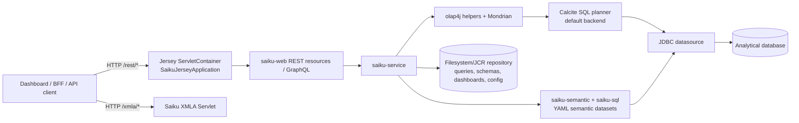
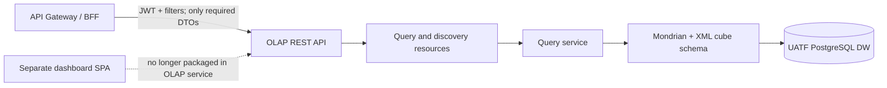

# OLAP Service — Architecture Map

## Scope and identity

`olap-service/` is a Saiku Analytics clone and a multi-module Java/Svelte product. It is not yet a narrowly scoped OLAP microservice: the runnable server includes query processing, user/session/security, repository, administration, dashboards, sharing/embedding, GraphQL, MCP, XMLA, and a browser UI. This map describes the checked-in structure and current runtime boundaries so the API can be separated deliberately.

## Repository map

| Area | Role | Runtime/build relationship |
|---|---|---|
| `saiku-bom/` | Central dependency/version catalogue | Imported by Java modules in the Maven reactor |
| `saiku-core/saiku-olap-util/` | olap4j/Mondrian adapters and helpers | Backend library |
| `saiku-core/saiku-service/` | Query execution, datasource/session/cache, schema discovery/generation, AI query planning and translation | Backend services |
| `saiku-core/saiku-semantic/` | YAML-based Ossie semantic model | Backend library; an additional SQL semantic path beside Mondrian XML schemas |
| `saiku-core/saiku-sql/` | Ossie SQL query path | Backend library for semantic datasets |
| `saiku-core/saiku-web/` | Jersey REST resources, GraphQL, DTOs, auth/security helpers and web services | HTTP/API layer |
| `saiku-webapp/` | WAR, Servlet descriptors, Spring XML wiring, Jersey/Spring Security configuration | Hosts backend APIs and currently receives the built UI assets |
| `saiku-launcher/` | Picocli commands and embedded Jetty 12 runtime | Starts the webapp WAR; produces the executable distribution |
| `saiku-proptest/` | Hegel property-based tests | Test-only Maven module; JDK 22 requirement is isolated here |
| `saiku-ui/` | SvelteKit 5 + Vite SPA and shared design-system workspace | Independent npm workspace, but Maven currently builds and bundles it into the WAR |
| `saiku-repository/`, `saiku-showcase/`, `enigma/`, `examples/`, `observability/`, `telemetry/`, `tests/` | Repository assets, demos, experiments, deployment/operations examples, and test resources | Mostly outside the Maven reactor; distinguish from the core API runtime |

The root Maven reactor is `saiku-bom → saiku-core → saiku-webapp → saiku-launcher → saiku-proptest`. `saiku-core` contains five modules: `saiku-olap-util`, `saiku-semantic`, `saiku-service`, `saiku-sql`, and `saiku-web`.

## Backend request and data flow

The servlet API is mounted at `/rest/*`; resource annotations add paths such as `/saiku/api/query`, so the external query prefix is `/rest/saiku/api/query`. Mondrian is the primary multidimensional engine and the README describes its Calcite SQL planner as the default, with a legacy planner switch. The Ossie path adds SQL querying over YAML semantic models. The product also has XMLA at `/xmla/*`.

### Main API surfaces

| Surface | Current route family | Responsibility |
|---|---|---|
| Query and discovery | `/rest/saiku/api/query`, discover resources | Query lifecycle, MDX/query model, results, drill, metadata |
| Typed AI query | `/rest/saiku/api/ai/*` | Cube/schema discovery and JSON-to-validated-MDX queries |
| Ossie AI/SQL | `/rest/saiku/api/ai/ossie/*` | YAML semantic model discovery and SQL query/ask path |
| Repository and datasource | `/rest/saiku/api/repository`, datasource resources | Saved queries/schemas and datasource administration |
| Dashboards/apps/embed | `/rest/saiku/api/dashboards/*`, `/apps`, `/tile-plugins`, `/embed` | Dashboard data/config, plugin tiles, embed tokens/views |
| GraphQL | `saiku-core/saiku-web/graphql` | Saiku's own GraphQL API; this is distinct from the planned BFF GraphQL layer |
| Administration | `/rest/saiku/admin/*` | Users, jobs, schema/cube designer, AI evaluation/audit, agent spaces |
| Session, statistics, sharing | `/rest/saiku/session`, `/statistics`, `/share/*` | Session handling, status/metrics, share tokens and public views |
| MCP | `/rest/saiku/api/mcp` plus bundled `saiku-mcp` executable | MCP integration over the REST query surface |
| XMLA | `/xmla/*` | Authenticated OLAP protocol endpoint |

These route families are broader than RF3.3's minimal API. For a microservice boundary, the query/discovery/typed-JSON surfaces are the likely core; admin, dashboards, embedding, sharing, and MCP need an explicit include/exclude decision.

## Frontend coupling points

The frontend is a separate SvelteKit package in the source tree, but deployment is currently coupled at three build/runtime points:

1. `saiku-webapp/pom.xml` runs `frontend-maven-plugin` against `../saiku-ui` (Node 22, `npm ci`, then `npm run build`, with `SAIKU_BASE_PATH=/ui`).
2. `maven-war-plugin` copies `saiku-ui/dist/` into the WAR at `ui/`.
3. `saiku-webapp/WEB-INF/web.xml` has a `/ui/*` SPA fallback filter, and `saiku-launcher` runs that WAR inside Jetty.

Consequently, removing the frontend from the service build means removing the Maven Node/npm executions and WAR asset overlay, then deciding whether `/ui/*`, SPA fallback, branding/static UI resources, showcase/demo seeding, and launcher documentation should also leave the API distribution. The REST and GraphQL resources are in Java modules and can remain independently consumable by a separately deployed client.

## Runtime and platform wiring

- The executable is a Picocli application that starts embedded Jetty 12 and loads the `saiku-webapp` WAR. Main artifacts target Java 21; the test-only property module needs JDK 22.
- Spring Framework XML contexts wire services and security; REST is JAX-RS through Jersey 3.1. The repository does not follow the RF3.1 Spring Boot deployment shape.
- Spring Security currently protects servlet/API surfaces and Saiku has its own user/session model. The inspected wiring does not show Keycloak JWT validation; that responsibility is currently expected at the perimeter in the target architecture.
- Datasources are JDBC-backed and can use pluggable drivers from the operator's `saiku-home/plugins`. Demo mode seeds H2/FoodMart data. Production PostgreSQL connection-pool sizing and Mondrian aggregation-cache behavior must be verified against the chosen deployment configuration before claiming the RF3 RNFs.
- User data and operational files are held in the Saiku home/repository (schemas, saved queries, dashboards, skills, plugins and other sidecars), in addition to the analytical database. The API's runtime state is therefore not only the DW.

## Fit against the Microservice 3 requirements

| Requirement | Existing alignment | Gap or decision for UATF |
|---|---|---|
| RF3.1 Mondrian MDX-to-SQL | Mondrian, olap4j helpers, query services, and Calcite-backed SQL planning already exist | Adapt datasource and query configuration to the UATF PostgreSQL DW; confirm supported MDX/query subset and error contract |
| RF3.2 hierarchy and calculated measures in XML | Mondrian schemas are XML; schema discovery and generation facilities exist | Define and validate the UATF cube XML, curricular hierarchies, PPA/pass/dropout formulas; demo FoodMart schemas are not the UATF model |
| RF3.3 secure REST + dynamic filters + JSON DTOs | Jersey REST resources, query endpoints, typed AI JSON endpoints and DTOs exist | Set the BFF-facing contract, trim unrelated product routes, and integrate perimeter JWT/RBAC claims and faculty/career data scoping |
| RNF3.1 <500 ms dashboard queries | Mondrian has aggregation/cache capabilities and the service has query/cache code | No measured UATF workload or 500 ms evidence from this map; benchmark representative queries and configure cache/lifecycle |
| RNF3.2 safe PostgreSQL pooling | JDBC datasource abstraction and connection-management code exist | Determine actual pool implementation and limits in the production profile; size pool against PostgreSQL and dashboard concurrency |

## Highest-impact extraction boundary

The safest first separation point is the existing Java HTTP boundary: preserve query services and their REST resources, keep the Mondrian/XML/JDBC path, and decouple only the Svelte artifact from the `saiku-webapp`/launcher packaging. Authentication ownership, endpoints to exclude, deployment/configuration state, and UATF-specific cube definitions remain explicit integration decisions rather than assumptions inherited from the Saiku product.

## Sources

- `AGENTS.md` — reactor modules, runtime build, and development constraints.
- `README.md` — product/runtime overview, Mondrian/Calcite, UI, API and MCP surfaces.
- `saiku-webapp/pom.xml` — Node/npm build and frontend WAR overlay.
- `saiku-webapp/src/main/webapp/WEB-INF/web.xml` — Jersey `/rest/*`, XMLA and `/ui/*` wiring.
- `saiku-launcher/src/main/java/org/saiku/launcher/SaikuLauncher.java` — embedded Jetty/WAR runtime.
- `saiku-core/saiku-web/src/main/java/org/saiku/web/rest/resources/` — REST resource implementations.
- `docs/AI-QUERY-API.md`, `docs/AI-OSSIE-API.md`, `docs/GRAPHQL-API.md`, `docs/schema-annotations.md`, `docs/mondrian-fork.md` — API and semantic-layer contracts.
- `docs/plans/` and `docs/superpowers/` — implementation history; use current source as the runtime authority where historical plans differ.
